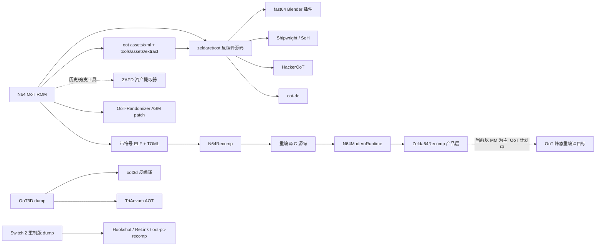

# 《塞尔达传说：时之笛》逆向反编译与静态重编译生态技术分析报告

> 报告日期：2026-11-18  
> 分析对象根目录：`/root/wsl-demo/oot-decomp-projects/`  
> 分析方法：本地浅克隆仓库 + 源码/配置/文档实读 + GitHub 仓库检索补全  
> 报告中所有路径若无特殊说明，均相对于上述根目录。

**目录**：[0 范围与摘要](#0-范围方法与重要结论摘要) · [1 OoT 主仓](#1-oot-反编译主仓oot) · [2 静态重编译工具链](#2-静态重编译工具链n64recomp--n64modernruntime) · [3 Zelda64Recomp](#3-产品级集成zelda64recomp) · [4 资源工具](#4-资源提取与创作工具zapd--fast64--oot-randomizer) · [5 生态对照](#5-生态对照与衍生项目) · [6 对比与结论](#6-技术路线对比风险与结论) · [附录 A 源文件索引](#附录-a关键源文件索引) · [附录 B 证据说明](#附录-b证据标记说明与复核建议)

---

## 0. 范围、方法与重要结论摘要

### 0.1 分析范围

本报告围绕《塞尔达传说：时之笛》（The Legend of Zelda: Ocarina of Time，下称 OoT）的逆向工程生态，覆盖两条技术路线：

1. **传统反编译（decompilation）**：以 `zeldaret/oot` 为代表，通过逐函数重建、目标文件字节匹配（matching）恢复 C 源码；资源由该仓自有的 `assets/xml/` + `tools/assets/extract` 链路抽取（ZAPD 是历史/旁支工具，详见 §1.4、§4.1）；fast64 将 Blender 场景编辑与 OoT 资源格式打通；OoT-Randomizer 利用汇编/代码补丁修改原版 ROM。
2. **静态重编译（static recompilation）**：以 `N64Recomp` 将 MIPS 机器码逐指令翻译为 C，再由 `N64ModernRuntime` 提供运行时，最终由 `Zelda64Recomp` 做成可移植的游戏产品。需要特别指出：当前本地 `Zelda64Recomp` 提交的主要目标仍是《姆吉拉的假面》（Majora's Mask），OoT 支持在 README 中明确列为计划中；因此它应被视为 **OoT 静态重编译即将落地的关键基础设施与参考实现**，而非已经完整支持 OoT 的成品。

此外，为满足“如有缺失可继续 clone”的要求，报告补入 11 个相关仓库作为生态对照：Shipwright（OoT decomp PC 移植）、HackerOoT（可修改型 decomp 分支）、zeldaret/oot-gc / oot-vc / oot3d（模拟器 / 3DS 版本的反编译）、n64decomp/oot（历史 MQ debug decomp）、oot-dc（Dreamcast 移植）、TriAevum（OoT3D 原生重编译运行时），以及 Hookshot / ProjectReLink / oot-pc-recomp（针对 Switch/Switch 2 重制版的原生重编译，明确标注为另一条路线）。

### 0.2 仓库清单与版本基线

以下为报告实际分析时的本地提交（短哈希 + 日期），所有结论均以这些版本为准：

| 仓库 | 上游 | 本地提交 | 角色分类 |
|---|---|---|---|
| `oot` | zeldaret/oot | `14759ab` 2026-10-18 | OoT N64 主反编译 |
| `ZAPD` | zeldaret/ZAPD | `35ea376` 2025-01-23 | ROM 资源提取器 |
| `fast64` | Fast-64/fast64 | `b130109` 2026-11-02 | Blender OoT/F3D 编辑导出 |
| `OoT-Randomizer` | OoTRandomizer/OoT-Randomizer | `526b4c8` 2026-11-02 | ROM 随机化/ASM patch |
| `N64Recomp` | N64Recomp/N64Recomp | `598ce20` 2026-11-03 | MIPS→C 静态重编译器 |
| `N64ModernRuntime` | N64Recomp/N64ModernRuntime | `e4342ae` 2026-11-03 | 重编译代码运行时 |
| `Zelda64Recomp` | Zelda64Recomp/Zelda64Recomp | `b65c482` 2026-09-25 | 产品级重编译集成（当前以 MM 为主，OoT 计划中） |
| `Shipwright` | HarbourMasters/Shipwright | `de1ab1b6` 2026-11-17 | OoT decomp PC 移植 |
| `HackerOoT` | HackerN64/HackerOoT | `5fac42f` 2026-11-11 | OoT decomp 可修改分支 |
| `oot-gc` | zeldaret/oot-gc | `6e449e1` 2025-05-24 | GameCube 版模拟器反编译 |
| `oot-vc` | zeldaret/oot-vc | `6fee076` 2026-09-06 | Wii VC 版模拟器反编译 |
| `oot3d` | zeldaret/oot3d | `a87ddae` 2026-09-04 | OoT 3D 反编译 |
| `n64decomp-oot` | n64decomp/oot | `e619fc0` 2020-04-23 | 历史 MQ debug 反编译（已迁移） |
| `oot-dc` | jnmartin84/oot-dc | `a775fec` 2026-09-11 | Dreamcast 移植 |
| `TriAevum` | coccofresco/TriAevum | `672d13f` 2026-11-12 | OoT3D 原生重编译运行时 |
| `Hookshot` | Z-TOON/Hookshot | `1c7e70b` 2026-11-15 | Switch 版 OoT 重制版原生重编译 |
| `ProjectReLink` | pixl27/ProjectReLink | `6570d6e` 2026-11-17 | Switch 版 OoT 重制版原生重编译 |
| `oot-pc-recomp` | Chiuauaa/oot-pc-recomp | `92529cb` 2026-11-05 | Switch 2/Switch 版 OoT 重制版实验性重编译 |

### 0.3 核心判断（详见后续章节）

* **反编译路线**解决的是“理解游戏逻辑与资产结构”：OoT 主仓已能按 16 个 ROM 版本重建可字节匹配代码，默认版本为 `gc-eu-mq-dbg`；其源码中的 Actor 系统、PlayState 状态机、RSP display list 生成逻辑是后续所有工具链的语义参考。
* **静态重编译路线**解决的是“绕开源代码直接移植二进制”：N64Recomp 以 ELF 符号/重定位信息为输入，把每个 MIPS 函数机械翻译为 C 函数；N64ModernRuntime 则重建内存、调用、RDRAM 访问和 RSP 执行环境。它不依赖 OoT 源码，但高度依赖反编译社区提供的符号/头文件/补丁知识。
* **资源工具链**是两条路线的共同知识底座，但需精确区分：当前 `zeldaret/oot` 主仓使用 `assets/xml/` + `tools/assets/extract` + extase 的**自有提取链**，并未使用 ZAPD；ZAPD 是历史/旁支的 XML 资源提取器，其输出风格与 decomp 生态兼容。fast64 直接读写 decomp C 工程而非 ZAPD XML；OoT-Randomizer 则代表“在 ROM 二进制层面修改游戏”的第三类实践。
* **当前 OoT 静态重编译状态需要准确表述**：本地 `Zelda64Recomp` README 第 2、102、112、127 行明确写明“当前为 MM、OoT soon/计划中”“不基于反编译源码但使用其头文件和函数做修改”“只接受美版 MM ROM”。因此，对 OoT 而言，这套管线是可复用范式与预研基础设施，而不是已完成的 OoT 重编译发行版。

---

## 1. OoT 反编译主仓（`oot`）

> 取证对象：`oot/`，HEAD `14759ab`（2026-10-18）。检查时 `build/`、`extracted/`、`expected/` 均不存在，因此生成物、map 文件、BSS patch 只能从源码/配置推断。仓库规模：`src/` 1469 文件（957 个 `.c`、469 个 `.h`、43 个 `.s`）、`assets/` 1170、`include/` 240、`tools/` 297、`spec/` 15、`linker_scripts/` 3、`rsp/` 4；没有 CMake，构建完全由 Makefile + `spec/` + `linker_scripts/` 驱动。README:26 明确 Its not producing a PC port。

### 1.1 构建体系：版本化、匹配导向的 Makefile

#### 1.1.1 版本矩阵与 ROM 校验

Makefile:25-42 与 CI 矩阵 `.github/workflows/ci.yml:21-37` 支持 16 个版本：

* N64：`ntsc-1.0`、`ntsc-1.1`、`pal-1.0`、`ntsc-1.2`、`pal-1.1`
* GameCube：`gc-jp`、`gc-jp-mq`、`gc-us`、`gc-us-mq`、`gc-eu-dbg-2`、`gc-eu-mq-dbg`、`gc-eu-dbg`、`gc-eu`、`gc-eu-mq`、`gc-jp-ce`
* iQue：`ique-cn`

README:30-47 给出每个版本的构建时间戳与输入 ROM MD5，默认版本为 `gc-eu-mq-dbg`（Makefile:42，README:49）。ROM 放入 `baseroms/<version>/`，文件名可为 `baserom.z64` / `.n64` / `.v64`（README:134-138），探测逻辑在 `tools/decompress_baserom.py:153-162`。

标准流程（README:142-181）：

```bash
make setup VERSION=<the-version>
make VERSION=<the-version>
# 成功：build/<version>/oot-<version>.z64: OK
```

#### 1.1.2 编译模型与编译器

Makefile 关键开关：

| 变量 | 默认 | 含义 | 位置 |
|---|---|---|---|
| `COMPARE` | `1` | 与预期 ROM 做 MD5 比对 | `Makefile:16-17` |
| `NON_MATCHING` | `0` | 允许非匹配构建 | `:18-19` |
| `ORIG_COMPILER` | `0` | QEMU + 原版 IDO | `:20-21` |
| `COMPILER` | `ido` | 编译器选择 | `:22-23` |

`COMPILER=gcc` 强制 `NON_MATCHING=1`；`NON_MATCHING=1` 追加 `-DNON_MATCHING -DAVOID_UB` 并关闭 `COMPARE`（Makefile:207-215）。因此 GCC 只是便利路径，不能用于匹配验证。

版本/平台宏注入见 Makefile:225-249：`PLATFORM_N64/GC/IQUE`、`OOT_VERSION`、`OOT_REVISION`、`OOT_REGION`、`LIBULTRA_VERSION`、`LIBULTRA_PATCH`，iQue 额外 `-DBBPLAYER`。

编译器映射见 Makefile:305-335：IDO 7.1 / 5.3（静态重编译版或 QEMU 原版）、EGCS（iQue）。文档 `docs/compilers.md:10-32` 说明 IDO 5.3 用于 libultra/libleo/JPEG，IDO 7.1 用于其余库与主游戏代码；现代构建用 `decompals/ido-static-recomp` 替代 `qemu-irix`，EGCS 来自 `decompals/mips-gcc-egcs-2.91.66` 的修改版。文档 `:34-63` 还记录了 EGCS 对结构体中偏移 `>= 0x8000` 的数组成员会触发 `internal error--unrecognizable insn` 的真实 bug，源码 `src/code/z_actor.c:2602-2609` 在 iQue 分支中通过先取局部指针绕过。

图形宏：总是 `-DF3DEX_GBI_2`；非 N64 额外 `-DF3DEX_GBI_PL -DGBI_DOWHILE`；debug features 增加 `-DGBI_DEBUG`（Makefile:414-420）。

#### 1.1.3 `make setup` 的八步提取链

Makefile:867-881 定义的 `setup` 顺序：

```make
setup: venv
	$(MAKE) -C tools
	$(PYTHON) tools/decompress_baserom.py $(VERSION)
	$(PYTHON) tools/extract_baserom.py ... extracted/<ver>/baserom -v $(VERSION)
	$(PYTHON) -m tools.assets.extract ... -v $(VERSION) -j$(N_THREADS)
	$(PYTHON) tools/extract_incbins.py ...
	$(PYTHON) tools/extract_text.py ...
	$(PYTHON) tools/extract_audio.py ... --read-xml
```

1. Python venv；2. 编译工具；3. 解压/规范化 baserom；4. 按 dmadata 拆分 ROM；5. XML 描述提取资源；6. incbin；7. 文本；8. 音频。

`decompress_baserom.py` 处理小端 word swap（`:217-223`）、byte swap（`:225-230`），对 debug ROM 剥离 overdump（`:134-149`），hash 不匹配报 `"The baserom has probably been tampered, find a new one"`（`:240-243`），解压后再校验一次（`:260-266`）。

`extract_baserom.py:16-77` 按 dmadata 项拆分，`VersionConfig`（`tools/version_config.py:19-35,60-100`）读取 `baseroms/<version>/config.yml` 与 `segments.csv`。默认版本配置 `baseroms/gc-eu-mq-dbg/config.yml:1-2` 为 `dmadata_start: 0x12F70`、`text_lang: PAL`，并列出 incbin、变量地址和资源 XML 映射。

#### 1.1.4 spec、链接与压缩

产物变量在 Makefile:462-465：`ROM`、`ROMC`、`ELF`、`MAP`。`all: rom compress`（`:834`），默认目标 `rom`（`:895`）。未压缩 ROM 由 ELF 按 `_RomSize` pad 并用 `ipl3checksum` 更新 CIC（`:907-910`）；iQue 用 gzip + CIC 6102，其他平台用 Yaz0 + CIC 6105（`:899-914`）。

链接流程：CPP 预处理 `spec/spec` → `tools/mkldscript` 生成链接脚本（`:939-943`）→ `tools/mkspecrules` 生成 overlay 规则（`:945-948`）→ overlay partial link + `tools/fado/fado.elf` 生成重定位对象（`:950-956`）→ `tools/mkdmadata` 生成 dmadata（`:1043-1044`）。

`spec/spec:7-119` 的 boot 段包含 boot、libu64、libc64、libultra、libgcc 和 RSP boot；`:121-124` 是 dmadata；`:816-824` 按 `F3DEX_GBI_PL` 选择 F3DZEX2 变体并包含 `aspMain`、`gspS2DEX2d`、`njpgdspMain`；`:850-857` 的 `buffers` 段用 `NOLOAD` 声明 zbuffer、gfx buffers、audio heap。平台差异被显式隔离：actor/effect overlay 顺序在 N64/iQue 与 GC 不同（`spec/overlays.inc:77-83`），GC/iQue 把 dungeon scenes 提前（`spec/scenes.inc:1-7`）。

### 1.2 Actor 系统

#### 1.2.1 数据结构

`ActorID` 由 `tables/actor_table.h` 宏展开生成，末项 `ACTOR_ID_MAX` 原名 `ACTOR_DLF_MAX`（`include/actor_profile.h:9-16`）。12 个类别：`SWITCH`、`BG`、`PLAYER`、`EXPLOSIVE`、`NPC`、`ENEMY`、`PROP`、`ITEMACTION`、`MISC`、`BOSS`、`DOOR`、`CHEST`（`include/actor_profile.h:22-36`）。

| 结构 | 大小 | 关键内容 | 位置 |
|---|---|---|---|
| `ActorProfile` | 0x20 | id、category、flags、objectId、instanceSize、`init/destroy/update/draw` 四指针 | `include/actor_profile.h:38-50` |
| `Actor` | 0x14C | id、category、room、flags、home/world/focus/scale/velocity、params、objectSlot、`colChkInfo`、parent/child/prev/next、四函数指针 | `include/actor.h:187-246` |
| `ActorContext` | 0x140 | 总数、按 category 的链表、attention、scene flags、title card、`absoluteSpace` | `include/actor.h:470-500` |
| `ActorOverlay` | 0x20 | VROM/VRAM 范围、加载地址、`ActorProfile*`、名称、分配类型 | `include/z_actor_dlftbls.h:56-68` |

实例上限 `ACTOR_NUMBER_MAX 200`（`include/actor.h:10`）。`gActorOverlayTable[]` 由 `src/code/z_actor_dlftbls.c:73-75` 展开 actor table 生成；debug 构建保留名称字符串，零售版设为 `NULL`（`:30-68`）。分配类型：`NORMAL`、`ABSOLUTE`（固定 absolute space）、`PERSISTENT`（GameState 生命周期内常驻），见 `include/z_actor_dlftbls.h:10-54`；absolute space 大小 debug 为 `0x27A0`、非 debug 为 `0x24E0`。

Object 侧 `ObjectContext` 有 19 个 slot，并保留 `mainKeepSlot`（`gameplay_keep`）与 `subKeepSlot`（field/dungeon keep）（`include/object.h:9-25`）。

#### 1.2.2 生命周期

`Actor_InitContext`（`src/code/z_actor.c:2337-2366`）清零上下文、初始化 overlay table 与 `loadedRamAddr`、恢复 chest/switch/clear/collect flags、初始化 title card 与 absolute space、生成玩家 entry。

`Actor_Spawn`（`z_actor.c:3174-3321`）流程：查 overlay table → 超过 200 打印 `"Actor set number exceeded"` 并返回 NULL（`:3196-3199`）→ 内部 actor 直接用 profile，overlay actor 按 alloc type 分配（`:3201-3232`）→ `Overlay_Load(vromStart, vromEnd, vramStart, vramEnd, loadedRamAddr)`（`:3234-3235`）→ 把 profile 的 VRAM 地址重定位到实际加载地址（`:3248-3252`）→ `Object_GetSlot()` 获取 object slot（`:3255`）→ 填实例与四函数指针 → `Actor_AddToCategory()`（`:3314`）→ 临时保存 `gSegments[6]`，调用 `Actor_Init()` 后恢复（`:3316-3318`）。`Actor_SpawnAsChild`（`:3323-3339`）只是设置 parent/child 的包装。

`Actor_UpdateAll`（`:2420-2515`）先生成挂起的 `actorEntryList`，再遍历 category 链表；对已 kill 的 actor 执行 `Actor_Delete`/`Actor_Destroy`（`:2480-2485`），更新相对玩家的距离/高度/朝向，依 `freezeTimer` 与 culling flags 决定是否更新，调用 `Actor_SetObjectDependency` 后执行 `actor->update()`（`:2495-2512`），最后重置伤害与动态碰撞交互标志。`Actor_Kill`（`:905-909`）并不立即释放，而是清 draw/update 与 attention flag。

`Actor_Draw`（`:2572-2647`）为 actor 建立 fault client、创建/绑定灯光、设置模型矩阵，用 `gSPSegment(..., 0x06, objectSegment)` 绑定 object 到 segment 6（`:2602-2610`），调用 `actor->draw()`（`:2630`），再恢复颜色滤镜并绘制影子。`Actor_DrawAll`（`:2890-2915`）按 category 顺序而非 spawn 顺序遍历。

`Actor_Delete`（`:3393-3424`）处理 lock-on/Navi/bgEnemy 引用、停止空间音效、`Actor_Destroy()`、从链表移除、`ZELDA_ARENA_FREE`、递减 `numLoaded` 并调用 `Actor_FreeOverlay()`。`Actor_FreeOverlay`（`:3147-3172`）的语义：`numLoaded != 0` 不释放；`PERSISTENT` 不释放；`ABSOLUTE` 只清 `loadedRamAddr` 保留空间；普通 overlay 才真正释放。

#### 1.2.3 Scene / Room / PlayState

`GameState` 是 0xA4 字节基类，含 `main/destroy/init` 三指针（`include/game.h:13-27`），`SET_NEXT_GAMESTATE` 用于切换（`:29-35`）。状态表含 `Setup`、`MapSelect`、`ConsoleLogo`、`Play`、`TitleSetup`、`FileSelect`（`include/tables/gamestate_table.h:1-16`）。`Graph_ThreadEntry`（`src/code/graph.c:506-549`）完成加载状态 overlay → 分配实例 → `GameState_Init` → `while (GameState_IsRunning) Graph_Update` → 取下一状态 → destroy/free。`GameState_Update` 每帧先设 framebuffer 段再调用 `gameState->main()`（`src/code/game.c:298-304`）。

`PlayState` 为 0x12518 字节大结构，含 sceneId、相机、灯光、碰撞、`ActorContext`、`CutsceneContext`、`MessageContext` 等（`include/play_state.h:55-133`）。`Play_Main` 分发 `Play_Update`/`Play_Draw`（`z_play.c:1450-1478`）；`Play_InitScene`（`:1583-1603`）初始化 object/light/transition actors/room，再调用 `Scene_ExecuteCommands`；`Play_SpawnScene`（`:1605+`）按 sceneId 加载。

`Scene_ExecuteCommands`（`src/code/z_scene.c:247-269`）按 code 索引 `sSceneCmdHandlers`，遇 `SCENE_CMD_ID_END` 结束。玩家 entry 会按当前 age 动态改写 Player overlay 的 objectId 并持久加载（`:272-283`）；actor entry 只记录指针与数量，留给 `Actor_UpdateAll` 生成（`:285-288`）；碰撞头指针经 `SEGMENTED_TO_VIRTUAL` 重定位后交给 `BgCheck_Allocate`（`:294-304`）。`ActorEntry` 为 0x10 字节（id、位置、旋转、params，`include/scene.h:27-32`）。

`Play_Update` 非暂停时的顺序（`z_play.c:1002-1048`）：

1. `Room_ProcessRoomRequest`
2. `CollisionCheck_AT`
3. `CollisionCheck_OC`
4. `CollisionCheck_Damage`
5. `CollisionCheck_ClearContext`
6. `Actor_UpdateAll`
7. `Cutscene_UpdateManual`
8. `Cutscene_UpdateScripted`
9. `Effect_UpdateAll` / `EffectSs_UpdateAll`

即碰撞检测使用已注册 collider，actor 状态更新后才处理过场。`Play_Draw` 设置 `gSegments[4/5/2]` 分别为 main keep、sub keep、scene segment（`z_play.c:1174-1200`），绘制顺序为 `Scene_Draw`/`Room_Draw`（`:1340-1342`）后 `Actor_DrawAll`（`:1365-1366`）。Room 分配/请求见 `z_room.c:616-790`。

#### 1.2.4 碰撞、Player 与过场

`CollisionCheckContext` 维护 AT/AC/OC 与 OC line，上限分别 50/60/50/3（`include/collision_check.h:7-10,324-334`），形状为 `JNTSPH/CYLINDER/TRIS/QUAD`（`:20-26`）。主流程在 `src/code/z_collision_check.c`：`SetAT/AC/OC`（`:1181/1250/1319`）、`ATvsAC`（`:1720`）、`AC`（`:2666-2685`，用 `sACVsFuncs[atShape][acShape]` 分派）、`AT`（`:2693`）、`OC`（`:2983+`）、`Damage`（`:3167-3182`）、`LineOC`（`:3237+`）。`DamageTable` 为 32 字节（`include/collision_check.h:455-457`）。

Player/Link 是特殊 actor。`PlayerActionFunc`/`UpperActionFunc` 定义在 `include/player.h:783-785`，`Player` 从 `:797` 开始；overlay 内维护 item action、action handler、start mode 多张函数表（`src/overlays/actors/ovl_player_actor/z_player.c:1374,1444,4248-4263,10678-10695`）。`Player_Init`（`:10708-10716`）向 `PlayState` 注入 `playerInit`、`playerUpdate`、`tryPlayerCsAction`、`damagePlayer`、`talkWithPlayer` 等回调，实现全局系统与 Player 的解耦；更新入口为 `Player_UpdateCommon`（`:11682`）与 `Player_Update`（`:12097`）。Player 的非 overlay 调用入口在 `src/code/z_player_call.c:14-22,29,59-67`。

Cutscene 状态为 `IDLE/START/RUN/STOP/RUN_UNSTOPPABLE`（`include/cutscene.h:16-22`），`CutsceneContext` 为 0x50 字节，含 script 指针、帧号、subCamId、相机样条点和 10 个 actor cue（`:500-515`）。更新入口 `src/code/z_demo.c:205-280`，脚本执行 `:1831`，entrance/条件触发与 `Cutscene_SetScript` 在 `:2338-2486`。

### 1.3 RSP / RDP / 图形系统

#### 1.3.1 Microcode：源码 boot + ROM blob ucode

`rsp/rspboot.s:1-12` 说明 RSP boot 是 loader：等待 RDP idle、把 ucode data DMA 到 DMEM 起始、把 text DMA 到 `RSPBOOT_ENTRYPOINT` 并跳转，同时检查 yield 请求；`:13-21` 定义 `.rsp` 段与 `OSTask_reg equ $1`。`rsp/rsp2elf.s:21-47` 把 armips 生成的 text/data 二进制封装为可链接 object，宏按 `UC_NAME` 生成 `TextStart/TextEnd/DataStart/DataEnd`。Makefile:1050-1086 用 CPP 预处理 `rsp/%.s` → armips 输出 `%.text.bin`/`%.data.bin` → `rsp2elf.s` 包装成 `.o`。

**关键事实**：F3DZEX2、S2DEX2、ASP、njpgdsp 等主体在仓库中不是完整反汇编源码，而是 `.incbin` 包装：`data/gspF3DZEX2.NoN.fifo.s:12-21`、`data/gspF3DZEX2.NoN.PosLight.fifo.s:12-18`、`data/gspS2DEX2d.fifo.s:12-20`、`data/aspMain.s:12-20`、`data/njpgdspMain.s:12-20`。对应二进制由 `tools/extract_incbins.py` 从 baserom 提取，地址/大小写在 `baseroms/gc-eu-mq-dbg/config.yml:8-51`。

运行时选择见 `src/code/sys_ucode.c:4-10`：无 `F3DEX_GBI_PL` 用 `gspF3DZEX2_NoN_fifo*`，有则使用 `PosLight` 变体；getter 在 `:12-26`。debug 构建还有 `Graph_UCodeFaultClient`，用 `UCodeDisas` 反汇编当前 display list（`src/code/graph.c:131-143`）。

#### 1.3.2 Gfx pool、display list 与 RCP task

`GfxPool` 单池 0x12410：`polyOpaBuffer[0x17E0]`、`polyXluBuffer[0x800]`、`overlayBuffer[0x400]`、`workBuffer[0x80]` 及头尾 magic（`include/gfx.h:18-26`）。`GraphicsContext` 含三条 `TwoHeadGfxArena`、`OSScTask`、framebuffer、VI 信息（`:28-60`）。指针宏 `WORK_DISP`/`POLY_OPA_DISP`/`POLY_XLU_DISP`/`OVERLAY_DISP` 在 `:82-85`。`Graph_InitTHGA` 使用 `gGfxPools[gfxCtx->gfxPoolIdx & 1]`，说明双池交替（`src/code/graph.c:147-160`）。

`Graph_Update` 每帧（`graph.c:350-388`）：`Graph_InitTHGA` → `GameState_ReqPadData` → `GameState_Update` → 串联三条 display list：

```c
gSPBranchList(WORK_DISP++, gfxCtx->polyOpaBuffer);
gSPBranchList(POLY_OPA_DISP++, gfxCtx->polyXluBuffer);
gSPBranchList(POLY_XLU_DISP++, gfxCtx->overlayBuffer);
gDPPipeSync(OVERLAY_DISP++);
gDPFullSync(OVERLAY_DISP++);
gSPEndDisplayList(OVERLAY_DISP++);
```

RCP task 填充在 `graph.c:288-308`：`M_GFXTASK`、`OS_SC_DRAM_DLIST`，ucode boot/text/data 来自 `SysUcode_*`，`data_ptr = workBuffer`，随后 `osSendMesg(&gScheduler.cmdQueue, ...)` 交给 scheduler（`:345-347`）。

#### 1.3.3 段地址与 GBI

`SEGMENTED_TO_VIRTUAL(addr)` 定义为 `gSegments[SEGMENT_NUMBER(addr)] + SEGMENT_OFFSET(addr) + K0BASE`（`include/segmented_address.h:9`）；低 24 位为 offset，高 4 位为段号（`include/ultra64/mbi.h:38-41`）。`F3DEX_GBI_2` 启用 F3DEX2 opcode 集（`include/ultra64/gbi.h:19-30`），`Gfx` 为 8 字节 union（`:2030-2037`）。

常用宏：`gSPSegment()` 实际是 `gMoveWd(..., G_MW_SEGMENT, segment*4, base)`（`:2576-2579`）；`gDPSetTextureImage` → `G_SETTIMG`（`:3520-3521`）；`gDPSetTile` 设置 tile 格式/TMEM/wrap/mask/shift（`:3833-3842`）；`gDPLoadTextureBlock` 组合 settimg/settile/loadblock/pipesync/settile（`:3919-3932`）；`gDPLoadTLUT_pal16/pal256`（`:4657-4666,4708-4712`）；`gDPTileSync`/`gDPPipeSync`（`:5144-5146`）。

段使用约定：

| 段 | 用途 | 证据 |
|---|---|---|
| 0 | 置空 | `z_play.c:1185-1187`、`game.c:257,260,263` |
| 2 | scene segment | `z_play.c:1183,1197-1199` |
| 4 | `gameplay_keep` object | `z_play.c:1181,1189-1191` |
| 5 | field/dungeon keep object | `z_play.c:1182,1193-1195` |
| 6 | 当前 actor 的 object | `z_actor.c:2602-2610` |
| E | zbuffer | `game.c:259,262,265` |
| F | 当前 framebuffer | `game.c:258,261,264` |

`GameState_SetFrameBuffer` 在每次 state update 前把这三类段写入 OPA/XLU/OVERLAY display list（`src/code/game.c:254-268`）。

### 1.4 资源提取：当前主线不是 ZAPD

对当前工作树搜索 `ZAPD`/`zapd` 无匹配，也没有 `fast64`、`randomizer`、`oot-recomp` 等项目级引用。当前链路是：

> `assets/xml/` descriptor + `tools/assets/extract` 自定义 Python 提取器 + extase/OoT64 handler + 版本 `config.yml`

文档 `docs/assets/extraction.md:1-5` 说明资产不入库，`make setup` 时提取到 `extracted/VERSION/assets`。可单独运行 `./tools/extract_assets.sh VERSION [-f|-j|-s|-r]`（`:10-14`），脚本实际调用 `python3 -m tools.assets.extract ...`（`tools/extract_assets.sh:12-13`）。CLI 参数与增量提取（`last_extracts.json`）见 `tools/assets/extract/extract_xml_z64.py:334-413,417-494`。文档 `:16-18` 也承认存在按资源名判断的硬编码 hack，计划改用 XML `HackMode`。

XML descriptor 规范见 `tools/assets/descriptor/spec.md:5-13,15-30,32-67`：`<Root>` 下为 `<File>` / `<ExternalFile>`，资源都有 `Name`、可选 `Offset`（支持 `.+0x421` 相对形式）。资源类型包括 `Blob`、`DList`、`Mtx`、`Texture`、`Array`、`Scene`/`Room`/`Collision`/`Cutscene`/`Path`、`Skeleton`/`LimbTable`/`Limb`、多种动画。实例：`assets/xml/objects/object_link_boy.xml:1-5`（Flex skeleton + LOD limbs）、`assets/xml/scenes/dungeons/bdan.xml:1-20`（scene segment 2 + 16 rooms segment 3）。

Handler 注册在 `tools/assets/extract/z64_resource_handlers.py:63-419`；extase 输出逻辑在 `tools/assets/extract/extase/__init__.py:643-715,942-977`。二进制写 `extracted/VERSION/assets/.../*.bin`，C 写 `.inc.c`，贴图写 `.png`，源码 include 路径保持 `assets/.../*.inc.c`。Makefile 中资产 text 用 `tools/msgenc.py`（`:973-985`），资源 `.c` 由目标编译器编译并 objcopy（`:987-1005`），PNG/bin/JPG 转 `.inc.c`（`:1109-1127`）。

incbin 由 `tools/extract_incbins.py:40-51` 按 `incbin.vram - segment.vram` 计算偏移；文本按 `config.text_lang` 选择 NTSC 日/英、PAL 英/德/法、CN 日/中（`tools/extract_text.py:2224-2243`），输出 `message_data.h`/`message_data_staff.h`（`:2259-2260`）。音频提取从 `config.variables` 取 `gSoundFontTable`、`gSequenceFontTable`、`gSequenceTable`、`gSampleBankTable`（`tools/extract_audio.py:26-32`），音频构建链见 Makefile:1137-1278，debug 模式还会与 baserom 音频数据 `cmp`（`:1131-1132,1147-1158,1178-1181,1212-1215,1227-1230`）。

### 1.5 匹配验证与工程基础设施

`docs/retail_versions.md:3-16` 说明 NTSC 1.2 目标不是直接复制匹配 ROM，而是把目标 ROM 反汇编成 `.s` 组装进 `expected/build/ntsc-1.2`，以便并行匹配代码、ROM 组织和 BSS 顺序。命令见 `:36-58`（`make setup`、`make`、`make disasm`）。`diff_settings.py:4-10` 绑定版本化 mapfile / myimg / baseimg；单函数 diff 示例 `./diff.py -mwo3 -v ntsc-1.2 Math3D_CylTriVsIntersect`（`docs/retail_versions.md:84-93`）。`retail_progress.py:154-169` 的 `has_diff` 忽略仅 `R_MIPS_HI16/LO16` 符号不同的情况，`:235-276` 比较 `.rodata` 内容与 `.data/.bss` 大小。

CI 用 16 版本矩阵，失败时自动生成 BSS fix patch 并合并（`.github/workflows/ci.yml:57-105`；`.github/actions/fix-bss-and-generate-patch/action.yml:8-20` 运行 `tools/fix_bss.py`）。这反映多版本匹配构建中 BSS 顺序是常见差异源。

格式化锁定 clang-format 14（`format.py:17-35,118-173`）；符号工具分根 `sym_info.py:180-216`（从 ELF `.mdebug` 合并局部符号）与 `tools/disasm/sym_info.py:32-97`（从 `context.csv` 查询）。文档规范见 `docs/includes.md:1-27`、`docs/Documenting.md:2-10`、`docs/libu64.md:1-10,55-77`。

外部依赖可确认的有 `decompals/ido-static-recomp`、`qemu-irix`、`decompals/mips-gcc-egcs-2.91.66`、vendored `asm-differ`、decomp.me 与 `tools/permuter_settings.toml`；但当前 checkout 没有 `tools/decomp-permuter/` 目录，相关命令依赖外部安装，属于不确定项。

---

## 2. 静态重编译工具链（`N64Recomp` + `N64ModernRuntime`）

> 版本基线：顶层独立仓库 `N64Recomp` HEAD `598ce208`、子模块 `rabbitizer e0d8003` / `ELFIO ad8b641` / `fmt 407c905` / `sljit f632608` / `tomlplusplus 1f7884e`；`N64ModernRuntime` HEAD `e4342ae`、子模块 `xxHash ac3a25d` / `miniz 8573fd7` / `o1heap a124b85`，其内嵌 `N64Recomp` 亦为 `598ce208`。
>
> **版本区分**：`Zelda64Recomp` 项目内 pinned 的是 `N64Recomp c1a6dc93` / `N64ModernRuntime df7e820`（§3）。两套版本的行号与函数签名已有差异（例如 `recomp::start()` 在本章为 `recomp.cpp:897`，pinned 版位置不同），引用时须注明所属版本。
>
> 第三方依赖声明见 `N64Recomp/.gitmodules:1-14`、`N64ModernRuntime/.gitmodules:1-12`；`concurrentqueue` 与 `json` 是 vendored headers，不在 `.gitmodules` 中。
>
> 本章事实均来自对上述 HEAD 的直接源码实读；凡 `README.md` 与源码现状不一致处，以源码为准并标注“文档滞后”。

### 2.1 定位、构建产物与文档滞后

`N64Recomp` 是一个把 N64 二进制静态翻译为宿主 C/C++ 的工具链；它不生产 PC 移植本身，而是产出可被任意原生工程消费的函数与表。`N64Recomp/README.md:2` 有“可快于解释器或动态重编译”的定性说法，但**没有给出任何性能数字**（详见 §2.8）。

CMake 目标（`N64Recomp/CMakeLists.txt`）比 README 描述的更丰富：

| target | 作用 | 证据 |
|---|---|---|
| `rabbitizer` / `SymbolLists` | 指令解码库与符号列表库 | `:10` / `:67` |
| `N64Recomp`（库） | 核心重编译逻辑：输入解析、翻译、代码生成 | `:79` |
| `N64RecompElf`（库） | 独立的 ELF 解析层 | `:97` |
| `N64RecompCLI` → 输出名 `N64Recomp` | 命令行前端 | `:117,129` |
| `RSPRecomp` | RSP 微码重编译（产品层用法见 §3.5.3） | `:133` |
| `RecompModTool` / `OfflineModRecomp` / `RecompModMerger` | mod 打包、离线重编译、合并（§2.7） | `:144,160,171` |
| `LiveRecomp`（库）+ `LiveRecompTest` | 基于 SLJIT 的运行时代码重生成 | `:182,197` |

**文档滞后清单**（README 描述与源码不符，均以源码为准）：

| README 说法 | 源码现状 | 证据 |
|---|---|---|
| `:20` 每个输出函数单独成文件 | 已有 `functions_per_output_file`，默认 **50**，按值切换单函数输出与 `funcs_<n>.c` 分组 | `config.cpp:435-444`、`main.cpp:617-659,771-783` |
| `:34` 当前只支持 ELF 输入 | 已支持 `symbols_file_path` + `rom_file_path` | `main.cpp:347-349,426-443` |
| `:32` `[[patches.hook]]` 尚未实现 | 已解析 hook 文本并挂到函数指令索引，重编译时输出 | `config.cpp:204-240,446-465`、`main.cpp:578-611`、`recompilation.cpp:129-131,788-790` |
| `:58` 使用 `toml11` | 实际使用 `tomlplusplus` | `config.cpp:3`、`CMakeLists.txt:61-63` |
| `:46-50` TLB / MIPS32 relocation 属未来功能 | `R_MIPS_32` 运行时重定位仍为 TODO | `elf.cpp:547-551` |

`N64ModernRuntime` 顶层只添加 `ultramodern` 与 `librecomp` 两个子目录（`CMakeLists.txt:1-9`）：librecomp 负责 RDRAM、overlay、函数映射、mod、配置；ultramodern 负责 thread/audio/input/gfx/renderer 等 libultra 层抽象。二者组合解决“生成代码如何获得原平台的内存模型与系统调用语义”的问题。

### 2.2 输入层：`Context` 作为 IR 与两种前端

#### 2.2.1 统一中间表示

两种输入最终都填充 `N64Recomp::Context`。`Function`、`JumpTable`、`RelocType`、`Reloc`、`Section`、`ElfParsingConfig` 与 `Context` 定义于 `include/recompiler/context.h:25-39,41-55,57-90,96-146,212-281`。ELF 与 TOML symbols-file 是两种**前端**，后续 `recompile_function` 不再关心输入来自何处——`Context` 实质承担前后端之间的 IR 边界（据源码结构推断）。

#### 2.2.2 rabbitizer：MIPS/RSP 指令解码

N64Recomp 用 rabbitizer 作为指令解码底座。C++ 包装类在构造时初始化底层指令并计算 `UniqueId`：

* `rabbitizer::InstructionCpu::InstructionCpu` → `RabbitizerInstruction_init` + `RabbitizerInstruction_processUniqueId`（`lib/rabbitizer/cplusplus/src/instructions/InstructionCpu.cpp:8-11`）
* `rabbitizer::InstructionRsp::InstructionRsp` → `RabbitizerInstructionRsp_init` + `..._processUniqueId`（`InstructionRsp.cpp:12-15`）

重编译器实际消费的解码结果：`InstructionBase::getUniqueId()`（`InstructionBase.cpp:655-657`）、`getBranchVramGeneric()` 用于解析分支目标（`:726-736`）、`getOpcodeName()` 从 UniqueId 取助记符（`:746-748`）。不可解码指令有显式表示：`RabbitizerInstruction_init` 默认写 `RABBITIZER_INSTR_ID_cpu_INVALID`（`lib/rabbitizer/src/instructions/RabbitizerInstruction/RabbitizerInstruction.c:14-25`），`processUniqueId` 也以 `cpu_INVALID` 初始化后按 opcode 分派（`RabbitizerInstruction_ProcessUniqueId.c:305-332`），C++ 枚举定义见 `cplusplus/include/generated/UniqueId_enum_class.hpp:10`。

#### 2.2.3 ELF 前端

配置禁止同时提供 ELF 与 symbols-file，报错为 `Config file cannot provide both an elf and a symbols file`（`main.cpp:347-349`）。ELF 模式的完整链路：

1. **参考符号导入**：`Context::from_symbol_file` 读取函数参考符号 TOML → `Context::import_reference_context` 写入主 `Context` → `Context::read_data_reference_syms` 读取数据参考符号（`main.cpp:356-377`、`context.h:212-281`）。
2. **解析参数打包**：`ElfParsingConfig` 封装可重定位段列表、ignored 符号、mdebug 映射、入口地址、绝对符号、LO16 警告与 `use_mdebug`，再调用 `Context::from_elf_file`（`main.cpp:379-400`）。
3. **严格格式检查**：仅接受 `ELFCLASS32` + `ELFDATA2MSB`（`elf.cpp:628-673`，检查点 `:636-644`）。ELFIO 本身同时接受 ELF32/ELF64 与大小端（`lib/ELFIO/elfio/elfio.hpp:141-178`、常量 `elf_types.hpp:346-354`），所以**32 位大端是 N64Recomp 自身限制，不是 ELFIO 固有限制**。
4. **段读取与 ROM 重建**：`read_sections` 以段物理地址推导 ROM 地址并按最小 load address 归一化，模拟 objcopy raw binary 布局；非 `SHT_NOBITS`、带 `SHF_ALLOC` 且尺寸非零的段复制进重建 ROM，NOBITS/bss 不写入（`elf.cpp:223-274,328-345`）。可重定位段由 `relocatable_sections` 或 `all_sections_relocatable` 决定，`.rel` 前缀推断目标段（`:286-326`）。
5. **重定位解析**（`elf.cpp:387-572`）：`R_MIPS_HI16`/`R_MIPS_LO16` 成对计算 addend，支持连续 HI16 的 GNU 扩展（`:469-508`）；`R_MIPS_32` 对 reference symbol 直接修正 ROM 中的字（`:510-545`）；`R_MIPS_26` 按 26 位目标编码计算 `target_section_offset`（`:547-571`）。未定义符号先查 reference symbols，查不到报 `Undefined symbol ... not found in input or reference symbols!` 并失败；绝对符号进入 `SectionAbsolute`（`:426-467`）。
6. **上下文转储**：`--dump-context` 输出 `dump.toml` 与 `data_dump.toml` 后直接返回（`main.cpp:411-424`、`elf.cpp:628-673`）。

#### 2.2.4 symbols-file 前端

symbols-file 模式必须同时提供 ROM，否则报 `A ROM file must be provided when using a symbols file`；该模式禁止 `--dump-context`（`main.cpp:426-443`）。TOML 结构由 `Context::from_symbol_file` 解析（`config.cpp:548-640`）：

* `[[section]]` 要求 `rom`、`vram`、`size`、`name`；
* `[[section.functions]]` 要求 `name`、`vram`、`size`，函数字从 ROM 按 `rom = vram - section.ram_addr + section.rom_addr` 读出（`config.cpp:700-703`）；
* `[[section.relocs]]` 要求 `vram`、`target_vram`、`type`，且**只允许** `R_MIPS_HI16`、`R_MIPS_LO16`、`R_MIPS_26`、`R_MIPS_32` 四种（`:535,647-686`，拒绝点在 `:666-670`）。

主流程在该模式下按全局表标记 reimplemented/ignored/renamed（`main.cpp:445-466`）；ELF 模式则通过配置中的 stub/ignore/rename 列表修改 `Context`（`:512-550`）。产品层 `Zelda64Recomp` 主程序使用此模式（`us.rev1.toml:9-10` 同时给 `symbols_file_path` 与 `rom_file_path`），补丁层使用 ELF 模式（`patches.toml:5` 的 `elf_path`），详见 §3.3。据源码结构推断：ELF 模式适合拥有反编译/反汇编工程、能提供完整符号与重定位信息的场景；symbols-file 模式把输入压缩为显式段/函数/重定位描述，代价是元数据须外部生成且重定位类型集合更小。

### 2.3 MIPS→C 翻译机制

#### 2.3.1 两遍翻译与操作表

`N64Recomp::recompile_function_impl`（`recompilation.cpp:769`）采用两遍处理：

* **第一遍**（`:793-829`）：逐指令解码、收集 branch label，并调用 `N64Recomp::analyze_function` 分析 jump table（`:809`）。
* **第二遍**（`:831-878`）：按序发出标签、处理重定位索引、逐指令生成 C 代码。

指令到 C 表达式的映射由 `unary_ops` / `binary_ops` / `store_ops` 等操作表驱动（例如 `cpu_lui → UnaryOpType::Lui`、`cpu_add_s → BinaryOpType::AddFloat`、`cpu_sll` 等整数运算映射到相应宏），见 `operations.cpp:4-16,95-100` 与 `recompilation.cpp:673-700`。生成代码保留原始指令注释以便回溯（`recompilation.cpp:137-145`）。branch delay slot 通过递归调用 `process_instruction` 处理下一条指令实现“复制”语义，`print_return_with_delay_slot` / `print_goto_with_delay_slot` / `print_func_call_by_register` 均先处理 delay slot 再发出 return/goto/call（`:215-266`）。

#### 2.3.2 控制流翻译的具体形态

| 源指令/情形 | 生成结果 | 证据 |
|---|---|---|
| `jal` 到 event | `emit_trigger_event` | `recompilation.cpp:268-363` |
| `jal` 到 reference symbol / 已知普通函数 / 歧义目标 / 未知静态目标 | 具名 C 调用 / `emit_function_call` / `LOOKUP_FUNC` / 登记并生成 `static_<section>_<vram>` | 同上 |
| `jalr` 到 `$ra` 以外寄存器 | 报 `Invalid return address reg for jalr` 并失败 | `:486-493` |
| 函数内 `j`/`b` | 标签 goto | `:495-531` |
| 跨函数 `j`/`b` 到已知函数 | tail call + return | 同上 |
| 跨函数 `j`/`b` 到未知目标 | 报 `Unhandled branch` 并失败 | `:519-529` |
| `jr $ra` | return | `:533-565` |
| `jr` + 已识别 jump table | `switch` / `case` / `switch_error` | 同上 |
| `jr` 其他 | 间接 tail call，经 `LOOKUP_FUNC` | 同上 |
| 未识别指令 | `Unhandled instruction`，`recompile_function` 失败并清空输出 | `:754-757,858-863` |

此外，reference symbol 上带 addend 的 `R_MIPS_26` 不受支持，会输出 `uses a MIPS_R_26 addend, which is not supported yet` 并失败（`:290-301`）；Cop0 只建模 Status 寄存器相关操作（`:423-451`）。这解释了 §2.8 的边界：翻译器面向“可静态分析的控制流”，不是通用 MIPS 模拟器。

#### 2.3.3 操作数渲染与生成代码 ABI

`CGenerator::get_operand_string`（`cgenerator.cpp:126`）把 MIPS 寄存器表示为 C 表达式：GPR 零寄存器输出 `0`，其余 GPR 输出 `ctx->rN`；单精度 FPR 输出 `ctx->fN.fl`，双精度输出 `ctx->fN.d`，MIPS3 模式下奇数单精度走 `ctx->f_odd[...]`。一元/二元操作经宏包装，例如 `ToS32 → S32(...)`、`Lui → S32(... << 16)`、`Mask5`/`Mask6` 为按位掩码（`cgenerator.cpp:217-239`）。

每个重编译函数签名统一为 `void <name>(uint8_t* rdram, recomp_context* ctx)`，由 `CGenerator::emit_function_start`/`emit_function_end` 包装（`cgenerator.cpp:395`、`recompilation.cpp:881-882`）。运行时 ABI 由 `include/recomp.h:443` 定义：

```c
typedef void (recomp_func_t)(uint8_t* rdram, recomp_context* ctx);
recomp_func_t* get_function(int32_t vram);
#define LOOKUP_FUNC(val) /* → get_function((int32_t)(val))，:448-451 */
```

直接地址调用输出 `LOOKUP_FUNC(0xXXXXXXXX)(rdram, ctx);`，寄存器间接调用输出 `LOOKUP_FUNC(ctx->rN)(rdram, ctx);`，reference symbol / 具名函数则输出普通 C 调用（`cgenerator.cpp:409-429`）。带重定位的立即数输出 `RELOC_HI16(section, offset)` / `RELOC_LO16(section, offset)`，引用 reference symbol 时由生成器加 `REF_` 前缀（`:109-124`）；运行时头定义非 `REF_` 版本，基于 `section_addresses[section_index] + offset`（`recomp.h:453-465`）。**注意**：本次检索在两个仓库中均未找到 `REF_RELOC_HI16` / `REF_RELOC_LO16` 的宏定义（`cgenerator.cpp:109-116`、`recomp.h:455-465`、`OfflineModRecomp/main.cpp:130-205`），推测由下游项目头或特定 mod 构建环境提供，不能视为已在本源码内闭合的能力。

#### 2.3.4 输出文件与 overlay 元数据

主流程输出 `funcs.h` 函数声明、`funcs_<n>.c`（默认每文件 50 个）或单文件 C、`lookup.cpp`、`recomp_overlays.inl`，并在配置 `output_binary_path` 时写出重建 ROM（`main.cpp:613-659,739-742,895-912,914-1113`）。`recomp_overlays.inl` 包含 `section_table`、`FuncEntry[]`、`RelocEntry[]`、`overlay_sections_by_index[]`，可选包含 `export_table`、`event_names`、`manual_patch_symbols`（`:914-1100`）。其中：

* `relocatable_sections_path` 指定的 overlay 表（`overlays.us.rev1.txt`，617 行）决定哪些段可重定位；产品层由生成器写出 `section_table` / `overlay_sections_by_index`（§3.1、§3.2）。
* `single_file_output = true` 时所有函数写入单一 `.c`，靠链接时的重复符号覆盖原实现（补丁层用法见 `patches.toml:7`、§3.4）。
* strict patch mode（独立仓库 `main.cpp:745-765`）校验 patch section 中的函数必须能在参考符号表找到同名函数、非 patch 函数不得与参考符号同名，失败即删除输出并退出；开关 `strict_patch_mode` 在提供 func reference 文件时默认打开（`config.cpp:510-518`）。
* `output_binary_path` 让重编译器自己 patch MIPS32 重定位并导出整个 ROM 镜像——这正是 `patches.bin` 的来源。

### 2.4 配置系统

配置解析入口 `N64Recomp::Config::Config` 以配置文件所在目录为 `basedir`，解析失败保持 `bad = true` 并由主流程退出（`config.cpp:288-296,520-527`、`main.cpp:320-323`）。`input` 表字段（`config.cpp:298-518`）：

| 类别 | 字段 |
|---|---|
| 输入/入口 | `entrypoint`、`elf_path`、`symbols_file_path`、`rom_file_path`、`relocatable_sections_path` |
| 输出布局 | `output_func_path`（**必填**，缺失报 `Missing output_func_path in config file`，`:331-337`）、`single_file_output`、`use_absolute_symbols`、`manual_funcs`、`function_sizes`、`output_binary_path`、`functions_per_output_file`、`recomp_include` |
| 解析行为 | `uses_mips3_float_mode`、`bss_section_suffix`、`unpaired_lo16_warnings`、`use_mdebug`、`mdebug_file_mappings`、`trace_mode` |
| 参考符号与校验 | `func_reference_syms_file`、`data_reference_syms_files`、`allow_exports`、`strict_patch_mode` |

默认值：`bss_section_suffix = ".bss"`、`recomp_include = "#include \"recomp.h\""`、`functions_per_output_file = 50`、`unpaired_lo16_warnings = true`、`allow_exports = false`、`use_mdebug = false`（`:355-361,402-444,501-518`）。

`patches` 表支持 stub、ignored、renamed、单指令 patch 与文本 hook；这些项目在主流程中分别修改 `Function::stubbed`、`Function::ignored`、函数名、`Function::words` 与 `Function::function_hooks`（`config.cpp:446-465`、`main.cpp:512-611`）。单指令补丁的实际用例见 §3.3.1（音频 dlist 写 kseg0、禁用 RCP timeout、修小地图崩溃）。

reference symbols **只允许 ELF 输入模式**：同时设置 `symbols_file_path` 与 `func_reference_syms_file` / `data_reference_syms_files` 会抛错，数据 reference symbols 还要求函数 reference symbols 同时存在（`:479-499`）。`trace_mode` 在 `recomp_include` 后追加 `#include "trace.h"` 并传播到 `Context::trace_mode`（`:467-477`、`main.cpp:552-553`）。

### 2.5 LiveRecomp：SLJIT 动态重生成

除静态预生成外，仓库还提供基于 SLJIT 的运行时代码生成路径。CMake 把 `sljitLir.c` 直接编入 `LiveRecomp` target（`CMakeLists.txt:182`）。`LiveRecomp/live_generator.cpp` 的关键点：

* 编译器生命周期：`sljit_create_compiler`（`:73-78`）、`sljit_generate_code` 与 `sljit_get_generated_code_size`（`:149-152`），通过 `sljit_get_label_addr` 取得每个函数指针（`:154-162`）。
* 宿主寄存器映射（stack/ctx/hi/lo 等）在 `:26-36`。
* reference/import 调用使用可重写跳转：`SLJIT_CALL | SLJIT_REWRITABLE_JUMP`（`:1404-1428`），生成后由 `set_reference_symbol_jump` / `populate_import_symbol_jumps` 调 `sljit_set_jump_addr` 回填（`:209-226`）。
* `ShimFunction` 生成尾调用 shim（`:1955-1974`）。

SLJIT 侧语义：`SLJIT_REWRITABLE_JUMP` 表示运行时可改目标（`lib/sljit/sljit_src/sljitLir.h:1736-1758`），`sljit_get_label_addr` / `sljit_set_jump_addr` 用于动态代码修改（`:2289-2300`）；普通 allocator 是单 RWX 映射，protected allocator 才做 RW+RX 双映射且默认关闭（`:704-713`、`sljitConfig.h:84-95`）。

**LiveRecomp 的明确缺口**（均为源码可确认）：

| 限制 | 依据 |
|---|---|
| 不能按名字调用函数：`emit_named_function_call` 直接 `assert(false)` 并置 `errored` | `live_generator.cpp:1439-1442` |
| 静态函数发现主要服务静态 C 后端；mod live 路径传空 static 列表 | `N64Recomp/src/main.cpp:803-893` vs `N64ModernRuntime/librecomp/src/mods.cpp` 相应调用点 |
| 运行时 mod live 重编译把 `syscall_handler` 设为 `nullptr` 并标 TODO | `mods.cpp` 相应初始化点 |
| 遇 MIPS syscall 会间接调用上述空指针，源码未见兜底（源码 + 推测） | `live_generator.cpp:1912-1919`、`mods.cpp` 相应点 |
| hook patch 依赖宿主代码页可写；SLJIT 默认单 RWX 映射 | `mods.cpp`、`sljitLir.h:704-713` |

这些缺口限制的是运行时重编译能力，不影响静态预生成主路径。

### 2.6 N64ModernRuntime：让重编译代码运行

#### 2.6.1 两库分工与启动链

* **ultramodern**：README:3-20 定义为 libultra 核心功能重实现，覆盖线程、手柄、音频、消息队列、定时器、RSP 任务处理与 VI timing；平台相关 I/O 通过 callbacks 注入，渲染器也要求用户注册。源文件覆盖 audio、error handling、events、input、renderer context、RSP、scheduling、threadqueue、threads、timer、ultrainit（`ultramodern/CMakeLists.txt:8-24`）。`ultramodern::set_callbacks` 分别安装 RSP/renderer/audio/input/events/error/threads 回调（`ultrainit.cpp:4-21`），由 `recomp::start` 统一调用（`recomp.cpp:909`）。
* **librecomp**：README:22-28 定义为 N64Recomp 输出代码与 ultramodern 之间的桥接库，补充 overlay 处理、PI DMA/ROM 读取、EEPROM/SRAM/Flashram 存档。源文件覆盖 RDRAM、config、cont、dp、eep、flash、heap、math、mod、mod_events、mod_hooks、mod_manifest、overlays、pi、rsp、sections、recomp（`librecomp/CMakeLists.txt:8-31`）。

启动链（独立仓库 `recomp.cpp`）：`GameEntry` 保存 ROM hash、内部名、显示名、game id、存档类型、入口地址、入口函数指针、thread create/on-init 回调与压缩代码解压回调（`include/librecomp/game.hpp:21-35`）。`recomp::start(cfg)` 设置 project version、检查已存 ROM、安装 RSP 回调，并把 renderer/audio/input/gfx/events/error/threads 回调统一传给 ultramodern（`:897-909`）。`wait_for_game_started` 在 `GameStatus::Running` 时载入已存 ROM、查找 `GameEntry` 并调用 `init(rdram, context, game_entry.entrypoint_address)`（`:701-715`）。`run_thread_function` 构造 `recomp_context`，设置 `$sp`、`$a0`、FPU odd-register 指针，调用可选 `thread_create_callback`，再经 `get_function(addr)` 取得 `recomp_func_t*` 并调用（`:476-492`）。运行时还根据 COP0 Status 的 FR 位切换 `ctx->f_odd` 与 `ctx->mips3_float_mode`，对应生成的 FPU 寄存器访问形态（`cop0_status_write`，`:417-439`）。

#### 2.6.2 librecomp 核心职责

| 职责 | 入口/文件 | 说明 |
|---|---|---|
| 启动与 ROM 校验 | `librecomp/src/recomp.cpp:164-167,200,232,393,476-492,701-715,897-909` | `check_hash` 用 XXH3 64-bit；多处与 `GameEntry.rom_hash` 比对；`recomp::start()` 装配回调、mod、guard page RDRAM |
| overlay 与函数映射 | `librecomp/src/overlays.cpp:153-167,192-209,211-264,368-376` | `load_overlay` 为每个加载段写 `func_map[ram + func.offset]` 并更新 `section_addresses`；`get_function()` 查不到即报错退出；`load_overlays`/`unload_overlays` 按 ROM 区间装卸；`get_base_patched_funcs()` 供 mod 冲突检测 |
| mod 与 `.nrm` | `librecomp/src/mod_manifest.cpp:34-75,638-813,851-1008`、`src/mods.cpp:1576-1635,2186-2242` | miniz 解 zip 容器；manifest 解析、zip/loose 两种容器与 mod 加载（§2.7） |
| 配置 | `include/librecomp/config.hpp:12,161-167`、`src/config.cpp:7-15,511-555` | JSON 配置解析与备份恢复 |
| RDRAM heap | `librecomp/src/heap.cpp:1,13-50` | o1heapInit / o1heapAllocate / o1heapFree，导出 `recomp_alloc` / `recomp_free` |
| RSP task 分派 | `librecomp/src/rsp.cpp:18-62`、`src/sp.cpp:6-19`、`include/librecomp/rsp.hpp:118-127` | `OSTask` 拷入 DMEM `0xFC0`、ucode_data 载入 `0xF80-1`；`osSpTaskLoad_recomp` 为空，图形 task 交渲染后端（§3.5.3） |

#### 2.6.3 第三方依赖的源码证据

先前容易误判的几处实现现已有直接调用点：

* **ROM hash 是 XXH3 64-bit**：`recomp.cpp:21` include `xxHash/xxh3.h`，兼容头定义 `XXH_INLINE_ALL` 后 include `xxhash.h`（`thirdparty/xxHash/xxh3.h:37-55`），`check_hash` 调 `XXH3_64bits`（`:164-167`）。
* **`.nrm` 是 miniz zip 容器**：librecomp 链接 miniz（`librecomp/CMakeLists.txt:63-67`），`ZipModFileHandle` 支持文件与内存两种初始化（`mod_manifest.cpp:34-45,53-75`）。
* **RDRAM heap 用 o1heap 而非自研 malloc**：`o1heap.c` 编入 librecomp（`CMakeLists.txt:38,47`），16 字节对齐后 `o1heapInit`（`heap.cpp:32-43`）。
* **concurrentqueue / json 为 vendored**：线程队列见 `ultramodern/src/events.cpp:140-142`、`threads.cpp:345`；配置 JSON 见 `config.hpp:12,161-167`、`config.cpp:7-15,511-555`。

### 2.7 mod 工具链：打包、离线重编译与合并

工具边界由三个 `main` 的 Usage 直接确认（`CMakeLists.txt:144,160,171`）：`RecompModTool` 从 mod TOML + mod ELF + reference symbols 生成 `.nrm`；`OfflineModRecomp` 把 mod symbols/binary 离线重编译为 C；`RecompModMerger` 把两个 mod 合并为一个。

**`RecompModTool`**（`N64Recomp/RecompModTool/main.cpp`）：输出包名为 `inputs.mod_filename + ".nrm"`，固定包含 `mod_syms.bin`、`mod_binary.bin`、`mod.json`，可附加 `additional_files`（`:21,1010-1084,1130,1242`）。`parse_mod_config_manifest` 校验 mod id、版本、显示名、描述、作者、game id、最低 recomp 版本、native libraries、dependencies、optional dependencies、config options 与 custom gamemode（`:230-375`）；`parse_mod_config_inputs` 要求 `elf_path`、`mod_filename`、`func_reference_syms_file`、`data_reference_syms_files`（`:377-429`）。`build_mod_context` 识别特殊段名 patch、force patch、export、event、import、callback、hook、hook return（`:563-658`）：patch 段生成 `FunctionReplacement`，hook/hook-return 段生成 `FunctionHook`，export 段进入 `exported_funcs`，callback 段解析 `<dependency>:<event>`（`:691-795`）。reference symbol 重定位中，不可重定位 reference section 的 HI16/LO16 直接改写 ROM 字，`R_MIPS_26` 因可能多函数同 VRAM 而保留 reloc（`:815-977`）。最终 `symbols_to_bin_v1` 序列化并打包（`:1209-1245`）。

**`OfflineModRecomp`**（`OfflineModRecomp/main.cpp`）：以 mod symbols、mod binary、recomp symbols 与输出 C 文件为输入（Usage 见 `:29`），先用 `parse_mod_symbols` 解析再 `import_reference_context` 导入基游戏信息（`:27-74`）；为 `R_MIPS_26` reference reloc 填充符号索引（`:76-114`）；输出包含 `#include "mod_recomp.h"`、`RECOMP_EXPORT uint32_t recomp_api_version = 1`、`imported_funcs[]`、`reference_symbol_funcs[]`、`get_function`、`cop0_status_write/read`、`switch_error`、`do_break`、参考段与本地 `section_addresses` 等（`:130-205`），再逐个调用 `N64Recomp::recompile_function`（`:210-230`）。源码注释称其“主要用于调试”（`:157-159`）。

**`RecompModMerger`**（`RecompModMerger/main.cpp`）：输入一份 reference symbol TOML 与两组 mod symbol/binary，输出新的一组（Usage `:209-212`）。`copy_into_context`（`:45-206`）追加 ROM 并重映射 dependencies、imports、dependency events、sections、functions、replacements、hooks、callbacks、exports、events 的索引。据源码推断，其核心是“索引空间重定位”而非机器码重编译：保留 mod 二进制内容，只重写符号表与表项索引使两个 mod 共存于同一 `Context`。

**运行时加载**（`N64ModernRuntime/librecomp`）：`parse_manifest` 读取 `mod.json`（`mod_manifest.cpp:638-813`）；`ModContext::open_mod_from_path` 对文件用 `ZipModFileHandle`、对目录用 `LooseModFileHandle`（`:958-1008`）；`load_mods` 按当前 game、启用集合与 game mode 选择活动 mod 并收集 base recomp 已 patch 的函数（`mods.cpp:1576-1635`）；`init_mod_code` 读取符号与 binary、拒绝不完整 mod、检查 hooks 与依赖一致性（`:2186-2242`）。mod 段复制到 RDRAM 并执行内部 `R_MIPS_32` 重定位（`:2244-2285`）。`load_mod_code` 构造 `ModCodeHandleInputs`，普通 `.nrm` 用 `LiveRecompilerCodeHandle`，`.offline.nrm` 用 `DynamicLibraryCodeHandle` 并检查 API 版本与 native libraries（`:2362-2426`）；mod 函数加载后经 `recomp::overlays::add_loaded_function` 注入函数查找表（`:2430-2446`）。`resolve_code_dependencies` 填充 reference symbols、解析 imports、注册 event callbacks 与 hooks、应用函数替换——后者通过保存原函数机器码字节并 `patch_func` 改写入口实现（`:2451-2644`）。hook slot 表见 `mod_hooks.cpp:28-92,96-155`（return hook 逆序），event callback 表见 `mod_events.cpp:24-70`。

需区分两种同名“hook”：`patches.hook` 是**重编译期**把文本插入生成 C 函数（§2.4）；runtime mod hook 是**运行时**按 mod 顺序调用的 hook slot（本节）。两者生命周期、排序规则与调用机制不同。产品层对 mod 生态的封装见 §3.5.4。

### 2.8 边界与限制

1. **不是精确硬件模拟**：cache、TLB、任意自修改代码、精确 FPU/时序未建模。RSPRecomp 把 `SP_STATUS`/`SP_DMA_FULL`/`DPC_STATUS` 读视为 0、“DMA 瞬间完成、不 yield”（§3.5.3），属有意简化。
2. **无通用指令 fallback**：未识别指令直接失败（`recompilation.cpp:754-757`）；输入必须使用工具链支持的指令子集。
3. **控制流前提**：`jalr` 仅限 `$ra`；跨函数 branch 仅在目标已知时降级为 tail call，否则 `Unhandled branch`；带 addend 的 `R_MIPS_26` 不支持；Cop0 只建模 Status（§2.3.2）。
4. **输入格式前提**：ELF 仅 32 位大端（来自 N64Recomp 自身，非 ELFIO）；symbols-file 仅四种重定位类型；reference symbols 仅限 ELF 模式；MIPS32 运行时重定位与 TLB 仍为 TODO（`elf.cpp:547-551`）；RSP overlay 与动态语言后端仍是计划项（README:43-50）。
5. **LiveRecomp 缺口**：named/static 调用、syscall handler、代码页可写性（§2.5）。
6. **`REF_RELOC_*` 未在两仓定义**：生成器加 `REF_` 前缀但运行时头只提供非 `REF_` 版本（§2.3.3），推测依赖下游环境。
7. **性能无量化证据**：README 仅定性描述；本次实读未发现基准脚本、帧率对比或耗时数字。源码只能证明静态逐指令展开、已知 `jal` 直调、可识别 tail call、static functions 发现与分组输出等设计线索；且间接调用仍依赖 `LOOKUP_FUNC → get_function` 查表（`recomp.h:448-451`、`overlays.cpp:368-376`），并非所有调用都消除了解耦成本。本报告不把设计线索当作性能事实。
8. **文档滞后**：README 在输出文件粒度、输入模式、hook 状态、TOML 库、TLB 规划等多处与源码不符（§2.1）。

据源码结构可进一步推断（非事实）：方案性能上限很大程度取决于输入二进制的控制流可分析性——jump table、间接调用、overlay 与不可解析 branch 越少，生成代码越接近普通 C 函数调用；反之会更多依赖 `get_function`、`switch_error` 或人工 reimplementation。

### 2.9 可复现构建与调用方式

按 N64Recomp README:52-53（CMake 3.20+、C++20、递归初始化子模块）与 N64ModernRuntime README:30-39（C++20，开发时使用 Clang 15）：

```bash
# N64Recomp 工具链
git clone --recurse-submodules <N64Recomp-repo>
cmake -B build -S <N64Recomp-repo>
cmake --build build
./build/N64Recomp path/to/config.toml              # --dump-context 仅 ELF 模式有效

# N64ModernRuntime（也可 add_subdirectory 集成）
cmake -B build -G Ninja \
  -DCMAKE_CXX_COMPILER=clang++ -DCMAKE_C_COMPILER=clang \
  -DCMAKE_BUILD_TYPE=Debug
cmake --build build

# mod 工具（Usage 来自各 main）
RecompModTool <mod toml> <output folder>
OfflineModRecomp <mod symbol file> <mod binary file> <recomp symbols file> <output C file>
RecompModMerger <function symbol toml> <symbol file 1> <binary 1> <symbol file 2> <binary 2> <output symbol file> <output binary file>
```

从产物关系推断，完整重编译工程的可复现输入至少包括：目标 ROM/ELF、符号或 symbols-file、配置 TOML、可重定位段列表（若有）、reference symbols（patch/mod 场景）、N64Recomp 生成的 C 与 overlay 元数据、N64ModernRuntime 两个库，以及上层项目提供的 renderer/audio/input 回调实现。产品层把这些输入组装成可发布游戏的完整命令序列见 §3.2。

---

## 3. 产品级集成（`Zelda64Recomp`）

> 取证基线：HEAD `b65c482`（2026-09-25），分支 `dev`。子模块已初始化：`Zelda64RecompSyms a325f8f`、`lib/N64ModernRuntime df7e820`、`lib/RmlUi 7a06f27`、`lib/lunasvg 4166d0c`、`lib/mm-decomp 5607eec`、`lib/rt64 23cab60`。  
> **版本陷阱**：本项目 pinned 的 `lib/N64ModernRuntime/N64Recomp` 为 `c1a6dc93`，而本地独立 `N64Recomp/` 为 `598ce208`、CI 使用 `a13e5cff`、Flatpak 使用 `989a86b3`。四者并不相同。下文凡涉及重编译器/运行时内核，优先引用项目内 pinned 代码。  
> 生成物 `RecompiledFuncs/`、`RecompiledPatches/`、`rsp/aspMain.cpp`、`patches/patches.elf|bin` 均不存在，故对其内部形状的描述来自生成器源码与消费方引用，而非实际产物逐行核对。

### 3.1 定位：不是 decomp 源码的移植

README:2、111-112 明确：项目用 N64Recomp **静态重编译**游戏， “not based on the source code provided by a decompilation”；但反编译工作对增强功能极有价值，因此用 decomp 的**头文件和部分函数**来写补丁。README:102 把 “Ocarina of Time support” 列在 Planned Features；README:127 强调只接受美版 MM `.z64`，“It is not an emulator and it cannot run any arbitrary ROM”。因此：**当前仓库不能推导任何 OoT 构建命令、符号文件或入口参数**。

顶层目录职责：

| 路径 | 职责 |
|---|---|
| `us.rev1.toml` | MM US rev1 主程序重编译配置（symbols-file 模式） |
| `patches.toml` | 手写补丁 ELF 的二次重编译配置 |
| `aspMain.us.rev1.toml` / `njpgdspMain.us.rev1.toml` | 两段 RSP 微码重编译配置 |
| `overlays.us.rev1.txt` / `rev1_overlays.txt` | 617 行 overlay 顺序表 |
| `Zelda64RecompSyms/` | 从 mm decomp ELF 生成的符号表（5.6 MB / 6.5 MB / 1.8 KB） |
| `patches/` | 39 个手写 C 补丁，约 19,609 行 |
| `src/main/` | 入口、游戏注册、host callbacks、overlay/patch 注册、RT64 上下文 |
| `src/game/` | 输入、配置、场景表、debug、recomp API、ROM 解压 |
| `src/ui/` | RmlUi 启动器、配置菜单、mod 安装与排序 |
| `shaders/` / `assets/config_menu/` | UI shader 与 6 个 `.rml` 菜单 |
| `lib/` | N64ModernRuntime、mm-decomp、RT64、RmlUi、lunasvg、freetype |

### 3.2 端到端构建流水线

`BUILDING.md:3-5` 把流程概括为：解压 ROM → 跑重编译器 → 构建工程。

1. **克隆**：`git clone --recurse-submodules`，或 `git submodule update --init --recursive`（`:7-14`）。
2. **依赖**：Ubuntu 需 `cmake ninja-build libsdl2-dev libgtk-3-dev lld llvm clang`（`:21-24`）。
3. **ROM**：NTSC-U MM，SHA1 `d6133ace5afaa0882cf214cf88daba39e266c078`，解压后命名 `mm.us.rev1.rom_uncompressed.z64` 放仓库根（`:38-46`）。游戏内实际使用标准压缩 ROM（`:76-77`）。
4. **生成 C 代码**（`:48-57`，需先把独立构建的 `N64Recomp`、`RSPRecomp` 拷到根目录）：

   ```bash
   ./N64Recomp us.rev1.toml
   ./RSPRecomp aspMain.us.rev1.toml
   ./RSPRecomp njpgdspMain.us.rev1.toml
   ```

5. **构建**（`:65-70`）：

   ```bash
   cmake -S . -B build-cmake -DCMAKE_CXX_COMPILER=clang++ \
     -DCMAKE_C_COMPILER=clang -G Ninja -DCMAKE_BUILD_TYPE=Release
   cmake --build build-cmake --target Zelda64Recompiled -j$(nproc) --config Release
   ```

CMake 内部依赖链（`Zelda64Recomp/CMakeLists.txt`）：

* `:44-52` 打开 `RT64_STATIC`、`RT64_SDL_WINDOW_VULKAN`、`HLSL_CPU` 并加入 `lib/rt64`。
* `:55-62` 静态编译 lunasvg 与 RmlUi。
* `:64` 加入 `lib/N64ModernRuntime`，runtime、librecomp、嵌套 N64Recomp 由此进入。
* `:68-88` `RecompiledFuncs` 静态库，`file(GLOB RecompiledFuncs/*.c|*.cpp)`。
* `:90-110` `PatchesLib`，源为 `RecompiledPatches/patches.c` 与 `patches_bin.c`。
* `:114-127` `PatchesBin` target：在 `patches/` 中用 `CC=clang LD=ld.lld make` 生成 `patches.elf`。
* `:129-145` `file_to_c` 把 `patches.bin` 转成 `mm_patches_bin` 数组；`./N64Recomp patches.toml` 产出 `patches.c`、`recomp_overlays.inl`、`funcs.h`、`patches.bin`。源码注释 `:141` 承认改补丁要构建两次。
* `:243-252` MSVC `/OPT:NOICF` 防止函数折叠破坏 mod 函数补丁；macOS 用 `ld64` wrapper 让 `__TEXT` 可写以支持 mod 函数补丁。
* `:342-352` 链接顺序：`PatchesLib → RecompiledFuncs → librecomp → ultramodern → rt64 → RmlUi → nfd → lunasvg`。
* `:356-381` DXC/SPIRV-Cross 按平台生成 HLSL 的 SPIR-V/DXIL/MSL 头。

**结论**：CMake 不从 decomp 源码编译游戏；mm-decomp 只作为补丁头/函数来源（`patches/Makefile:9`）。

CI/Flatpak/本地 pinned 使用不同 N64Recomp commit：GitHub Actions 从 `Mr-Wiseguy/N64Recomp` checkout `a13e5cff`（`.github/workflows/validate.yml:9-12,55-77`），Flatpak 拉 `N64Recomp/N64Recomp` `989a86b3`（`flatpak/io.github.zelda64recomp.zelda64recomp.json:42-52`）。这是版本不确定性主要来源。

### 3.3 主程序与补丁的重编译配置

#### 3.3.1 主程序 `us.rev1.toml`

```toml
[input]
entrypoint = 0x80080000
output_func_path = "RecompiledFuncs"
relocatable_sections_path = "overlays.us.rev1.txt"
symbols_file_path = "Zelda64RecompSyms/mm.us.rev1.syms.toml"
rom_file_path = "mm.us.rev1.rom_uncompressed.z64"
[patches]
stubs = ["RcpUtils_PrintRegisterStatus", "RcpUtils_Reset", "CIC6105_Init"]
ignored = ["D_80186028"]
```

单指令补丁（`us.rev1.toml:26-64`）示例：

* `AudioHeap_WritebackDCache@0x8018B510`：`lui $at,0x2000 → 0x0000`，让音频 dlist 写 kseg0，省去每次访存检查 kseg1（`:30-33`）。
* `AudioMgr_HandleRetrace@0x80172DBC` 与 `Graph_TaskSet00@0x80174218`：`jal osSetTimer → nop`，禁用 RCP timeout 误报（`:49-58`）。
* `func_80106644@0x80106684`：`slti …,0x4 → 0x3`，修暂停时小地图绘制崩溃（`:61-64`）。

#### 3.3.2 补丁二次重编译 `patches.toml`

```toml
elf_path = "patches/patches.elf"
output_func_path = "RecompiledPatches"
single_file_output = true
use_absolute_symbols = true
func_reference_syms_file = "…/mm.us.rev1.syms.toml"
data_reference_syms_files = ["…datasyms.toml", "…datasyms_static.toml", "patches/custom_syms.toml"]
output_binary_path = "patches/patches.bin"
allow_exports = true
strict_patch_mode = true
```

`patches/custom_syms.toml` 提供补丁专用绝对符号（如 `Play_Init_NORELOCATE = 0x8016A2C8`）与若干 overlay 动画符号段，使补丁能引用不可重定位的原函数地址。

pinned N64Recomp 的两模式实现（`lib/N64ModernRuntime/N64Recomp/src/main.cpp`）：ELF 模式 `Context::from_elf_file()`（`:320-362`）与符号文件模式 `Context::from_symbol_file()` + 从 ROM 读指令字（`:387-401`）；二者互斥（`:315`）。逐函数输出在 `:695-743`，`recompile_function` 在 `:728`。strict patch mode（`:746-765` 附近，pinned 位于 `:701`）校验 patch section 中函数必须存在于参考符号表，失败即删除输出并退出。配置解析见 `src/config.cpp`：stubs `:61-82`、ignored `:84-104`、单指令 patch `:160-196`、entrypoint `:260-269`、single-file output `:323-328`、output binary `:354-359`、strict mode `:455-461`。

### 3.4 补丁如何覆盖重编译函数

补丁编写约定（`patches/Makefile:6-10`）：

```make
CFLAGS   := -target mips -mips2 -mabi=32 -O2 -G0 -mno-abicalls -fno-builtin-memset
CPPFLAGS := -nostdinc -D_LANGUAGE_C -DMIPS -I dummy_headers -I ../lib/mm-decomp/include \
            -I ../lib/mm-decomp/src -I ../lib/mm-decomp/assets -I../lib/rt64/include
LDFLAGS  := -nostdlib -T patches.ld -T syms.ld -Map patches.map \
            --unresolved-symbols=ignore-all --emit-relocs
```

`patches/patches.h:4-11` 定义 `RECOMP_EXPORT`、`RECOMP_PATCH`、`RECOMP_FORCE_PATCH` 的 section 属性与 `RECOMP_DECLARE_EVENT(func)`；`:14-32` 把 `osCreateMesgQueue`、`sinf`、`bzero` 等重命名为 `*_recomp` 避免与 runtime 撞名；`:33` 直接 `#include "global.h"` 吃 mm-decomp 头；`:36-69` 定义 `gEXFillRectangle`、`gEXMatrixGroupNoInterpolation` 等宏，把 RT64 扩展 GBI 命令写入 display list。`patches.ld:1-19` 设置 `RAMBASE = 0x80801000`、`PATCH_RAM_END = 0x81000000` 并 `/DISCARD/` 其余段。

39 个补丁约 1.96 万行，按行首宏统计约 187 个 `RECOMP_PATCH`、25 个 `RECOMP_EXPORT`、23 个 `RECOMP_DECLARE_EVENT`（口径为 grep 行首计数，近似值）。分类：

| 类别 | 代表文件 | 作用 |
|---|---|---|
| 必需运行时桥接 | `required_patches.c:12,15-35,56-92` | `Main_Init` 调 `register_base_actor_extensions()`、`recomp_on_init()`、`recomp_load_overlays()`；`Overlay_Load` 接入 runtime |
| RT64 变换/插值 tagging | `billboard_tagging.c:64-1023`、`actor_transform_tagging.c:52-1445`、`camera_transform_tagging.c`、`ui_transform_tagging.c`、`effect_transform_tagging.c`、`particle_transform_tagging.c` | 给矩阵/骨骼/粒子/天空打 `G_EX_*` 矩阵组 ID，使 RT64 帧间插值正确、高帧率不抖 |
| 输入/相机 | `input.c`、`input_latency.c:37-277`、`camera_patches.c` | 陀螺/鼠标瞄准、输入延迟、相机修正 |
| UI/HUD | `ui_patches.c`、`options.c` | 宽屏 HUD、菜单、字体布局 |
| 存档 | `autosaving.c`、`save_patches.c` | 自动存档、猫头鹰存档语义、mod 事件 |
| 音效/效果/修正 | `sound_patches.c`、`effect_patches.c`、`cutscene_patches.c`、`culling.c`、`fixes.c`、`gibdo_mask_cutscene_*.c` | 宽屏过渡、运动模糊、剪裁、过场插值 |
| 内存/其他 | `memory_patches.c`、`gamestate_patches.c`、`print.c` | segmented→virtual、gamestate update、printf 导出 |

已禁用代码：`quicksave_patches.c:49-232`、`camera_patches.c:158-444`、`src/game/quicksaving.cpp`、`cheats.c:2-139` 均被 `#if 0` 或注释禁用，不能视为生效功能。

运行时覆盖机制在 pinned `librecomp/src/overlays.cpp`：

* `load_patch_functions()`（`:172-180`）把每个 patch section 以 `load_special_overlay(section, section.ram_addr)` 注入 `func_map`；补丁函数沿用原函数 VRAM，因此 `func_map[ram] = func` **直接覆盖原实现**。
* `init_overlays()`（`:278-297`）最后调用 `load_patch_functions()`，因此补丁优先于后续普通 overlay 加载。
* `register_patches()` / `register_base_exports()`（`:54-96`）、`register_manual_patch_symbols()`（`:317-330`）、`get_function()`（`:364-376`，查不到 assert + exit）、`get_base_patched_funcs()`（`:378-405`，供 mod 做函数级冲突检测）。
* 产品层注册点：`src/main/register_overlays.cpp:6-19`、`src/main/register_patches.cpp:8-13`。

### 3.5 运行时、RT64 与增强功能

#### 3.5.1 游戏注册与 ROM 解压

`src/main/main.cpp:333-345` 的 `get_rsp_microcode()`：`M_AUDTASK → aspMain`，`M_NJPEGTASK → njpgdspMain`，其他报错。`:347-364` 是唯一 `GameEntry`：

* `rom_hash = 0xEF18B4A9E2386169`，`internal_name = "ZELDA MAJORA'S MASK"`
* `game_id = "mm.n64.us.1.0"`、`mod_game_id = "mm"`、`SaveType::Flashram`
* `decompression_routine = zelda64::decompress_mm`、`has_compressed_code = true`

`:651-745` 注册配置路径、内置 mod、overlay/patch、rsp/renderer/gfx/audio/input/events/error/threads callbacks，并调用 `recomp::start(...)`。

`src/game/rom_decompression.cpp:13-55` 是 Yaz0 解压；`:67-70` 注释明确只有 MM 因代码被压缩而需要此例程；`:71-104` 校验 `0x2000000` 大小与 `NZSE` 头，DMA 表在 `0x1A500`。

pinned runtime `librecomp/src/recomp.cpp:725-767` 的 `recomp::start(...)` 比独立仓库多 `version` 与 `window_handle` 参数：ROM 校验 → `rsp::set_callbacks` → 把 `rsp::constants_init/run_task` 装入 ultramodern callbacks → mod 初始化与扫描 → 带 guard page 的 RDRAM 分配。

#### 3.5.2 RT64：display list 到现代 GPU

`src/main/rt64_render_context.cpp` 是核心桥：

* `:22-23` 本地 `DMEM[0x1000]` / `IMEM[0x1000]`；`:48-57` MI/DPC 伪寄存器。
* `:61-126` 宽高比、MSAA、刷新率、高精度 framebuffer 到 RT64 的映射。
* `:128-167` 分辨率（Auto=WindowIntegerScale）、HUD 比例（`Clamp16x9 → extAspectTarget = 16/9`）、恒定 Triple buffering。
* `:205-317` `RT64Context` 构造：填 `Application::Core`（window、RDRAM、DMEM/IMEM、MI/DPC/VI 指针），`:256-260` `new RT64::Application`，`:267` `forceBranch = true` 防 LOD 提前启用，`:269` `textureLOD.scale = true`。
* `:321-326` `send_dl()` 是最关键边界：

  ```text
  rsp->reset()
  loadUCodeGBI(ucode & 0x3FFFFFF, ucode_data & 0x3FFFFFF, true)
  processDisplayLists(RDRAM, data_ptr & 0x3FFFFFF, 0, true)
  ```

  即重编译游戏仍发出原始 N64 display list，由 RT64 做高分辨率重渲染。
* `:424-426` 纹理包按 `get_mod_order_index(lhs) > get_mod_order_index(rhs)` 逆序排序，列表靠前者覆盖靠后者；`:431-434` 用 `get_mod_filename()` 构造 `RT64::ReplacementDirectory`。

RT64 侧：`lib/rt64/include/rt64_extended_gbi.h:8-27` 定义 hook opcode `0xE0`（F3DEX2）/ `0x00`（F3D）、magic `0x525464`、扩展 opcode `0x64`；`:29-70+` 列出 `G_EX_MATRIXGROUP_V1`、`G_EX_FORCEUPSCALE2D_V1` 等命令。`lib/rt64/src/rhi/rt64_render_hooks.h:9-18` 定义 `SetRenderHooks(init, draw, deinit)`。`src/ui/ui_state.cpp:791-793` 把 RmlUi 绘制挂到 RT64 hook，`src/ui/ui_renderer.cpp:11-28` 用 RT64 RHI + HLSL 编译产物渲染 UI。

#### 3.5.3 RSP 微码重编译

配置：

| 配置 | text_offset | text_size | text_address | 输出 |
|---|---|---|---|---|
| `aspMain.us.rev1.toml:1-6` | `0xC40FF0` | `0x1000` | `0x04001000` | `rsp/aspMain.cpp` / `aspMain` |
| `njpgdspMain.us.rev1.toml:1-6` | `0xC438B0` | `0xAF0` | `0x04001080` | `rsp/njpgdspMain.cpp` / `njpgdspMain` |

pinned `RSPRecomp/src/rsp_recomp.cpp` 要点：

* `vector_operands()`（`:34-115`）把 RSP 向量指令映射到操作数形态，覆盖 `vabs/vadd/vmacf/vrndn/vmov/vrcp/mfc2/mtc2/vnop` 等；`rsp_lwv` 因 rabbitizer 不支持被注释（`:46`）。
* `expected_c0_reg_value()`（`:124-141`）把 `SP_STATUS`/`SP_DMA_FULL`/`DPC_STATUS` 等读视为 0，即“DMA 瞬间完成、不 yield”。
* `c0_reg_write_action()`（`:143-162`）把 `SP_DRAM_ADDR/SP_MEM_ADDR/SP_RD_LEN/SP_WR_LEN` 映射为 `SET_DMA_DRAM/SET_DMA_MEM/DO_DMA_READ/DO_DMA_WRITE`，状态/信号量写忽略。
* `get_branch_targets()`（`:187-198`）与 `get_overlay_swap_resume_targets()`（`:205-223`）处理直接跳转、`doesLink()` 返回地址与 DMA 恢复点。
* 不支持指令在 `:290-291` 替换为提前返回；间接跳转在 `:576-593` 生成 `switch ((jump_target | 0x1000) & mask) + goto L_xxxx`，未命中返回 `RspExitReason::UnhandledJumpTarget`。
* overlay swap 在 `:595-607` 保存 32 个 GPR、DMA 地址、jump_target 到 `RspContext` 并返回 `SwapOverlay`。
* `create_function()`（`:1004-1078`）生成形如 `RspExitReason aspMain(uint8_t* rdram, uint32_t ucode_addr)` 的 C++，含 GPR 初始化与常量表；`main()`（`:1087-1196`）读 ROM、写 `#include "librecomp/rsp.hpp"`、按有无 overlay 生成单函数或多排列函数。

运行侧 `librecomp/src/rsp.cpp:36-62`：按 task type 取 microcode 函数，把 `OSTask` 拷到 DMEM `0xFC0`，`dma_rdram_to_dmem` 载入 ucode_data 到 `0xF80-1`，调用 `ucode_func(rdram, task->t.ucode)`，要求返回 `RspExitReason::Broke`。`constants_init()`（`:18-33`）用 Ares 的倒数/平方根倒数表初始化常量。`librecomp/src/sp.cpp:6-19` 显示 `osSpTaskLoad_recomp` 为空、`osSpTaskStartGo_recomp` 按 task type 分派——**图形任务不走 RSP 重编译，而交给 RT64 的 `send_dl()`**。

#### 3.5.4 配置、UI 与 mod

`src/game/config.cpp:21-24` 四个 JSON：`general/graphics/controls/sound`；`:26-35` 默认值（Auto 分辨率、Clamp16x9 HUD、Expand 宽高比、MSAA2X、Display 刷新率、1x downsample、manual 60Hz）。`src/ui/ui_state.cpp:897-914` 处理 mod 拖放安装；`ui_mod_menu.cpp:249-735` 处理扫描、详情、开关与顺序。`mods/BUILTIN_MODS.md:1-6` 说明内置 mod 与用户同名 `.nrm` 覆盖规则；`main.cpp:658` 注册 `mm_recomp_dpad_builtin`。

mod 扩展点（事件/导出）：23 个事件含 `recomp_on_init`（`required_patches.c:12`）、`recomp_on_play_main/update/after_play_update/init/after_play_init`（`play_patches.c:31-33,153-154`）、actor 生命周期（`actor_transform_tagging.c:47-50`）、存档与输入。25 条导出含 `z64recomp_extend_actor`、`z64recomp_get_actor_spawn_index`、`actor_transform_id`（`actor_data.c:32-81`）等。宿主侧 `src/game/recomp_api.cpp:17-175` 提供 22 个 `recomp_*` 函数；`src/ui/ui_api.cpp:32-950+` 提供约百个 `recompui_*`；`src/game/recomp_actor_api.cpp:13-237` 用 slot map + mutex 管理 actor 扩展数据。

README:131-132 说明随机化器是外部 mod `RecompRando/MMRecompRando`，不是内置功能，也不是 OoT-Randomizer。

### 3.6 与相邻项目的关系

| 项目 | 关系 | 证据 |
|---|---|---|
| N64Recomp（pinned `c1a6dc93`） | 直接构建依赖：重编译器、RSPRecomp、符号格式 | `CMakeLists.txt:64,142`；`patches.toml:5-14` |
| N64ModernRuntime（pinned `df7e820`） | 直接运行时依赖：librecomp + ultramodern | `CMakeLists.txt:64,342-346`；`recomp.cpp:725-767` |
| Zelda64RecompSyms | 直接输入：函数/数据符号表，由 mm ELF 生成 | `us.rev1.toml:9`；`patches.toml:11-12` |
| lib/mm-decomp | 头文件/少量函数来源，不是游戏主体 | `patches/Makefile:9`；`patches.h:33`；README:111-112 |
| lib/rt64 | 渲染后端、扩展 GBI、纹理替换、RmlUi RHI hooks | `rt64_render_context.cpp:205-326` |
| RmlUi / lunasvg / freetype | 菜单与 SVG/字体 | `.gitmodules:1-9`；`CMakeLists.txt:56-62` |
| zeldaret/oot | 概念相关、非依赖 | 无 OoT 配置/符号/ROM 入口；README:102 列为计划 |
| ZAPD / fast64 / OoT-Randomizer | 概念相关、非依赖 | 运行时直接从 ROM 解压加载；MM 随机化器是另一项目 |

### 3.7 OoT 支持状态与不确定性

当前唯一游戏条目 `main.cpp:351-364` 为 `game_id = "mm.n64.us.1.0"`；唯一符号表为 `mm.us.rev1.*`；唯一主程序配置为 `us.rev1.toml`；RSP 配置均带 `.us.rev1.`。README:102 把 OoT 列为 Planned Features，README:2 写 “soon Ocarina of Time”，README:13 提到 “the Ocarina of Time support that is being developed”——可判断 OoT 支持处于**开发中但未发布**，而非仅有构想；README:127 明确当前只接受美版 MM ROM。

不确定性与限制：

1. 生成物缺席，无法逐行核对 `recomp_overlays.inl` 等产物。
2. 工作树无 ROM，无法验证 `rom_hash` 与解压 SHA1 实际匹配，也无法验证单指令补丁的目标字节。
3. 四套 N64Recomp commit 并存（pinned / 独立 / CI / Flatpak）。
4. N64ModernRuntime pinned 与独立 HEAD 在 `recomp::start` 签名、`start_game` 参数、mod/overlay 细节上确有差异，本文以 pinned 为准。
5. `lib/rt64` 内部 4 个 nested submodule 显示 `M` 状态，可能影响完全可复现构建。
6. 补丁宏数量为 grep 行首近似口径。
7. shader 编译产物由构建期生成，工作树中不存在。

---

## 4. 资源提取与创作工具（`ZAPD` / `fast64` / `OoT-Randomizer`）

这三个项目解决的是三种不同问题：ZAPD 把 ROM 二进制按 XML 描述提取成 decomp 风格源码/PNG；fast64 把 Blender 内容写回 decomp 工程；OoT-Randomizer 在 ROM 层面做规则随机化与补丁输出。它们共享 decomp 生态的命名约定，但**直接耦合程度比直觉要低**：未发现 fast64 直接调用 ZAPD，也未发现 OoT-Randomizer 具备 recomp/mod 支持代码。

### 4.1 ZAPD：XML 驱动的 ROM 资源提取器

#### 4.1.1 定位与命令行

ZAPD（Zelda Asset Processor for Decomp）是 C++ 命令行工具。主入口 `ZAPD/ZAPD/Main.cpp:59-129` 的流程为：参数检查（`:63-67`）→ 创建全局 `Globals` 单例与 `WarningHandler`（`:69-70`）→ `ParseArgs()` 与 `ParseFileMode()`（`:90-95`）→ 可选 exporter 二次解析参数（`:103-109`）→ 按模式分派到 `HandleExtract()`、`BuildAssetTexture()`、`BuildAssetBackground()`、`BuildAssetBlob()`（`:117-125`）。

模式映射见 `ZAPD/ZAPD/Main.cpp:286-304`：

| CLI mode | `ZFileMode` |
|---|---|
| `btex` | 构建纹理 |
| `bren` | 构建背景 |
| `bsf` | 构建源文件 |
| `bblb` | 构建 blob |
| `e` | 提取 |
| 其他 | 交给 exporter 扩展 |

因此 ZAPD 不只是“提取器”，也支持从 PNG/Binary 反向构建资源数据。

全局状态在 `ZAPD/ZAPD/Globals.cpp:13-25` 设定默认值：`game = OOT_RETAIL`、`genSourceFile = true`、`useExternalResources = true`、输出到当前目录。Exporter 通过 `Globals::GetExporterMap()` / `AddExporter()` 注册（`ZAPD/ZAPD/Globals.cpp:52-62`），可挂钩 `parseArgsFunc`、`parseFileModeFunc`、`beginFileFunc`、`endFileFunc`、`beginXMLFunc`、`endXMLFunc`、`resSaveFunc`（`ZAPD/ZAPD/ExporterSet.h:3-24`），构成插件式输出扩展点。

#### 4.1.2 XML 语法与配置

顶层 XML 由 `ZAPD/ZAPD/Main.cpp:131-228` 的 `Parse()` 处理：tinyxml2 加载文件（`:134-143`），`<Root>` 下只允许 `<File>` 与 `<ExternalFile>`（`:155-198`），其他元素报 `InvalidXML`（`:199-206`）。文档定义在 `ZAPD/docs/zapd_xml_spec.md:21-40`，资源类型包括 `Texture`、`Background`、`Blob`、`DList`、`Scene`、`Room`、`AltHeader`、动画、`Skeleton`、`LimbTable`、`Limb`、`Symbol`、`Collision` 等。

`<File>` 属性由 `ZAPD/ZAPD/ZFile.cpp:87-209` 解析：

| 属性 | 位置 | 语义 |
|---|---|---|
| `Name` | `:91-94` | baserom 文件名 |
| `OutName` | `:96-99` | 输出 C 文件名 |
| `Game` | `:103-118` | `OOT` / `MM` / `SW97` / `OOTSW97` |
| `BaseAddress` | `:120-124` | 十六进制基址 |
| `RangeStart` / `RangeEnd` | `:126-137` | 范围校验 |
| `Segment` | `:139-173` | 十进制段号 0–15；128 为旧式虚拟地址语义 |
| `Defines` | `:187-191` | 生成 defines |

`<ExternalFile XmlPath="..." OutPath="..."/>`（`ZAPD/docs/zapd_extraction_xml_reference.md:111-128`）用于跨 XML 解析符号，使 segmented address 能映射到外部文件的变量名；实现在 `ZAPD/ZAPD/Main.cpp:168-198`。

`GameConfig` 由 `ZAPD/ZAPD/GameConfig.cpp:260-273` 读取 `SymbolMap`、`ActorList`、`ObjectList`、`EntranceList`、`SpecialEntranceList`、`TexturePool`、`BGConfig`、`EnumData`、`ExternalXMLFolder`、`ExternalFile` 等配置。`GameConfig::ReadTexturePool()`（`:26-55`）建立 CRC→路径索引；`GameConfig.h:24-50+` 的 `EnumData` 维护 `seqId`、`cutsceneCmd`、`textType` 等数值→宏名映射。

#### 4.1.3 资源工厂与生命周期

ZAPD 通过 `REGISTER_ZFILENODE` 宏（`ZAPD/ZAPD/ZResource.h:239-255`）在程序启动时把 XML 元素名注册到工厂表（`ZAPD/ZAPD/ZFile.cpp:1019-1029`）。源码中共有 35 个注册点，涵盖：

* 基础数据：`Texture`（`ZTexture.cpp:13`）、`DList`（`ZDisplayList.cpp:18`）、`Background`（`ZBackground.cpp:11`）、`Blob`（`ZBlob.cpp:10`）、`Array` / `Vector` / `Scalar` / `Mtx` / `Vtx` / `Pointer` / `Symbol` / `String`。
* 动画与骨架：`Animation` / `PlayerAnimation` / `CurveAnimation` / `LegacyAnimation`（`ZAnimation.cpp:12-15`）、`Skeleton` / `LimbTable`（`ZSkeleton.cpp:10-11`）、`Limb`、`KeyFrameSkel` / `KeyFrameLimbList` / `KeyFrameAnimation`。
* 场景结构：`Scene` / `Room` / `AltHeader`（`ZRoom/ZRoom.cpp:50-52`）、`Collision`、`SurfaceType`、`Waterbox`、`Path` / `PathList`、`ActorList`、`Cutscene`。

资源通用属性在 `ZAPD/ZAPD/ZResource.cpp:10-25`：`Name`（必填）、`OutName`、`Offset`、`Custom`、`Static`（默认 `Global`）。`ExtractWithXML()`（`:27-51`）依次设置偏移、标记声明、调用 `ParseXML()`、非 `ExternalFile` 时 `ParseRawData()` 与 `CalcHash()`、最后 `DeclareVar()`。`ZFile::ExtractResources()`（`ZFile.cpp:358-419`）则执行晚解析、引用声明、源码生成、资源保存、聚合 `.bin` 输出和 exporter 回调。

值得注意的是 `GetSegmentedPtrName()`（`ZAPD/ZAPD/Globals.cpp:85-140+`）：它先查当前文件符号，再查当前文件分段范围声明，最后遍历 `cfg.segmentRefFiles[segment]` 跨文件查找。也就是说 ZAPD 生成的是带 decomp 变量名的 C 源码，而不是裸地址数组。

#### 4.1.4 显示列表与场景命令反编译

OoT retail 默认 display list 类型为 F3DZEX/F3DEX2，SW97 为 F3DEX（`ZAPD/ZAPD/ZDisplayList.cpp:20-32`）。`ProcessGfxDis()`（`:1953-1987`）调用 libgfxd：

* `gfxd_input_buffer()` / `gfxd_endian()`（`:1960-1961`）
* 注册 `GfxdCallback_FormatSingleEntry`、`_Vtx`、`_Texture`、`_Palette`、`_DisplayList`、`_Matrix`（`:1963-1968`）
* `gfxd_target(gfxd_f3dex2)` 或 `gfxd_target(gfxd_f3dex)`（`:1975-1978`）
* `gfxd_execute()` 后 `MergeConnectingVertexLists()`（`:1980-1984`）

相关回调实现：`GfxdCallback_FormatSingleEntry()` 在 `ZDisplayList.cpp:1547-1596`，`_Vtx` 在 `:1598-1660`，`_Texture` 在 `:1662-1685`，`_Palette` 在 `:1687+`。libgfxd 自身在 `ZAPD/lib/libgfxd/`，并直接编译 `gfxd.c`、`uc.c`、`uc_f3d.c`、`uc_f3db.c`、`uc_f3dex.c`、`uc_f3dex2.c`、`uc_f3dexb.c`（`ZAPD/ZAPD/ZAPD.vcxproj:177-183`）。

场景/房间命令由 `ZAPD/ZAPD/ZRoom/ZRoom.cpp:134-276` 的 `ZRoom::ParseRawData()` 每 8 字节读取一个 opcode，`switch` 覆盖 `0x00`–`0x1E`，`0x19` 在 MM 与 OoT 中含义不同（`:229-234`），遇 `EndMarker (0x14)` 停止（`:270-271`）。命令枚举见 `ZRoom/ZRoomCommand.h:13-49`，并输出为 decomp 宏，例如 `SCENE_CMD_ACTOR_LIST`（`SetActorList.cpp:47`）、`SCENE_CMD_COL_HEADER`（`SetCollisionHeader.cpp:33`）、`SCENE_CMD_ROOM_LIST`（`SetRoomList.cpp:38`）、`SCENE_CMD_SOUND_SETTINGS`（`SetSoundSettings.cpp:18`）、`SCENE_CMD_ROOM_SHAPE`（`SetMesh.cpp:82`）、`SCENE_CMD_END()`（`EndMarker.cpp:9`）。

#### 4.1.5 纹理与边界

纹理构造函数 `ZAPD/ZAPD/ZTexture.cpp:22-29` 要求 `Width`、`Height`、`Format`，可选 `TlutOffset`、`ExternalTlut`、`ExternalTlutOffset`、`SplitTlut`；`ParseRawData()`（`:132-164`）按 N64 纹理格式分派转换；`Save()`（`:729-749`）输出 PNG，非 8 字节对齐的文件名带 `.u32`。输出类型支持 `rgba32`、`rgba16`、`i4`、`i8`、`ia4`、`ia8`、`ia16`、`ci4`、`ci8`（`:871-907`）。

版本适配由 `ZGame` 枚举（`ZAPD/ZAPD/ZFile.h:25-27`：`OOT_RETAIL` / `OOT_SW97` / `MM_RETAIL`）驱动，分支点包括 microcode、waterbox 步长（12/16）、properties 位宽（16/32）、动画布局、room 0x19 命令、path entry 布局等。

**重要边界**：本次分析未发现独立音频资源 XML 工厂（如 `ZAudio.cpp`）。与声音相关的只有 `ZRoom/SetSoundSettings.cpp:8-19` 的场景命令、`GameConfig.h` 的 `seqId` 枚举等。因此不应把 ZAPD 描述为通用音频提取器。另一个边界是：当前 `oot` 构建已不是以 ZAPD 为唯一提取主线，不能说“当前 oot 构建必然依赖 ZAPD”。

### 4.2 fast64：Blender 到 OoT decomp 工程的双向桥

#### 4.2.1 插件架构与版本

fast64 是 Blender 插件，`fast64/__init__.py:456-467` 的 `register()` 要求 Blender ≥ 3.2.0；`:471-494` 注册 preferences、updater，并调用 `sm64_register`、`oot_register`、`mk64_register`。OoT 子系统在 `fast64/fast64_internal/z64/__init__.py:220-255` 注册 actor、collision、cutscene、animated material、scene、room、spline、F3D、animation、skeleton 等大量 operator 与 props。

版本枚举见 `fast64/fast64_internal/z64/__init__.py:87-105`，包含 `ntsc-1.0/1.1/1.2`、`pal-1.0/1.1`、`gc-jp/jp-mq/jp-ce`、`gc-us/us-mq`、`gc-eu/eu-mq/eu-mq-dbg`、`ique-cn`、`hackeroot-mq`、`legacy` 等。`OOT_Properties.get_extracted_path()`（`:141-147`）把 `legacy` 映射为 `"."`，其他版本映射为 `extracted/<version>`。

`OOT_Properties`（`z64/__init__.py:114-166`）集中暴露 DL/skeleton/animation/collision 导入导出设置，以及 `useDecompFeatures`（`:164-166`），其描述明确为“Use names and macros from decomp when exporting”。

#### 4.2.2 Scene / Room 导出主链

Blender operator：`OOT_ImportScene`（`fast64/fast64_internal/z64/scene/operators.py:89-110`）调用 `parseSceneFunc`；`OOT_ExportScene`（`:114-160`）要求活动 Empty 的 `ootEmptyType == "Scene"`，计算缩放变换，然后以 `bpy.path.abspath(context.scene.ootDecompPath)` 为导出根目录。

`SceneExport`（`fast64/fast64_internal/z64/exporter/__init__.py:52-137`）流程为：复制/分类 Blender 层级并 `validateScene()` → 计算子目录与 include 路径 → `scene.getNewSceneFile()` → 处理 flipbook texture arrays → `sceneFile.write()` → `Files.add_scene_edits()` → 可选改写 HackerOoT 启动配置。输出布局见 `z64/exporter/file.py`：`RoomFile.write()`（`:19-30`）输出单文件 `<room>.c` 或 `<room>_main.c` / `_model_info.c` / `_model.c`；`SceneFile.write()`（`:84-114`）输出 `<scene>.c` 或 `<scene>_main.c` / `_col.c` / `_cs_<i>.c` / `_tex.c` / `.h`。

更关键的是 fast64 **直接修改 decomp 工程文件**：

* `z64/exporter/decomp_edit/__init__.py:16-64` 的 `Files` 类负责删除旧 room 文件、删除场景目录、`add_scene_edits()`（调用 `SpecUtility.add_segments()` 与 `SceneTableUtility.edit_scene_table()`）。
* `decomp_edit/spec.py:16-26` 根据版本选择 `scenes_gc_ique.inc` 或 `scenes_n64.inc`；`SpecUtility.add_segments()`（`:245-327`）更新 spec 中的 scene/room/DL/texture/cutscene 段。
* `decomp_edit/scene_table.py:266-275` 写回 `include/tables/scene_table.h`。
* `decomp_edit/config.py:14-68` 用正则改写 `BOOT_TO_SCENE`、`BOOT_ENTRANCE`、`BOOT_AGE`、`BOOT_TIME`、`BOOT_CUTSCENE`、`BOOT_PLAYER_NAME`。

#### 4.2.3 F3D、骨架、动画、碰撞与数据 XML

F3D 管线核心在 `fast64/fast64_internal/f3d/f3d_writer.py:429+` 的 `saveStaticModel()`（按 material index 分组 `loop_triangles`，生成 `FMesh` / `FModel`）与 `f3d_parser.py:36-50`（用 opcode 分类 RDP 设置命令、顶点加载和绘制命令）。

骨架、动画、过场、碰撞分别由以下路径实现：

* 骨架：`z64/skeleton/operators.py:60-137` 的 `OOT_ImportSkeleton` / `OOT_ExportSkeleton`；`exporter/skeleton/functions.py:237+` 的 `ootConvertArmatureToC()`；`exporter/skeleton/classes.py:84-107` 输出 `StandardLimb` 等 C 初始化体。
* 动画：`z64/animation/operators.py:23-104` 的 `exportAnimationC()` 区分 Link 与非 Link，Link 动画写 `assets/misc/link_animetion`，其他写 `assets/objects/...`；导入见 `:106-142`；数据类见 `exporter/animation/classes.py:10-26+`。
* 过场：`z64/cutscene/operators.py:49-134` 的导入/导出/全量导出；`exporter/cutscene/__init__.py:35-144` 生成 C 文件。
* 碰撞：`exporter/collision/__init__.py:88-215` 从 Blender 三角形生成 vertices / collision polygons / surface types；`CollisionHeader`（`:218-260`）含 `minBounds`、`maxBounds`、`bgCamInfo`、`waterbox`；`:263-305` 写 `.h/.c`。

fast64 自带 XML 是 actor/object/enum 元数据，不是 ZAPD extraction XML：`fast64_internal/data/z64/actor_data.py:37-40` 读 `oot_actor_list.xml`，`object_data.py:22-30` 读 `oot_object_list.xml`，`enum_data.py:74-94` 读 `oot_enum_data.xml`，均位于 `fast64_internal/data/z64/xml/`。

与 ZAPD 的对接是**间接的命名/目录约定兼容**：`z64/f3d/operators.py:177-181` 识别 `"new" (post-ZAPD) assets system`，并设置 `ignore_tlut`；`z64/importer/scene.py:147-183` 区分 fast64 naming、new assets system naming 与 `not_zapd_assets`。未发现 fast64 直接解析 `<Root>` / `<File>` / `<Texture>` 这类 ZAPD XML。

### 4.3 OoT-Randomizer：规则图、ROM Patch 与输出工具链

#### 4.3.1 入口与主流程

`OoT-Randomizer/OoTRandomizer.py:1-5` 要求 Python ≥ 3.13；`:14-19` 的 `start()` 负责 venv 与参数解析。`Main.py:39-63` 的 `main()` 流程为 `resolve_settings()` → 最多 `max_attempts` 次 `generate()`（捕获 `ShuffleError` 后重置 distribution）→ `patch_and_output()`。`resolve_settings()`（`:66-126`）加载 distribution、处理 trick、判断是否需 ROM、校验 world count 1–255、设置种子。

世界图由 `Main.py:139-188` 的 `build_world_graphs()` 构建：按 `world_count` 创建 `World`，依据 `logic_rules` 选择 `World` / `Glitched World`，读取 `Overworld.json`、`Bosses.json`，调用 `World.load_regions_from_json()`（实现见 `World.py:570-594`）、`set_rules()`（见 `Rules.py:18-39`）、`generate_itempool()`、`set_entrances()`。

搜索与填充由 `Search.py:27` 的 `SearchCache`、`Search.py:41-59` 的 `Search.__init__()`、`Search.py:87+` 的 `max_explore()`、`Search.py:326+` 的 `can_reach()`，以及 `Fill.py:30+` 的 `distribute_items_restrictive()` 构成。Entrance shuffle 在 `EntranceShuffle.py:25-39`（表绑定）、`:424-439`（`set_entrances`）、`:903+`（`shuffle_entrances`）。

#### 4.3.2 ROM 模型与补丁生成

`Rom.py:24-33` 写死 NTSC 1.0 常量：`DMADATA_START = 0x7430`、`OVERLAY_TABLE_START = 0xB5E490`、`OVERLAY_TABLE_ENTRY_SIZE = 0x20`、`NUM_OVERLAY_ENTRIES = 0x1D7`。`Rom` 类（`:35-83`）用 128 MiB 的 numpy 数组记录 `changed_address`，加载 `generated/symbols.json` 与 `generated/patch_symbols.json`，补齐 ROM 到 64 MiB 并读取 overlay table。

`Rom.py:180-203` 禁止直接写入 vanilla scene/room 区间 `0x1F12000-0x3471000`（除非 `overwrite_scenes=True`），体现对原数据的保护。`sym()` / `sym_length()` 在 `:220-240`，写文件前调用 `verify_dmadata()` 与 `update_header()` 重算 CRC。

补丁链：`OoT-Randomizer/ASM/build.py:153-157` 生成 `symbols.json` 与 `patch_symbols.json`；`:173-174` 调用 `create_diff()` 生成 `rom_patch.txt`。`Patches.py:53-74` 的 `patch_rom()` 读取 `rom_patch.txt` 逐行 `address, value` 写入（`:54-57`），调用 `rom.scan_dmadata_update()`（`:58`），重新读取 scene/room（`:62-63`），再应用 `bin_patch.json`（`:69-74`）。`ASM/build.py:14-21` 支持 `--pj64sym`、`--compile-c`、`--mips-binutils-prefix`、`--debug-c` 等参数；`:49-66` 要求 `roms/base.z64` 为 `0x4000000` 字节，并调用 `make` 与 `armips -sym2`。

ZPF（Zelda Patch Format）由 `N64Patch.py` 实现。`key_next()`（`:20-30`）从原 ROM 取非零字节作 XOR key；`write_block()`（`:33-81`）分块 XOR，零字节保持为零；`create_patch_file()`（`:101-196`）写 `"ZPFv1"` header、DMA/XOR 信息、changed DMA entries，最后 `zlib.compress()`（`:190-192`）；`apply_patch_file()`（`:200-294`）解压、校验版本、还原 DMA 与 XOR blocks。

输出由 `Main.py:368-489` 的 `patch_and_output()` 统一处理：`.zpf`（`:412-417`）、`_uncompressed.z64`（`:433-441`）、压缩 `.z64`（`:448-452`）、`.wad`（`:458-464`）、多世界 `.zpfz` ZIP（`:466-477`）、`Settings.json`（`:479-483`）、`Spoiler.json`（`:484-488`）。选项定义见 `SettingsList.py:491-548`。Cosmetics 见 `Cosmetics.py:1225-1252` 的 `patch_cosmetics()`，会通过 `rom.sym('RANDO_CONTEXT')` 检测新格式并在失败时回退 legacy header。

#### 4.3.3 与 recomp 的关系边界

本次检索**未发现** OoT-Randomizer 仓库具有 Zelda64Recomp / N64Recomp / mod loader 的直接支持代码：不存在 `patches` 目录，也没有 recomp-specific output、manifest、TOML 或 mod descriptor 生成逻辑。唯一命中是 `Notes/WAD_crashscreen_patch.asm:1530` 的调试字符串 `"Recomp Node:%x PPC:%x"`，不足以证明 recomp 支持。因此报告中不应声称 OoT-Randomizer 已支持 Zelda64Recomp 或 N64Recomp。

### 4.4 三者的关系与边界

| 关系 | 结论 | 证据强度 |
|---|---|---|
| ZAPD → decomp C assets | 读取 baserom + XML，输出 C/PNG/inc 文件 | 事实：`ZAPD/ZAPD/Main.cpp:117-125`、`ZFile.cpp:358-419,807-857` |
| fast64 → decomp 工程 | 读写场景/room/spec/scene table/config | 事实：`fast64/.../exporter/__init__.py:91-137`、`exporter/decomp_edit/__init__.py:45-56` |
| fast64 ↔ ZAPD 直接调用 | 未发现 | 未见证据；仅有命名兼容分支 |
| OoT-Randomizer → ROM patch | 输出 `.zpf`/`.z64`/`.wad`/`.zpfz` | 事实：`Main.py:368-489` |
| OoT-Randomizer ↔ recomp/mod | 未发现直接支持 | 未见证据 |
| `data/generated/*` 来源 | 由 `ASM/build.py` 生成并由 randomizer 消费 | 事实：`ASM/build.py:153-174`、`Rom.py:52-57`、`Patches.py:53-57` |
| `data/generated/*` 与 decomp 符号逐项一致 | 未验证 | 不应作为事实陈述 |

---

## 5. 生态对照与衍生项目

本节把补入的 11 个仓库按“反编译层 / 原生化路线 / 目标平台”分开讨论。一个重要结论是：**名字里同样带 OoT 与 decomp/recomp 的项目，实际处理对象可能完全不同**——有的反编译游戏本体，有的反编译模拟器，有的重编译 N64 MIPS 码，有的重编译 Switch 2 AArch64 码。

### 5.1 Shipwright（Ship of Harkinian）：反编译源码 + OTR/O2R 资产归档

Shipwright 是 SoH 的仓库。README 明确说明其建立在自研 `libultraship`（LUS）之上，并依赖 OoT decompilation project 的源码：`Shipwright/README.md:56-59`。因此它属于 **“用反编译源码重新编译/移植到 PC”** 路线，而不是机器码静态重编译。

关键实现：

* 游戏源码由 decomp 体系 vendored 而来：`Shipwright/docs/FORMATTING.md:3-4`、`Shipwright/soh/.gitrepo:6-9`。
* 资产从用户 ROM 抽取并打包为 `.o2r` 归档：`Shipwright/README.md:59`；构建目标 `oot.o2r` / `oot-mq.o2r` 位于 `Shipwright/CMakeLists.txt:308-357`。
* 运行时通过 `ship/resource/archive/O2rArchive.h` 加载归档：`Shipwright/soh/soh/OTRGlobals.cpp:30,418-419,1473-1477`。
* 现行抽取桥接是 Torch → O2R：`Shipwright/soh/soh/Extractor/TorchExtract.cpp:35-51`；YAML 资产定义在 `Shipwright/soh/assets/yml/`。
* 支持的哈希清单在 `Shipwright/docs/supportedHashes.json`，覆盖 19 个 SHA-1，包括 NTSC 1.0/1.1/1.2、PAL 1.0/1.1、GC、MQ 和若干 debug 版本；CRC 映射见 `Shipwright/soh/soh/Extractor/Extract.cpp:60-85`。
* 典型 Linux 构建命令（`Shipwright/docs/BUILDING.md:163-181`）：

  ```bash
  git submodule update --init
  cmake -H. -Bbuild-cmake -GNinja
  cmake --build build-cmake --target GenerateSohOtr
  cmake --build build-cmake
  ```

需要注意：当前树中 **没有 ZAPDTR 源码或构建目标**，仅在 `.gitignore:427`、`docs/CREDITS.md:19` 等处留有历史痕迹；Torch 迁移后 ZAPD 资产头重新生成不可用（`Shipwright/docs/BUILDING.md:83-85`、`Shipwright/CMakeLists.txt:327-335`）。换言之，OTR 思想以 `.o2r` 形式延续，但 ZAPDTR 已退出当前构建链。

### 5.2 HackerOoT：可修改型 OoT decomp 分支

HackerOoT 基于 `zeldaret/oot`，明确定位为易用的 OoT mod 基底，并强调“不是 PC 移植”（`HackerOoT/README.md:8`）。它支持 14 个构建版本（`HackerOoT/README.md:10-29`），命令为 `make setup VERSION=ntsc-1.2`、`make VERSION=ntsc-1.2`，并可生成 `wad` / `patch`（`HackerOoT/INSTALLATION.md:92-118,150-166`）。

其最有特色的扩展是 F3DEX3 微码。配置开关集中在 `HackerOoT/include/config/config_graphics.h:8-23`，微码以 `F3DEX3/n64/*.{code,data}.bps` 形式提供，并在 `HackerOoT/spec/spec:909+` 编入 code/data segment；偏移与版本限制见 `HackerOoT/.make_hackeroot.mk:84-123`。F3DEX3 需要 Ares/ParaLLEl 等 LLE 平台，Project64 一类 HLE 不支持（`HackerOoT/README.md:32,56`），且 debug/GC/WiiVC 构建会通过 `HackerOoT/include/config/config_safeguards.h:144-156` 强制关闭。

mod 工具包括 `HackerOoT/new_actor.py`、`HackerOoT/template_files/`、`tools/gzinject`、`tools/z64compress`、`tools/Flips`（`HackerOoT/README.md:60-66`）。它与 N64Recomp 无直接依赖，是反编译源码路线在“内容创作友好性”上的延伸。

### 5.3 oot-gc / oot-vc：反编译的是模拟器，不是游戏

两个仓库都容易被名称误导：

* `oot-gc/README.md:23` 说明其对象是 **GameCube 版 OoT 内置的 N64 模拟器**；`oot-gc/config/ce-j/config.yml:2-8` 指向 `files/tgc/120903_zelda.tgc:sys/main.dol`。主要源码在 `oot-gc/src/emulator/`（`cpu.c`、`rsp.c`、`rdp.c`、`rom.c`、`xlCoreGCN.c`、`codeGCN.c`、`simGCN.c`）与 `oot-gc/src/dolphin/`。README:25-35 列出 MQ/CE 的 JP/US/EU 与 MM CE 共 9 个版本；构建为 `python3 configure.py && ninja`（README:83-91）。
* `oot-vc/README.md:17` 说明其对象是 **Wii Virtual Console 的 N64 模拟器**；`oot-vc/config/oot-j/config.yml:2-6` 指向 `orig/oot-j/content1.app`，源码在 `oot-vc/src/emulator/`（`cpu.c`、`rsp.c`、`rdp.c`、`xlCoreRVL.c`、`codeRVL.c`、`vc64_RVL.c`）。支持 SM64/MK64/OoT 的 JP/US/EU VC 共 9 版本（README:19-29），构建方式类似。

特别要区分：`oot-gc/debug/Fire/_cpuGCN.c:40` 的 `cpuRecompileFunction` 是**被反编译的模拟器自带的动态重编译器**，不是 N64Recomp 工具。这两个项目与 `zeldaret/oot` 游戏源码无直接代码依赖，属于 zeldaret 反编译工具体系的姊妹项目。

### 5.4 oot3d 与 TriAevum：3DS 的两条路线

`oot3d/README.md:3-5` 说明它是 OoT3D 的 WIP 传统反编译，仅支持 USA；把 `baserom.3ds` 放入 `disassembly/`，目标是匹配 `code.bin`（MD5 `20c7ec6288ba0af4feb6db646c6cc6d5`）与 `oot3d.axf`（README:5-16,25）。构建依赖 ARM RVCT4.0 与 `ARMCC_PATH`（README:27-48）。仓库中 `src/functions/functions_*.cpp` 大量按地址命名，说明仍处于早期阶段。

TriAevum 则走 **3DS 二进制 AOT/整段翻译 + 自研运行时**，不是 oot3d 源码直接编译，也不是 N64Recomp：`TriAevum/README.md:7-12,85-91`。其核心目录为 `TriAevum/runtime/three_ds_recomp/`（派生自 libultraship，保留 `Ship::`/Fast3D 兼容层）、`TriAevum/tools/oot3d/native_game_runtime/`、`TriAevum/tools/oot3d/native_a32_runtime/`、`TriAevum/titles/oot3d/`。文档 `TriAevum/docs/OOT3D_OPERATIONAL_INPUTS.md:24-28` 明确当前构建链接 `three_ds_recomp_runtime`，不再需要旧 OoT N64 游戏、ZAPDTR、OTRExporter 或 OTR 生成；曾存在的 oot3d 源码原生重编实验已在 2026-10-03 删除（`TriAevum/docs/OOT3D_SOURCE_NATIVE_RUNTIME.md:3-7`、`OOT3D_SOURCE_NATIVE_DECOMP_HANDOFF.md:3-12`）。因此 oot3d 对 TriAevum 是语义/结构证据源，而非产品 Gameplay 的源码输入。

TriAevum 的 OoT3D 产品名为 Echoes of Time，支持 EUR/USA 的解密 dump，v0.8.0-beta.2；MM3D 产品 Moonfall Curse 为 v0.5.0-alpha.1，二者均为预发布（README:20-33,381-398）。

### 5.5 n64decomp-oot 与 oot-dc：历史前身与硬件移植

`n64decomp-oot/README.md:1-3` 只有一句：旧仓库，活跃开发已迁移至 `zeldaret/oot`。其 HEAD 停在 2020-04-23，是 MQ debug 反编译的直接历史前身，`makefile:14-18` 使用 IDO + QEMU IRIX，`:116-118` 定义 `compare` 做 MD5 校验。

`oot-dc` 是从 zeldaret/oot 代码派生的 **Dreamcast 原生移植**：游戏码用 KallistiOS 编译到 SH4，RSP/RDP 图形被 PowerVR 显示列表解释器替代，音频走 AICA 硬件声部（`oot-dc/README.md:8-21,97-101`）。关键实现是 `oot-dc/src/dreamcast/main.c:4757-4780` 的 `walk_dl` 逐条解析 GBI 命令，`:4868+` 为 `G_VTX/G_TRI1/G_MTX/G_DL` 等 switch；音频在 `src/audio/internal/aica_synth.c`。目前仅支持 `gc-eu-mq-dbg`（README:20-21），流程为 `make -f Makefile.dc extract`、生成 assets、`make -j $(nproc) -f Makefile.dc`（README:32-44）。

### 5.6 Switch/Switch 2 重制版重编译：同名但不同代

最后三个仓库针对的是 **Switch/Switch 2 的 OoT 重制版**，与 N64 版在指令集、图形 API、资产格式上都不同，报告中必须隔离讨论：

* `Hookshot/docs/design.md:1-6`：把 Switch 2 重制版的 AArch64 代码 AOT 翻译为 C，替换 Horizon OS/NVN2，GPU 工作重放到 Vulkan；它 fork 自 mkw-recomp。架构图见同文件 `:54-71`（`nx2/` 提码与 lifting、`host/` HLE、`gpu/vk` 后端）。
* `ProjectReLink/README.md:5-6,18-29`：同样针对 Switch 2 重制版，固定程序 ID `0400486024DEC000`、update `v131072`、build `e0f3ccfa`；安装器本地生成游戏，不附带游戏文件。
* `oot-pc-recomp/README.md` 与 `docs/oot-status.md:1-3`：其 `oot-port` 分支实验性支持 OoT 1.1.1，但仍继承 Donkey Kong Bananza/TOTK 的运行时与 Maxwell 路径。状态文档详述了 NVN2 程序翻译、mesh shader 回放、神经 upscaler 替代、2.4 GB 池与 1.4 GB 写回等工程问题（`docs/oot-status.md:5-100`）。

这三者与 N64Recomp 的共同点只是“静态/AOT 重编译”思想；它们处理 AArch64、NVN2、SASS/SPIR-V，而本报告主线的 N64Recomp 处理 MIPS III、RSP 微码和 RDP display list。

### 5.7 生态关系图



---

## 6. 技术路线对比、风险与结论

### 6.1 五条技术路线的本质对比

把本报告覆盖的项目按“输入 → 转换机制 → 输出 → 运行时依赖”归类，可以得到五条界限清晰的路线。它们在名称上都可能出现 OoT 与 decomp/recomp 字样，但工程对象完全不同。

| 路线 | 代表项目 | 输入 | 核心机制 | 输出 | 运行时/图形 | 对 OoT 的支持 |
|---|---|---|---|---|---|---|
| A. 传统反编译 | `oot`、`oot3d` | 原版 ROM + 符号/反汇编 | 逐函数重建 + 字节匹配 | 可重新编译出原 ROM 的 C 源码 | libultra / 原生平台；RSP/RDP 原样 | OoT（N64）与 OoT3D（3DS，WIP） |
| B. 反编译源码移植 | `Shipwright`、`HackerOoT`、`oot-dc` | 路线 A 的源码 | 改 SDK/后端后重新编译 | PC / N64 mod / Dreamcast 程序 | LUS+RT64 或 SDL、KallistiOS+PowerVR | 均为 OoT |
| C. 二进制静态重编译 | `N64Recomp` + `N64ModernRuntime` | 带符号 ELF 或 ROM+符号表 | MIPS III 指令逐条翻译为 C；RSP 微码单独重编译 | 大量普通 C/C++ 函数 + 表/段数据 | librecomp/ultramodern 重建 ABI；RT64 消费 display list | 工具本身与游戏无关 |
| D. 产品级重编译集成 | `Zelda64Recomp` | 路线 C + decomp 头文件/补丁 + ROM | 重编译 + 手写补丁覆盖 + UI/mod/渲染接线 | 可发布的游戏产品 | RT64 + RmlUi + N64ModernRuntime | **当前仅 MM US rev1；OoT 计划中** |
| E. 模拟器/新硬件重编译 | `oot-gc`、`oot-vc`、`TriAevum`、`Hookshot`、`ProjectReLink`、`oot-pc-recomp` | 模拟器二进制或 3DS/Switch 游戏 | 反编译模拟器，或 AOT 翻译 ARM/AArch64 | 模拟器源码 / 新平台原生程序 | 各自 HLE 或自研运行时 + Vulkan | 多为 OoT，但对象不是 N64 ROM |

几个必须强调的区分：

* **A 与 C 的目标相反**：反编译追求“重新编译出字节一致的 ROM”，静态重编译追求“生成能在现代 CPU 上直接跑的等价函数”，不要求输出与原题名指令相同。前者的验证是 MD5/diff（`oot/diff_settings.py:4-10`），后者的验证是运行时行为。
* **B 与 D 常被混为一谈**：Shipwright 把 decomp **源码**移植到 PC；Zelda64Recomp 的 README:111-112 明确“不基于反编译源码”，只借头文件/函数写补丁。二者对 decomp 的依赖性质完全不同：前者是编译输入，后者是知识来源。
* **C 与 E 的“重编译”不是一回事**：N64Recomp 主程序负责 MIPS III CPU 代码的翻译，同仓的 RSPRecomp 单独处理 RSP 微码，而 RDP display list 不由重编译器“翻译”，而是由重编译后的游戏照常生成、交给 RT64 重渲染（§2、§3.5.2–3.5.3）；Hookshot/ProjectReLink/oot-pc-recomp 则处理 Switch 2 的 AArch64 + NVN2 + SASS/SPIR-V（§5.6），TriAevum 处理 3DS ARM11（§5.4）。它们共享“提前翻译”思想，但工具链与图形栈不可互换。
* **反编译模拟器 ≠ 重编译游戏**：`oot-gc` 的 `cpuRecompileFunction`（`oot-gc/debug/Fire/_cpuGCN.c:40`）是 GameCube 版 OoT 内置模拟器自带的动态重编译器，属于被研究的对象，而不是 N64Recomp 工具。

### 6.2 反编译与静态重编译的共生关系

两条路线不是替代关系，而是知识单向流动的关系：

1. **反编译产出符号与语义**：`oot` 已重建 Actor 系统（`ActorProfile`/`ActorOverlay`/`ActorContext`，§1.2）、PlayState 状态机（§1.2.3）、RSP/RDP 提交路径（§1.3）；这些结构定义了“游戏的语义边界”。
2. **符号表是重编译的输入**：`Zelda64RecompSyms` 由 zeldaret/mm 的 ELF 生成（首行 `Autogenerated from an ELF via N64Recomp`，README:1-12），`us.rev1.toml:9` 直接引用它。没有反编译社区产出的符号，重编译器只能得到无意义的地址。
3. **头文件是补丁的载体**：`patches/Makefile:6-10` 把 mm-decomp 的 `include/`、`src/`、`assets/` 加入 include 路径；`patches.h:33` 直接 `#include "global.h"`。补丁以 decomp 命名书写，再被交叉编译为 MIPS ELF 并二次重编译（§3.4）。
4. **重编译反过来放大反编译价值**：反编译源码若只是“能匹配 ROM”，受众有限；静态重编译把符号知识转成可发布、可打 mod、可高分辨率渲染的产品（RT64、RmlUi、mod 事件/导出，§3.5.4）。

内容工具链处在这个共生体的外围：ZAPD/自有提取链解决“资产从 ROM 里出来”，fast64 解决“新资产回到 decomp 工程”，OoT-Randomizer 解决“在 ROM 上做规则与外观修改”。它们与静态重编译**未见直接调用关系**（§4.4、§3.6），但共享同一套结构命名（scene/room/object/actor/display list）作为通用语言。

### 6.3 风险与不确定性

#### 6.3.1 版本与可复现性风险（高）

* N64Recomp 在同一工作树内存在四个不同 commit：`Zelda64Recomp` pinned `c1a6dc93`、独立仓库 `598ce208`、CI `a13e5cff`、Flatpak `989a86b3`（§3.2）。`N64ModernRuntime` 同样有 pinned `df7e820` 与独立 HEAD `e4342ae`，且 `recomp::start()` 签名已不同（§3.7）。任何“按文档复现”的结论都必须先锁定具体 commit。
* `lib/rt64` 子模块内部 4 个 nested submodule 显示 `M` 状态（§3.7 第 5 条），可能影响完全可复现构建。
* 工作树缺 `RecompiledFuncs/`、`RecompiledPatches/`、`patches.elf|bin`、RSP 生成物与 shader blob；本报告对这些产物的描述来自生成器与消费方源码，而非逐行核对。

#### 6.3.2 ROM 与证据边界（高）

* 所有 decomp 仓库都不附带 ROM；`make setup` 需要用户提供对应版本 baserom 并通过 MD5/SHA1 校验（§1.1.1）。`Zelda64Recomp` 只接受 SHA1 `d6133ace…` 的 MM US rev1，且内部 `rom_hash = 0xEF18B4A9E2386169`（§3.5.1）。本报告未持有任何 ROM，无法验证这些哈希与单指令补丁目标字节。
* 检查时 `oot` 的 `build/`、`extracted/`、`expected/` 均不存在，map 文件、BSS patch、提取资源只能从源码/配置推断（§1 取证说明）。
* 未生成产物、无基准测试，因此“静态重编译比模拟器快”一类性能主张在本报告中**不作事实陈述**；源码只能证明静态预生成、SLJIT 重生成、预读取/代码锁定等设计线索。

#### 6.3.3 技术边界（中高）

* 静态重编译不是精确硬件模拟：cache、TLB、任意自修改代码、精确 FPU/时序等未建模；RSPRecomp 把 `SP_STATUS`/`SP_DMA_FULL`/`DPC_STATUS` 读一律视为 0、“DMA 瞬间完成、不 yield”（§3.5.3），这是有意的简化。
* 未处理指令没有通用 fallback：rabbitizer 会给出 `cpu_INVALID`，但 N64Recomp 的翻译 switch 最终以 `"Unhandled instruction: {}\n"` 失败（§2）。
* LiveRecomp 的 named/static 调用不支持、mod live 重编译的 syscall handler 为 `nullptr`（带 TODO），且 SLJIT 默认 allocator 为单 RWX 映射（§2）。这些是当前实现缺口，不影响静态预生成路径，但限制了运行时重编译能力。
* 图形路线的正确性依赖补丁 tagging：RT64 需要在矩阵/骨骼/粒子层打 `G_EX_*` 矩阵组 ID 才能在帧间插值（§3.4）。这类补丁目前是 MM 专属的；移植到 OoT 需要重新做一遍，而不是自动继承。

#### 6.3.4 生态与维护风险（中）

* 术语高度混淆：`oot-gc`/`oot-vc` 反编译的是模拟器；`Hookshot`/`ProjectReLink`/`oot-pc-recomp` 面向 Switch 2 重制版；`TriAevum` 面向 3DS 原生运行。若按名称归类会得出错误结论（§5）。
* 多版本匹配构建的 BSS 顺序是常见差异源，`oot` 需要 CI 自动生成/合并 BSS fix patch（§1.5）；EGCS 对大偏移数组成员有已知编译器 bug，靠源码 workaround 绕过（§1.1.2）。
* `oot` 提取器存在按资源名判断的硬编码 hack（§1.4）；Zelda64Recomp 的部分补丁（`quicksave_patches.c`、`camera_patches.c`、`cheats.c`）已被整体禁用（§3.4），文档中与生效代码之间存在落差。

#### 6.3.5 OoT 支持状态风险（高，最易误判）

`Zelda64Recomp` 的唯一 `GameEntry` 是 `mm.n64.us.1.0`（§3.5.1），唯一符号表是 `mm.us.rev1.*`，唯一主程序配置是 `us.rev1.toml`；README:2 写 “soon Ocarina of Time”、README:13 提到 “being developed”，README:102 仍将其列在 Planned Features，README:127 明确当前只接受美版 MM ROM（§3.7）。综合判断：OoT 支持**处于开发中但未随本基线发布**。因此：

* 不能从本仓库推导任何 OoT 重编译命令、符号文件或入口参数；
* 不能把 MM 的补丁/RT64 tagging/mod 生态视为 OoT 已完成；
* 正确表述是：这套管线是 OoT 静态重编译的**参考实现与预研基础设施**，而非已交付的 OoT 产品。

### 6.4 结论与务实建议

1. **若目标是理解游戏逻辑/资产结构**：从 `oot` 反编译源码入手（§1）；它提供 Actor/PlayState/碰撞/RSP 提交的完整语义，是所有其他工具的参照系。
2. **若目标是内容创作**：ZAPD/自有提取链解决资产抽取，fast64 解决 Blender↔decomp 工程写回（§4）；二者与静态重编译无直接耦合，选择时不必绑定。
3. **若目标是 ROM 分发/随机化**：OoT-Randomizer 的 ZPF/ROM patch 体系（§4.3）是成熟路径；不要期待它直接产出 recomp mod（未见证据）。
4. **若目标是现代化移植产品**：`N64Recomp` + `N64ModernRuntime` + RT64 是已由 MM 验证的范式（§2、§3）。对 OoT 而言，落地工作至少包括：从 OoT ELF 生成符号表、编写 OoT 主程序与 overlay 配置、重建补丁集（尤其 RT64 变换 tagging）、接入 libultra 桥接与 mod 事件。这仍属于“预研/进行中”，不应按成品规划。
5. **若目标是研究新平台**：按 §5 严格区分对象——模拟器反编译（oot-gc/oot-vc）、3DS AOT（TriAevum）、Switch 2 AArch64 重编译（Hookshot/ReLink/oot-pc-recomp）是三条独立路线，不能与 N64 MIPS 静态重编译混用结论。

**总体判断**：OoT 逆向生态已经形成“反编译提供语义 → 工具链提供资产与创作 → 静态重编译提供产品化路径 → 产品层提供现代渲染/mod”的分层结构；但截至本报告版本基线，这条链在 OoT 上的最后一环尚未闭合，最接近的闭环证据来自 Majora's Mask。任何对 OoT 静态重编译完成度的陈述都必须回到 §6.3.5 的证据边界。

---

## 附录 A：关键源文件索引

以下命令均可在对应仓库根目录执行（例如 `cd /root/wsl-demo/oot-decomp-projects/oot && sed -n '1,60p' README.md`）。路径为仓库内相对路径；行号对应 §0.2 的版本基线。

### A.1 `oot`（OoT 主反编译）

| 主题 | 文件:行 | 内容 |
|---|---|---|
| 定位 | `README.md:26` | “It is not producing a PC port.” |
| 版本/MD5 | `README.md:30-49`、`Makefile:25-42` | 16 个版本、默认 `gc-eu-mq-dbg` |
| 编译开关 | `Makefile:16-23,207-215,225-249` | `COMPARE`/`NON_MATCHING`/`COMPILER`、平台宏 |
| setup 链 | `Makefile:867-881` | 解压→dmadata→资源→incbin→文本→音频 |
| 编译器 | `docs/compilers.md:10-63`、`Makefile:305-335` | IDO 5.3/7.1、EGCS 与 workaround |
| ROM 校验 | `tools/decompress_baserom.py:134-149,217-266` | endian 处理、overdump 剥离、双重 hash |
| dmadata | `tools/extract_baserom.py:16-77`、`tools/version_config.py:19-100` | 段拆分与版本配置 |
| spec/链接 | `spec/spec:7-124,816-857`、`Makefile:939-956,1043-1044` | boot/dmadata/ucode/buffers、mkldscript/fado |
| Actor 数据结构 | `include/actor_profile.h:9-50`、`include/actor.h:10,187-246,470-500`、`include/z_actor_dlftbls.h:10-68` | Profile/实例/Context/Overlay |
| Actor 生命周期 | `src/code/z_actor.c:905-909,2337-2366,2420-2515,2572-2647,2890-2915,3147-3424` | Spawn/Update/Draw/Delete/FreeOverlay |
| GameState/Play | `include/game.h:13-35`、`include/play_state.h:55-138`、`src/code/graph.c:506-549`、`src/code/z_play.c:1002-1048,1174-1200,1340-1366,1450-1605` | 状态循环与 Play 主循环顺序 |
| 场景命令 | `src/code/z_scene.c:247-313`、`include/scene.h:27-32` | `Scene_ExecuteCommands`、`ActorEntry` |
| 碰撞 | `include/collision_check.h:7-26,324-334,455-457`、`src/code/z_collision_check.c:1181-3237+` | AT/AC/OC 形状分派 |
| Player | `include/player.h:783-797+`、`src/overlays/actors/ovl_player_actor/z_player.c:4248-4263,10678-10716,11682,12097` | 动作表与回调注入 |
| RSP boot | `rsp/rspboot.s:1-21`、`rsp/rsp2elf.s:21-47`、`Makefile:1050-1086` | armips → text/data bin → .o |
| ucode blob | `data/gspF3DZEX2.*.s`、`data/aspMain.s`、`data/njpgdspMain.s`、`baseroms/gc-eu-mq-dbg/config.yml:8-51` | incbin 地址/大小 |
| Gfx/RCP | `include/gfx.h:18-85`、`src/code/graph.c:147-160,288-388`、`src/code/sys_ucode.c:4-26` | GfxPool、task 提交、ucode 选择 |
| GBI/段 | `include/segmented_address.h:9`、`include/ultra64/mbi.h:38-41`、`include/ultra64/gbi.h:19-30,2030-2037,2576-2579,3520-3932` | 段转换与常用宏 |
| 资产提取 | `assets/xml/`、`docs/assets/extraction.md:1-18`、`tools/extract_assets.sh:12-13`、`tools/assets/descriptor/spec.md:5-301`、`tools/assets/extract/extract_xml_z64.py:334-494`、`tools/assets/extract/z64_resource_handlers.py:63-419`、`tools/assets/extract/extase/__init__.py:643-977` | XML descriptor + handler + 输出 |
| 文本/音频 | `tools/extract_text.py:2224-2260`、`tools/extract_audio.py:20-36`、`Makefile:973-985,1137-1278` | 多语言消息、VADPCM/soundfont |
| 匹配验证 | `diff_settings.py:4-10`、`docs/retail_versions.md:36-109`、`retail_progress.py:154-276`、`tools/permuter_settings.toml:36-39` | asm-differ、expected 反汇编、decomp.me |
| CI/BSS | `.github/workflows/ci.yml:21-105`、`.github/actions/fix-bss-and-generate-patch/action.yml:8-20`、`tools/fix_bss.py` | 16 版本矩阵与自动修复 |

### A.2 `N64Recomp` + `N64ModernRuntime`（静态重编译工具链）

版本：顶层独立仓库 HEAD 分别为 `598ce208` / `e4342ae`；子模块详见 §2 版本快照。注意与 `Zelda64Recomp` pinned 版本（`c1a6dc93` / `df7e820`）区分。

| 主题 | 文件:行 | 内容 |
|---|---|---|
| 项目定位/构建 | `N64Recomp/README.md:2,16-41,52-58`、`N64Recomp/CMakeLists.txt:10,67,79,97,117,129,133,144,160,171,182,197` | 能力说明；库/CLI/RSP/mod/LiveRecomp 全套 target；文档滞后见 §2.1 |
| 入口与两模式 | `N64Recomp/src/main.cpp:294-323,347-349,356-443,512-611,613-659,695-765,803-912,914-1113` | ELF/symbols-file 互斥、参考符号导入、逐函数输出、导出/事件/manual symbol、output_binary |
| 统一 IR | `N64Recomp/include/recompiler/context.h:25-39,41-55,57-90,96-146,212-281` | Function/JumpTable/Reloc/Section/ElfParsingConfig/Context |
| ELF 前端 | `N64Recomp/src/elf.cpp:223-274,286-345,387-572,628-673` | ROM 重建、段/可重定位段、HI16/LO16/R_MIPS_32/R_MIPS_26、mdebug、严格 32 位大端 |
| symbols-file 前端 | `N64Recomp/src/config.cpp:535,548-640,647-686,700-703,705-731` | 段/函数/重定位 TOML 结构，函数字从 ROM 读出，仅四种重定位类型 |
| 配置解析 | `N64Recomp/src/config.cpp:3,288-296,298-518,520-527,548-640` | input/patches 全字段、basedir、默认值、`output_func_path` 必填、strict/trace |
| 翻译两遍流程 | `N64Recomp/src/recompilation.cpp:769,793-829,831-878` | 解码+label+jump table 分析 → C 代码生成 |
| 操作表/操作数 | `N64Recomp/src/operations.cpp:4-16,95-100`、`N64Recomp/src/cgenerator.cpp:109-126,217-239,395,409-429` | unary/binary/store 表；寄存器→C 表达式；宏包装；直接/间接调用输出 |
| 控制流翻译 | `N64Recomp/src/recompilation.cpp:137-145,215-266,268-363,423-451,486-565` | 指令注释、delay slot、jal 多态、Cop0、jalr/j/b/jr、jump table switch |
| 翻译失败/限制 | `N64Recomp/src/recompilation.cpp:290-301,519-529,754-757,858-863` | R_MIPS_26 addend、`Unhandled branch`、`Unhandled instruction`、无通用 fallback |
| 生成 ABI | `N64Recomp/include/recomp.h:443-465` | `recomp_func_t`、`get_function`、`LOOKUP_FUNC`、`section_addresses`、`RELOC_HI16/LO16` |
| overlay 元数据 | `N64Recomp/src/main.cpp:895-912,914-1100` | `funcs.h`/`funcs_<n>.c`/`lookup.cpp`/`recomp_overlays.inl`/`patches.bin` |
| LiveRecomp | `N64Recomp/LiveRecomp/live_generator.cpp:26-36,73-78,149-162,209-226,1404-1442,1912-1974` | SLJIT 生成、可重写跳转、label 地址、shim、named 调用 `assert(false)` |
| SLJIT 内存策略 | `lib/sljit/sljit_src/sljitLir.h:704-713,1736-1758,2289-2300`、`sljitConfig.h:84-95` | 单 RWX / protected allocator（默认关闭） |
| mod 工具 | `N64Recomp/RecompModTool/main.cpp:21,230-429,563-658,691-977,1010-1084,1128-1130,1154-1245`、`OfflineModRecomp/main.cpp:27-30,76-114,130-230`、`RecompModMerger/main.cpp:45-206,209-221,248-303` | `.nrm` 打包、特殊段语义、离线 C、索引空间合并 |
| 运行时启动 | `N64ModernRuntime/librecomp/src/recomp.cpp:21,164-167,200,232,393,417-439,476-492,701-715,897-909` | XXH3 ROM hash、`GameEntry`、`run_thread_function`、`recomp::start`、COP0 FR |
| overlay/patch | `N64ModernRuntime/librecomp/src/overlays.cpp:153-167,192-209,211-264,368-376` | `func_map` 覆盖、`load/unload_overlays`、`get_function`、`get_base_patched_funcs` |
| mod 与 `.nrm` | `librecomp/src/mod_manifest.cpp:34-75,638-813,851-1008`、`librecomp/src/mods.cpp:1576-1635,2186-2285,2362-2446,2451-2644`、`mod_hooks.cpp:28-155`、`mod_events.cpp:24-70` | miniz zip/loose、manifest、LiveRecompiler vs DynamicLibrary code handle、`patch_func`、hook/event |
| RDRAM heap | `librecomp/src/heap.cpp:1,13-50`、`librecomp/CMakeLists.txt:38,47,63-67` | o1heapInit/Allocate/Free |
| OS 抽象 | `N64ModernRuntime/ultramodern/CMakeLists.txt:8-24`、`ultramodern/src/ultrainit.cpp:4-21`、`events.cpp:140-142`、`threads.cpp:345`、`librecomp/include/librecomp/config.hpp:12,161-167`、`librecomp/src/config.cpp:7-15,511-555` | `set_callbacks`、concurrentqueue 与 JSON 配置 |
| RSP 运行时 | `librecomp/src/rsp.cpp:18-62`、`librecomp/src/sp.cpp:6-19`、`librecomp/include/librecomp/rsp.hpp:118-127` | task 分派、DMEM 拷贝、Ares 常量表；图形 task 交渲染后端 |
| 第三方 | `.gitmodules` 与 `thirdparty/{xxHash,miniz,o1heap}` | xxHash/miniz/o1heap；concurrentqueue/json 为 vendored |

### A.3 `Zelda64Recomp`（产品级集成）

| 主题 | 文件:行 | 内容 |
|---|---|---|
| 定位/OoT 状态 | `README.md:2,102,111-112,127,131-132` | 非源码移植、OoT Planned、只接受 MM、随机化器为外部 mod |
| 构建说明 | `BUILDING.md:3-77` | 解压 ROM→三条重编译命令→CMake |
| CMake 依赖图 | `CMakeLists.txt:44-145,150-204,243-252,342-381` | RT64/RmlUi/runtime/RecompiledFuncs/PatchesLib、函数折叠防护 |
| 主配置 | `us.rev1.toml:1-64` | entrypoint、符号表、ROM、stubs/ignored、单指令补丁 |
| 补丁配置 | `patches.toml:1-20`、`patches/custom_syms.toml` | ELF 二次重编译、reference syms、strict mode |
| 补丁编译 | `patches/Makefile:6-10`、`patches/patches.h:4-69`、`patches/patches.ld:1-26` | MIPS 交叉编译、RECOMP_* 宏、RT64 扩展 GBI 宏 |
| 覆盖机制 | `src/main/register_overlays.cpp:6-19`、`src/main/register_patches.cpp:8-13` | 产品层注册 section/export/event/manual symbol |
| 游戏注册 | `src/main/main.cpp:333-364,651-745` | 唯一 MM GameEntry、`recomp::start()` 装配 |
| ROM 解压 | `src/game/rom_decompression.cpp:7-104` | Yaz0、NZSE、DMA 表、输出 buffer |
| RT64 桥 | `src/main/rt64_render_context.cpp:22-317,321-326,424-434` | `send_dl()` 核心边界、纹理包排序 |
| 扩展 GBI | `lib/rt64/include/rt64_extended_gbi.h:8-70+`、`lib/rt64/src/rhi/rt64_render_hooks.h:9-18` | hook opcode、`G_EX_*` 命令、render hooks |
| RSP 重编译 | `aspMain.us.rev1.toml:1-6`、`njpgdspMain.us.rev1.toml:1-6`、`lib/N64ModernRuntime/N64Recomp/RSPRecomp/src/rsp_recomp.cpp:34-1196` | 配置与生成器（向量指令、C0 寄存器、间接跳转、overlay swap） |
| mod/API | `src/game/recomp_api.cpp:17-175`、`src/game/recomp_actor_api.cpp:13-237`、`src/ui/ui_api.cpp:32-950+`、`src/ui/ui_mod_menu.cpp:249-735` | host 导出、actor 扩展、UI API、mod 菜单 |
| 配置 | `src/game/config.cpp:21-35,467-491` | 四个 JSON 与默认值 |

### A.4 `ZAPD` / `fast64` / `OoT-Randomizer`

| 主题 | 文件:行 | 内容 |
|---|---|---|
| ZAPD 入口/模式 | `ZAPD/ZAPD/Main.cpp:59-129,286-304` | `main()`、CLI mode→`ZFileMode` |
| ZAPD XML | `ZAPD/ZAPD/Main.cpp:131-228`、`ZAPD/ZAPD/ZFile.cpp:87-311,358-419,807-857`、`docs/zapd_xml_spec.md:21-40` | `<Root>/<File>/<ExternalFile>`、资源生命周期 |
| ZAPD 工厂 | `ZAPD/ZAPD/ZResource.h:239-255`、`ZAPD/ZAPD/ZFile.cpp:1019-1029` | `REGISTER_ZFILENODE` 宏与 35 个注册点 |
| ZAPD gfxd | `ZAPD/ZAPD/ZDisplayList.cpp:20-32,1547-1987`、`ZAPD/lib/libgfxd/` | F3DZEX/F3DEX 目标与回调 |
| ZAPD 场景命令 | `ZAPD/ZAPD/ZRoom/ZRoom.cpp:101-276`、`ZRoom/ZRoomCommand.h:13-49` | opcode→`SCENE_CMD_*` 宏 |
| fast64 注册/版本 | `fast64/__init__.py:456-494`、`fast64/fast64_internal/z64/__init__.py:87-166,220-255` | Blender ≥3.2、版本枚举、props |
| fast64 场景导出 | `fast64/fast64_internal/z64/scene/operators.py:89-160`、`z64/exporter/__init__.py:52-137`、`z64/exporter/file.py:19-114` | operator→`SceneExport`→C 文件 |
| fast64 工程写回 | `z64/exporter/decomp_edit/__init__.py:16-64`、`spec.py:16-327`、`scene_table.py:266-275`、`config.py:14-68` | spec/scene_table/config 修改 |
| fast64 资产管线 | `f3d/f3d_writer.py:429+`、`f3d/f3d_parser.py:36-50`、`z64/f3d/operators.py:177-181`、`data/z64/xml/*.xml` | F3D/骨架/动画/碰撞与元数据 XML |
| Randomizer 主流程 | `OoT-Randomizer/OoTRandomizer.py:1-19`、`Main.py:39-188,368-489` | 入口、世界图、输出矩阵 |
| Randomizer 规则 | `World.py:570-594`、`Rules.py:18-39`、`Search.py:27-326+`、`Fill.py:30+`、`EntranceShuffle.py:25-903+` | 区域/规则/搜索/填充/入口洗牌 |
| Randomizer ROM | `Rom.py:24-83,180-240`、`Patches.py:53-74`、`ASM/build.py:14-174` | DMA 常量、写保护、符号/补丁生成 |
| ZPF | `N64Patch.py:20-294` | XOR block、`ZPFv1`、zlib 压缩 |

### A.5 生态对照仓库入口

| 仓库 | 关键文件 | 一句话定位 |
|---|---|---|
| `Shipwright` | `README.md:56-59`、`CMakeLists.txt:308-357`、`soh/soh/OTRGlobals.cpp:30,418-419`、`soh/soh/Extractor/TorchExtract.cpp:35-51` | decomp 源码 + `.o2r` 归档的 PC 移植 |
| `HackerOoT` | `README.md:8-66`、`include/config/config_graphics.h:8-23`、`spec/spec:909+` | decomp mod 基底 + F3DEX3 |
| `oot-gc` | `README.md:23-35`、`src/emulator/`、`debug/Fire/_cpuGCN.c:40` | GameCube 内置 N64 模拟器反编译 |
| `oot-vc` | `README.md:17-29`、`src/emulator/` | Wii VC N64 模拟器反编译 |
| `oot3d` | `README.md:3-48`、`src/functions/functions_*.cpp` | OoT3D 传统反编译（WIP） |
| `n64decomp-oot` | `README.md:1-3`、`makefile:14-18,116-118` | 历史 MQ debug decomp，已迁移 |
| `oot-dc` | `README.md:8-101`、`src/dreamcast/main.c:4757-4868+` | Dreamcast SH4/PowerVR 移植 |
| `TriAevum` | `README.md:7-12,85-91`、`runtime/three_ds_recomp/`、`docs/OOT3D_OPERATIONAL_INPUTS.md:24-28` | 3DS 二进制 AOT + 自研运行时 |
| `Hookshot` | `docs/design.md:1-71` | Switch 2 AArch64→C + Vulkan |
| `ProjectReLink` | `README.md:5-29` | Switch 2 重制版重编译 |
| `oot-pc-recomp` | `README.md`、`docs/oot-status.md:1-100` | Switch/Switch 2 重制版实验性重编译 |

---

## 附录 B：证据标记说明与复核建议

* 本报告以“源码可验证”为事实标准；凡属推断均显式写明“推测/未见证据”。特别注意 §4.4 的“未发现直接支持/调用”结论：它表示本次检索范围内没有找到证据，不等于证明其不存在。
* 复核优先级：先锁定 §0.2 的提交哈希，再按附录 A 的路径直接读取；对涉及生成物（重编译 C、map、BSS patch、shader blob）的结论，需先按 §1.1.3、§3.2 的命令实际生成后再核对。
* 若要验证 OoT 静态重编译现状，唯一权威来源是 `Zelda64Recomp` 后续提交是否新增 OoT 的 `GameEntry`、符号表与 `*.toml` 配置；截至本报告基线（§3.7）三者均不存在。
