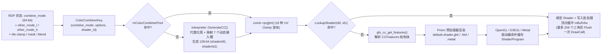
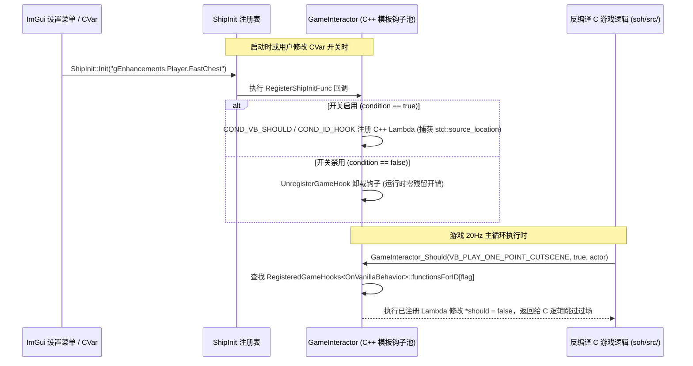
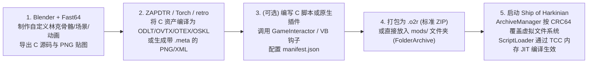

# 《塞尔达传说：时之笛》(Ocarina of Time) 原生 PC 移植版与 Mod 工具链开源生态深度技术报告

> **本地源码仓库路径**
> - 工作区主仓库集：[`/root/orca-workspaces/oot-ports-repos/`](file:///root/orca-workspaces/oot-ports-repos/)
> - 镜像同步仓库集：[`/root/wsl-demo/oot-ports-repos/`](file:///root/wsl-demo/oot-ports-repos/)
> - 报告文件路径：[`/root/wsl-demo/reports/03_oot_ports_and_mods_analysis.md`](file:///root/wsl-demo/reports/03_oot_ports_and_mods_analysis.md)

---

## 1. 全景生态概览与本地克隆仓库清单

《塞尔达传说：时之笛》（*The Legend of Zelda: Ocarina of Time*，以下简称 **OoT**）拥有复古游戏逆向工程领域最成熟、最庞大的开源 PC 移植与 Mod 工具链生态。从 `zeldaret/oot` 的 100% 字节级匹配反编译出发，社区衍生出了**源码级原生移植**（以 **Ship of Harkinian / Shipwright** 与 **libultraship** 为代表）、**静态重编译移植**（以 **N64Recomp / Zelda64Recomp** 以及针对 3DS 版 OoT3D 的 **TriAevum / Ocarina-ReTuned** 为代表）、**逻辑与二进制随机化引擎**（**OoT-Randomizer** 与 SoH 内置 C++ Randomizer），以及**工业级 3D 内容创作与 ROM 构建工具链**（**Fast64**、**ZAPD / ZAPDTR / Torch**、**z64rom**、**SharpOcarina**、**gz**）。

### 1.1 本地已克隆并同步的 20 个核心开源项目清单

所有核心项目均已克隆至 [`/root/orca-workspaces/oot-ports-repos/`](file:///root/orca-workspaces/oot-ports-repos/) 并完整同步至 [`/root/wsl-demo/oot-ports-repos/`](file:///root/wsl-demo/oot-ports-repos/)：

| 分类 | 项目名称 | 本地仓库路径 | 上游 Git 仓库 | 核心定位与技术栈 |
| :--- | :--- | :--- | :--- | :--- |
| **原生 PC 移植 (OoT/MM)** | **Shipwright (Ship of Harkinian)** | [`oot-ports-repos/Shipwright`](file:///root/orca-workspaces/oot-ports-repos/Shipwright) | `HarbourMasters/Shipwright` | OoT 原生 PC/多平台移植版主工程（C99 游戏逻辑 + C++20 增强层与 GUI） |
| **原生移植引擎底座** | **libultraship (LUS)** | [`oot-ports-repos/libultraship`](file:///root/orca-workspaces/oot-ports-repos/libultraship) | `Kenix3/libultraship` | 跨平台 N64 现代运行时引擎（Fast3D 渲染器、OTR/O2R 虚拟文件系统、ControlDeck、TCC 脚本） |
| **Fast3D 渲染鼻祖** | **n64-fast3d-engine** | [`oot-ports-repos/n64-fast3d-engine`](file:///root/orca-workspaces/oot-ports-repos/n64-fast3d-engine) | `Emill/n64-fast3d-engine` | 源自 `sm64-port` 的原始 Fast3D/F3DEX2 GBI 解释器与动态着色器生成器（LUS `src/fast` 的前身） |
| **姊妹移植项目 (MM)** | **2ship2harkinian** | [`oot-ports-repos/2ship2harkinian`](file:///root/orca-workspaces/oot-ports-repos/2ship2harkinian) | `HarbourMasters/2ship2harkinian` | 《梅祖拉的假面》(MM) 原生 PC 移植版，与 SoH 共享 `libultraship` 与 `Torch` 架构 |
| **资源提取与打包管线** | **Torch** | [`oot-ports-repos/Torch`](file:///root/orca-workspaces/oot-ports-repos/Torch) | `HarbourMasters/Torch` | 新一代跨游戏资产提取与 `.o2r` (ZIP) / `.otr` (MPQ) 打包工具（YAML 驱动，现已内嵌进 SoH） |
| **资源提取与打包管线** | **ZAPDTR** | [`oot-ports-repos/ZAPDTR`](file:///root/orca-workspaces/oot-ports-repos/ZAPDTR) | `HarbourMasters/ZAPDTR` | HarbourMasters 维护的 ZAPD 分支，增加 `.otr` (MPQ) 导出器与二进制资源序列化 |
| **资源提取与打包管线** | **ZAPD** | [`oot-ports-repos/ZAPD`](file:///root/orca-workspaces/oot-ports-repos/ZAPD) | `zeldaret/ZAPD` | `zeldaret` 官方 Zelda 资产提取与反汇编工具（XML 驱动，将 ROM 拆解为 C/PNG/BIN） |
| **Mod 打包 GUI 工具** | **retro** | [`oot-ports-repos/retro`](file:///root/orca-workspaces/oot-ports-repos/retro) | `HarbourMasters/retro` | 面向 SoH/2Ship 的可视化自定义纹理替换、模型与音频 OTR/O2R 生成工具 |
| **反编译源码基座** | **oot** | [`oot-ports-repos/oot`](file:///root/orca-workspaces/oot-ports-repos/oot) | `zeldaret/oot` | OoT (NTSC 1.0/1.1/1.2, PAL, GC, MQ Debug) 100% 匹配 C 反编译源码库 |
| **N64 静态重编译框架** | **N64Recomp** | [`oot-ports-repos/N64Recomp`](file:///root/orca-workspaces/oot-ports-repos/N64Recomp) | `N64Recomp/N64Recomp` | 将 N64 MIPS 二进制直接离线翻译为可移植 C 代码的静态重编译器与 `.nrm` Mod 重编译器 |
| **N64 现代运行时** | **N64ModernRuntime** | [`oot-ports-repos/N64ModernRuntime`](file:///root/orca-workspaces/oot-ports-repos/N64ModernRuntime) | `N64Recomp/N64ModernRuntime` | 为 N64Recomp 提供 `libultra` 高层模拟 (`ultramodern`) 与线程/消息队列调度 |
| **Zelda64 静态重编译** | **Zelda64Recomp** | [`oot-ports-repos/Zelda64Recomp`](file:///root/orca-workspaces/oot-ports-repos/Zelda64Recomp) | `Zelda64Recomp/Zelda64Recomp` | 基于 `N64Recomp` + `RT64` 的塞尔达 64 原生 PC 移植与 `.nrm` Mod 运行时 |
| **3DS OoT3D 静态重编译** | **TriAevum** | [`oot-ports-repos/TriAevum`](file:///root/orca-workspaces/oot-ports-repos/TriAevum) | `coccofresco/TriAevum` | 3DS《时之笛 3D》(Echoes of Time) 与《假面 3D》ARMv6K AOT 静态重编译 PC 引擎（NRI/Vulkan） |
| **3DS OoT3D 移植衍生** | **Ocarina-ReTuned** | [`oot-ports-repos/Ocarina-ReTuned`](file:///root/orca-workspaces/oot-ports-repos/Ocarina-ReTuned) | `OTPR26/Ocarina-ReTuned` | 基于 TriAevum 的跨平台（PC/Android/iOS/Switch）OoT3D 重编译移植，集成 ReFramed 单屏 HUD 与 PAK 模型加载器 |
| **随机化器 (Randomizer)** | **OoT-Randomizer** | [`oot-ports-repos/OoT-Randomizer`](file:///root/orca-workspaces/oot-ports-repos/OoT-Randomizer) | `OoTRandomizer/OoT-Randomizer` | 独立版 OoT 随机化器（Python AST 逻辑求解器 + MIPS 汇编与 C 补丁注入引擎） |
| **3D 建模与关卡导出** | **fast64** | [`oot-ports-repos/fast64`](file:///root/orca-workspaces/oot-ports-repos/fast64) | `Fast-64/fast64` | Blender 全功能 N64 插件（支持 F3DEX2 材质、OoT 场景/房间、碰撞体、骨骼动画、过场动画导入导出） |
| **ROM 构建与 Mod 框架** | **z64rom** | [`oot-ports-repos/z64rom`](file:///root/orca-workspaces/oot-ports-repos/z64rom) | `z64tools/z64rom` | 现代化 OoT ROM Hacking 完整工程构建器（DMA 重排、ELF 注入、自定义 Actor/Object/Scene 编译） |
| **可视化场景编辑器** | **SharpOcarina** | [`oot-ports-repos/SharpOcarina`](file:///root/orca-workspaces/oot-ports-repos/SharpOcarina) | `xdanieldzd/SharpOcarina` | C#/OpenGL 可视化 OoT 自定义场景、房间、碰撞、水体与 Actor 编辑器 |
| **速通练习 ROM (N64)** | **gz** | [`oot-ports-repos/gz`](file:///root/orca-workspaces/oot-ports-repos/gz) | `krimtonz/gz` | OoT 权威速通练习与内存调试工具（Practice ROM，支持即时存档 Memfile、碰撞视图、自由视角、宏录制） |
| **速通练习菜单 (3DS)** | **oot3d_practice_menu** | [`oot-ports-repos/oot3d_practice_menu`](file:///root/orca-workspaces/oot-ports-repos/oot3d_practice_menu) | `gamestabled/oot3d_practice_menu` | 3DS 版《时之笛 3D》速通练习与即时调试插件 |

---

### 1.2 三大原生 PC 移植技术路线对比

在深入源码前，我们可以从架构层面对比目前《时之笛》生态中的三大原生 PC 化路线：

```mermaid
flowchart TD
    subgraph Route1["路线一：反编译源码级移植 (Shipwright / SoH)"]
        R1_ROM["合法 N64/GC ROM (.z64/.n64/.v64)"] --> R1_Torch["Torch / ZAPDTR 资产提取器"]
        R1_Torch --> R1_O2R["oot.o2r (ZIP) / oot.otr (MPQ)"]
        R1_Decomp["zeldaret/oot C99 反编译源码"] --> R1_Modify["64位指针适配 + __OTR__ 资源宏替换 + C/C++ Hook 注入"]
        R1_Modify --> R1_Bin["原生可执行文件 (soh.elf / soh.exe)"]
        R1_O2R --> R1_LUS["libultraship 运行时 (Fast3D + ResourceManager)"]
        R1_Bin --> R1_LUS
    end

    subgraph Route2["路线二：N64 MIPS 静态重编译 (N64Recomp / Zelda64Recomp)"]
        R2_ROM["合法 N64 ROM"] --> R2_Recomp["N64Recomp 静态分析与指令翻译"]
        R2_Recomp --> R2_C["生成 C 函数 (ctx->r4, MEM_W 宏)"]
        R2_C --> R2_Native["原生可执行文件 + ultramodern + RT64 渲染器"]
        R2_ROM --> R2_Runtime["运行时直接挂载原版 ROM 读取资产"]
        R2_Runtime --> R2_Native
    end

    subgraph Route3["路线三：3DS ARMv6K 静态重编译 (TriAevum / Ocarina-ReTuned)"]
        R3_ROM["合法解密 3DS ROM (.3ds/.cci)"] --> R3_Forge["TriAevumForge 提取 ExeFS (code.bin) 与 RomFS (GAR/ZAR)"]
        R3_Forge --> R3_AOT["ARMv6K + VFPv2 静态重编译为 C/原生指令"]
        R3_AOT --> R3_PICA["3DS HLE OS + PICA200 GPU 翻译层 (NRI/Vulkan 或 OpenGL)"]
    end
```



| 维度 | 源码级反编译移植 (`Shipwright` + `libultraship`) | N64 静态重编译 (`N64Recomp` + `RT64`) | 3DS 静态重编译 (`TriAevum` / `Ocarina-ReTuned`) |
| :--- | :--- | :--- | :--- |
| **代码来源** | `zeldaret/oot` 人类可读 C99 反编译源码 | 离线将 MIPS 二进制直接翻译为寄存器上下文 C 函数 | 离线将 3DS ARMv6K `code.bin` 翻译为 C 函数 |
| **内存模型** | **真原生 64 位宿主指针**（结构体大小与对齐随 64 位架构变化） | **平坦 32 位虚拟 RDRAM 数组** (`0x80000000` 偏移寻址) | **平坦 32 位 3DS 虚拟地址空间** (`0x00100000` 等映射) |
| **资产加载方式** | 首次启动通过 `Torch`/`ZAPDTR` 提取为 `.o2r`/`.otr` 独立资源包 | 运行时直接挂载原版 ROM 并拦截 DMA，无需预提取步骤 | `Forge` 预构建阶段解包 ExeFS/RomFS 并重编译代码模块 |
| **渲染后端** | `Fast3D` (`Fast::Interpreter`)：基于 Prism 转译器的 OpenGL / D3D11 / Metal | `RT64`：高精度硬件模拟 + 路径追踪/现代管线 (D3D12/Vulkan/Metal) | PICA200 硬件状态机转译至 NRI/Vulkan (`TriAevum`) 或 OpenGL (`ReTuned`) |
| **帧率插值机制** | 源码级矩阵树记录 (`frame_interpolation.cpp`) + 顶点/UV 插值 | `RT64` 渲染器层基于显示列表与变换矩阵自动插值 | 引擎层对 30 FPS 骨骼/相机变换矩阵进行 60+ FPS 插值 |
| **二次开发与可维护性** | **极高**（直接阅读修改具名结构体如 `PlayState`、`Player` 及 `GameInteractor` 钩子） | 依赖反编译符号表与 `.nrm` 函数替换/钩子补丁 | 依赖符号映射表与 HLE 运行时补丁 |

---

## 2. Fast3D 现代渲染后端深度源码解析 (`libultraship/src/fast` & `n64-fast3d-engine`)

在 N64 原版硬件上，CPU（NEC VR4300）在内存中构建 **GBI (Graphics Binary Interface) 显示列表 (Display List)**，交由 **RSP (Reality Signal Processor)** 执行微码（OoT 使用 **F3DEX2** 与 **S2DEX** 微码）完成矩阵变换、顶点光照与裁剪，随后输出低级三角形与光栅化指令给 **RDP (Reality Display Processor)**，在 4KB 的片上纹理内存（**TMEM**）与双周期 **Color Combiner (CC，颜色组合器)** / **Blender (混合器)** 中完成像素合成。

`libultraship` 中的 Fast3D 渲染器（源码位于 [`libultraship/include/fast/`](file:///root/orca-workspaces/oot-ports-repos/libultraship/include/fast/) 与 [`libultraship/src/fast/`](file:///root/orca-workspaces/oot-ports-repos/libultraship/src/fast/)，演化自 [`Emill/n64-fast3d-engine`](file:///root/orca-workspaces/oot-ports-repos/n64-fast3d-engine/gfx_pc.c)）在宿主 CPU 上以 C++ 实现了极高效率的 **HLE (High-Level Emulation) GBI 解释器 (`Fast::Interpreter`)**，并将 RDP 状态机实时动态编译为现代 GPU 着色器。

### 2.1 64 位原生环境下的 GBI 指令扩展与自定义 OTR 操作码

在 N64 原版 32 位环境中，每条 `Gfx` 显示列表指令严格占 **64 bit（8 字节，`w0` 32 位 + `w1` 32 位）**，其中 `w1` 往往存放 32 位段地址（Segmented Address，如 `0x06001230`）。而在 64 位 PC 原生编译环境下，宿主指针 `uintptr_t` 是 64 位的。

查看 [`libultraship/include/fast/lus_gbi.h`](file:///root/orca-workspaces/oot-ports-repos/libultraship/include/fast/lus_gbi.h#L1155-L1178)：

```cpp
typedef struct {
    uintptr_t w0;
    uintptr_t w1;
#ifdef USE_GBI_TRACE
    F3DTrace trace;
#endif
} F3DGwords;

typedef union F3DGfx {
    F3DGwords words;
    long long int force_structure_alignment;
} F3DGfx;
```

1. **指令字宽自适应扩展**：`F3DGwords` 将 `w0` 和 `w1` 定义为 `uintptr_t`。在 64 位平台上，单条 `F3DGfx` 自动扩展为 **128 bit（16 字节）**，使得 `w1` 可以直接无损存放 64 位宿主内存指针（如 `const char*` 资产路径字符串或 `F3DVtx*` 顶点数组指针），同时操作码仍保存在 `(int8_t)(cmd->words.w0 >> 24)`（见 [`interpreter.cpp#L4897`](file:///root/orca-workspaces/oot-ports-repos/libultraship/src/fast/interpreter.cpp#L4897)）。
2. **自定义 OTR 扩展操作码 (`OTR_G_*`)**：为了支持从 `.otr`/`.o2r` 归档中按 64 位 CRC64 哈希或文件路径懒加载资产，以及支持离屏帧缓冲（Framebuffer）、宽屏矩形、自定义 Shader 和纹理插值，LUS 在 [`lus_gbi.h#L38-L78`](file:///root/orca-workspaces/oot-ports-repos/libultraship/include/fast/lus_gbi.h#L38-L78) 中定义了 30+ 个扩展 GBI 操作码，并在 [`interpreter.cpp#L4720-L4759`](file:///root/orca-workspaces/oot-ports-repos/libultraship/src/fast/interpreter.cpp#L4720-L4759) 的 `otrHandlers` 跳转表中派发：

| 自定义操作码名称 | 十六进制值 | 指令结构（单字/双字） | 核心功能与源码实现 ([`interpreter.cpp`](file:///root/orca-workspaces/oot-ports-repos/libultraship/src/fast/interpreter.cpp)) |
| :--- | :--- | :--- | :--- |
| `OTR_G_SETTIMG_OTR_HASH` | `0x20` | 双指令 (2×`F3DGfx`) | 第 1 条携带格式/尺寸/宽度，第 2 条 `w0<<32 \| w1` 携带 64 位 CRC 哈希；通过 `ResourceManager` 加载 `Fast::Texture` 并传递 HD 缩放元数据 (`h_byte_scale`, `v_pixel_scale`)（[#L4060-L4120](file:///root/orca-workspaces/oot-ports-repos/libultraship/src/fast/interpreter.cpp#L4060-L4120)） |
| `OTR_G_SETFB` / `OTR_G_RESETFB` | `0x21` / `0x22` | 单指令 | 切换当前渲染目标至创建的 GPU 离屏 Framebuffer 或恢复至主窗口 Framebuffer（用于暂停界面背景截图、真相之镜等效果，[#L4153-L4183](file:///root/orca-workspaces/oot-ports-repos/libultraship/src/fast/interpreter.cpp#L4153-L4183)） |
| `OTR_G_SETTIMG_FB` | `0x23` | 单指令 | 直接将 GPU Framebuffer 纹理绑定为当前采样纹理（零 CPU 回读开销，保留高分辨率渲染结果，[#L4258-L4267](file:///root/orca-workspaces/oot-ports-repos/libultraship/src/fast/interpreter.cpp#L4258-L4267)） |
| `OTR_G_VTX_OTR_FILEPATH` / `HASH` | `0x24` / `0x32` | 双指令 | 通过资源路径指针或 64 位哈希从 `ResourceManager` 获取 `F3DVtx*` 顶点数组并送入 `GfxSpVertex`（[#L3683-L3706](file:///root/orca-workspaces/oot-ports-repos/libultraship/src/fast/interpreter.cpp#L3683-L3706)） |
| `OTR_G_DL_OTR_FILEPATH` / `HASH` | `0x27` / `0x31` | 单/双指令 | 通过资源路径或 64 位哈希解析子显示列表 `F3DGfx*`，压入 `g_exec_stack.call(cmd, gfx)` 或 `branch(cmd)`（[#L3708-L3776](file:///root/orca-workspaces/oot-ports-repos/libultraship/src/fast/interpreter.cpp#L3708-L3776)） |
| `OTR_G_BRANCH_Z_OTR` | `0x35` | 双指令 | 替代原版 `gsSPBranchLessZraw`，检测 `mRsp->loaded_vertices[vbidx].z <= zval`（或开启 `G_EX_ALWAYS_EXECUTE_BRANCH` 强制最高 LOD）后按 64 位哈希跳转子显示列表（[#L3808-L3831](file:///root/orca-workspaces/oot-ports-repos/libultraship/src/fast/interpreter.cpp#L3808-L3831)） |
| `OTR_G_MTX_OTR` | `0x36` | 双指令 | 按 64 位哈希加载静态 `Mtx` 资源并执行 `GfxSpMatrix` |
| `OTR_G_TEXRECT_WIDE` / `FILLWIDERECT` | `0x37` / `0x38` | 多指令 | 突破原版 RDP 10.2 定点数 `0..1023` 正向屏幕坐标限制，支持 24 位有符号坐标（允许在 16:9 / 21:9 超宽屏负坐标区域绘制 HUD 与遮罩，[#L4514-L4536](file:///root/orca-workspaces/oot-ports-repos/libultraship/src/fast/interpreter.cpp#L4514-L4536)） |
| `OTR_G_SETGRAYSCALE` / `SETINTENSITY` | `0x39` / `0x40` | 单指令 | 启用着色器灰度/染色滤镜 (`mRdp->grayscale`, `mRdp->grayscale_color`)，用于石化、过场滤镜或自定义外观染色（[#L4269-L4275](file:///root/orca-workspaces/oot-ports-repos/libultraship/src/fast/interpreter.cpp#L4269-L4275)） |
| `OTR_G_EXTRAGEOMETRYMODE` | `0x3a` | 单指令 | 控制 LUS 扩展几何模式标志，如 `G_EX_INVERT_CULLING`（镜像世界模式反转背面剔除旋向）与 `G_EX_ALWAYS_EXECUTE_BRANCH`（禁用远景 LOD 降级，[#L1833](file:///root/orca-workspaces/oot-ports-repos/libultraship/src/fast/interpreter.cpp#L1833)） |
| `OTR_G_REGBLENDEDTEX` | `0x3f` | 双指令 | 注册带蒙版（Mask）的混合替换纹理（`RegisterBlendedTexture(name, mask, replacement)`），在 GPU 片元着色器中实时按 `mask.a` 混合原贴图与替换贴图（[#L4227-L4256](file:///root/orca-workspaces/oot-ports-repos/libultraship/src/fast/interpreter.cpp#L4227-L4256)） |
| `RDP_G_SETTILESIZE_INTERP` / `LERP` | `0x45` / `0x4a` | 三/五指令 | 携带浮点 UV 坐标 (`uls, ult, lrs, lrt`)，配合高帧率插值因子 `mInterpolationT` 实现材质滚动动画的平滑插值（[#L4328-L4370](file:///root/orca-workspaces/oot-ports-repos/libultraship/src/fast/interpreter.cpp#L4328-L4370)） |

### 2.2 RSP 模拟：段地址解析、矩阵替换、顶点变换与宽屏投影修正

1. **段地址解析 (`Interpreter::SegAddr`)**：
   N64 游戏大量使用 `0x01000000` ~ `0x0F000000` 的段地址（如 Segment `0x02` 为当前 Scene，Segment `0x03` 为当前 Room，Segment `0x04`/`0x05` 为 Keep 对象，Segment `0x06` 为当前 Actor Object，Segment `0x08`~`0x0D` 为动态分配的材质/矩阵/高亮块）。
   在 SoH 中，`SEG_ADDR(seg, addr)` 将最低位标记为 `1`（即 `addr | (seg << 24) | 1`）。当 Fast3D 执行 `SegAddr(uintptr_t w1)` 时，若检测到最低位为 `1`，则提取高 8 位段号 `segNum = (w1 >> 24) & 0x0F` 与低 24 位偏移，查表 `mSegmentPointers[segNum] + offset` 还原为真实的宿主内存地址；若最低位为 `0`，则直接作为 64 位原生指针使用！
2. **定点数矩阵解码与高帧率矩阵替换 (`Interpreter::GfxSpMatrix`)**：
   在 [`interpreter.cpp#L1507-L1562`](file:///root/orca-workspaces/oot-ports-repos/libultraship/src/fast/interpreter.cpp#L1507-L1562) 中，当执行 `G_MTX` 指令时：
   - 首先查询 `mCurMtxReplacements->find((Mtx*)addr)`：如果当前处于高帧率插值子帧，直接取出 `FrameInterpolation_Interpolate` 计算好的浮点插值矩阵 `MtxF`（并按 `1.0f / 65536.0f` 模拟 s15.16 精度对齐）。
   - 否则，将 N64 特有的分离式 `s15.16` 定点数矩阵（前 32 字节存放 16 个整数部分，后 32 字节存放 16 个小数部分）解码为 4×4 `float` 矩阵：
     ```cpp
     int32_t int_part = addr[i * 2 + j / 2];
     uint32_t frac_part = addr[8 + i * 2 + j / 2];
     matrix[i][j] = (int32_t)((int_part & 0xffff0000) | (frac_part >> 16)) / 65536.0f;
     matrix[i][j + 1] = (int32_t)((int_part << 16) | (frac_part & 0xffff)) / 65536.0f;
     ```
   - 维护深度为 11 的模型视图矩阵栈 `mRsp->modelview_matrix_stack[11][4][4]` 与投影矩阵 `mRsp->P_matrix[4][4]`，实时更新乘积 `mRsp->MP_matrix`。
3. **顶点光照、Positional Light 扩展与宽屏纵横比自适应 (`Interpreter::GfxSpVertex`)**：
   在 [`interpreter.cpp#L1602-L1788`](file:///root/orca-workspaces/oot-ports-repos/libultraship/src/fast/interpreter.cpp#L1602-L1788) 中：
   - 将顶点乘上 `MP_matrix` 得到裁剪空间坐标 `(x, y, z, w)`。
   - **原生宽屏自适应 (`AdjXForAspectRatio`)**：通过 `x = x * (4.0f / 3.0f) / ((float)mCurDimensions.width / (float)mCurDimensions.height)`（见 [#L1577-L1586](file:///root/orca-workspaces/oot-ports-repos/libultraship/src/fast/interpreter.cpp#L1577-L1586)）自动根据当前窗口宽高比缩放水平视锥体，同时对固定比例的离屏 Framebuffer（如暂停菜单 Link 预览框）跳过缩放以防拉伸变形。
   - **光照与环境贴图生成 (`G_LIGHTING` & `G_TEXTURE_GEN`)**：支持最多 `MAX_LIGHTS = 32` 盏光源，除了原版平行光外还实现了 `G_LIGHTING_POSITIONAL` 点光源距离衰减公式，以及基于 `lookat` 向量的球面环境反射 UV 生成（用于铁靴、镜盾等金属高光）。

### 2.3 RDP Color Combiner 动态着色器合成与 Prism 跨 API 转译器

N64 RDP 的核心灵魂是双周期 **Color Combiner (CC)**，其每个周期的硬件数学公式为：
$$\text{Output} = (A - B) \times C + D$$
其中 RGB 通道的 $A, B, C, D$ 与 Alpha 通道的 $A_\alpha, B_\alpha, C_\alpha, D_\alpha$ 可分别从 `COMBINED`、`TEXEL0`、`TEXEL1`、`PRIMITIVE`、`SHADE`、`ENVIRONMENT`、`CENTER`/`SCALE`（Chroma Key）、`K4`/`K5`（YUV 转换）、`LOD_FRACTION`、`NOISE`、`1`、`0` 等多路复用器输入中任选。如果为所有可能的组合预编译 Shader，组合空间将高达数百万种。

Fast3D 采用 **按需特征提取 + 模板元编程动态生成 + 二级缓存** 的架构：



1. **代数化简与 128 位特征编码 (`Interpreter::GenerateCC`)**：
   在 [`interpreter.cpp#L197-L370`](file:///root/orca-workspaces/oot-ports-repos/libultraship/src/fast/interpreter.cpp#L197-L370) 中：
   - 若 $A = B$ 或 $C = 0$，则 $(A - B) \times C + D$ 自动代数化简为 $0 + D$（将 $A, B, C$ 归一化为 `G_CCMUX_0`）。
   - 在双周期模式 (`SHADER_OPT(_2CYC)`) 下，若第 2 周期完全没有引用 `G_CCMUX_COMBINED`（或 `G_ACMUX_COMBINED`），则直接消去第 1 周期的无用计算。
   - 在单周期模式下，若引用了 `TEXEL1`，自动重映射至 `TEXEL0`（还原 N64 硬件单周期下 `TEXEL1` 返回 `TEXEL0` 的硬件怪癖，见 [#L269-L279](file:///root/orca-workspaces/oot-ports-repos/libultraship/src/fast/interpreter.cpp#L269-L279)）。
   - 将该 Combiner 实际用到的动态颜色变量（`PRIMITIVE`、`SHADE`、`ENVIRONMENT`、`PRIM_LOD_FRAC` 等）紧凑映射到最多 7 个顶点属性槽 `SHADER_INPUT_1` ~ `SHADER_INPUT_7`，并将双周期公式压缩编码进 `shader_id0`（64 位）和 `shader_id1`（64 位选项位掩码 `ShaderOpts`）。
2. **Prism 跨平台着色器模板系统 (`default.shader.glsl` / `.hlsl` / `.metal`)**：
   查看 [`libultraship/src/fast/shaders/opengl/default.shader.glsl`](file:///root/orca-workspaces/oot-ports-repos/libultraship/src/fast/shaders/opengl/default.shader.glsl)：
   - 使用 `@prism` 模板指令（`@if`, `@for`, `@{append_formula(...)}`），根据 `gfx_cc_get_features` 解析出的 `CCFeatures`（[`interpreter.cpp#L5439-L5520`](file:///root/orca-workspaces/oot-ports-repos/libultraship/src/fast/interpreter.cpp#L5439-L5520)）仅生成当前材质所需的最小顶点属性（`aTexCoord`, `aTexClampS/T`, `aFog`, `aGrayscaleColor`, `aInput1..N`）和片元计算公式。
   - **N64 三点纹理过滤 (`filter3point`)**：在 [`default.shader.glsl#L147-L154`](file:///root/orca-workspaces/oot-ports-repos/libultraship/src/fast/shaders/opengl/default.shader.glsl#L147-L154) 中精确还原了 N64 RDP 独特的对角线三线性插值（3-Point Bilerp，采样 3 个相邻纹素而非现代 GPU 双线性过滤的 4 个纹素，呈现标志性的六边形纹素过渡）：
     ```glsl
     vec4 filter3point(in sampler2D tex, in vec2 texCoord, in vec2 texSize) {
         vec2 offset = fract(texCoord*texSize - vec2(0.5));
         offset -= step(1.0, offset.x + offset.y);
         vec4 c0 = TEX_OFFSET(offset);
         vec4 c1 = TEX_OFFSET(vec2(offset.x - sign(offset.x), offset.y));
         vec4 c2 = TEX_OFFSET(vec2(offset.x, offset.y - sign(offset.y)));
         return c0 + abs(offset.x)*(c1-c0) + abs(offset.y)*(c2-c0);
     }
     ```
   - **N64 组合器定点数溢出回绕模拟 (`WRAP`)**：N64 RDP 的颜色组合器内部使用 9 位有符号定点数运算，当中间结果超出 $[-0.5, 1.5]$ 时会发生硬件整数溢出回绕（许多 N64 特效如火焰、魔法光晕依赖此溢出特性）。着色器在 [`default.shader.glsl#L221-L253`](file:///root/orca-workspaces/oot-ports-repos/libultraship/src/fast/shaders/opengl/default.shader.glsl#L221-L253) 中对周期 1 与周期 2 的输出精确执行 `WRAP(texel, -0.51, 1.51)` / `WRAP(texel, -1.01, 1.01)` 后再 `clamp(texel, 0.0, 1.0)`。
   - **N64 硬件噪声抖动 (`o_noise`)**：针对 `G_AC_DITHER`（如林克传送、幽灵渐隐、云雾边缘），通过帧计数器 `frame_count` 与屏幕坐标 `floor(gl_FragCoord.xy * noise_scale)` 计算伪随机噪声 `random(...)` 实现与内部分辨率无关的原生颗粒感渐隐（[#L267-L269](file:///root/orca-workspaces/oot-ports-repos/libultraship/src/fast/shaders/opengl/default.shader.glsl#L267-L269)）。

### 2.4 多图形后端抽象 (`GfxRenderingAPI`) 与纹理缓存/HD 贴图管线

`libultraship/src/fast/backends/` 提供了三大图形 API 后端与两大窗口后端：
- **渲染后端**：
  - OpenGL / OpenGL ES ([`gfx_opengl.cpp`](file:///root/orca-workspaces/oot-ports-repos/libultraship/src/fast/backends/gfx_opengl.cpp))：支持 Linux / Windows / Android / Switch 等全平台。
  - Direct3D 11 ([`gfx_direct3d11.cpp`](file:///root/orca-workspaces/oot-ports-repos/libultraship/src/fast/backends/gfx_direct3d11.cpp) & [`gfx_dxgi.cpp`](file:///root/orca-workspaces/oot-ports-repos/libultraship/src/fast/backends/gfx_dxgi.cpp))：Windows 默认后端，内置 DXGI Flip Model 与帧延迟控制。
  - Metal ([`gfx_metal.cpp`](file:///root/orca-workspaces/oot-ports-repos/libultraship/src/fast/backends/gfx_metal.cpp) & [`gfx_metal_shader.cpp`](file:///root/orca-workspaces/oot-ports-repos/libultraship/src/fast/backends/gfx_metal_shader.cpp))：macOS / iOS / tvOS 原生后端，支持 Retina 缩放与 MSAA Resolve。
- **窗口与事件后端**：SDL2 ([`gfx_sdl.cpp`](file:///root/orca-workspaces/oot-ports-repos/libultraship/src/fast/backends/gfx_sdl.cpp)) 与 DXGI。
- **LRU 纹理缓存与多调色板 CI4/CI8 模拟**：
  - `GfxTextureCache`（[`interpreter.h#L187-L217`](file:///root/orca-workspaces/oot-ports-repos/libultraship/include/fast/interpreter.h#L187-L217)）维护容量为 `TEXTURE_CACHE_MAX_SIZE = 1024` 的哈希表 + LRU 链表，缓存键 `TextureCacheKey` 由 `(texture_addr, palette_addrs[0..1], fmt, siz, palette_index, size_bytes)` 共同构成。
  - 针对 N64 TMEM 的 16 个 CI4 调色板槽位，RDP 状态结构体设立了 `uint8_t palette_staging[2][256]` 暂存区与 `palette_dram_addr[2]`（[#L268-L275](file:///root/orca-workspaces/oot-ports-repos/libultraship/include/fast/interpreter.h#L268-L275)），支持单模型多 CI4 调色板动态切换。
  - 支持原版 `RGBA16`、`RGBA32`、`IA4`、`IA8`、`IA16`、`I4`、`I8`、`CI4`、`CI8` 解码，以及 HD 替换贴图直通格式 `ImportTextureRaw` / `ImportTextureImg`（PNG/DDS 解码后的 32 位 RGBA 缓冲区，通过 `h_byte_scale` 与 `v_pixel_scale` 自动补偿 Tile 字节跨度，使 4K 高清纹理与原版 UV 坐标无缝对齐）。

---

## 3. OTR / O2R 资源格式、归档系统与提取工具链深度解析

为了遵循数字版权法（DMCA）并坚决杜绝分发任天堂受版权保护的 ROM 资产，HarbourMasters 设计了将代码与资产彻底解耦的 **OTR (Ocarina Table of Resources)** 与新一代 **O2R (OTR v2)** 虚拟文件系统架构。

### 3.1 容器演进：从 `.otr` (MPQ) 到 `.o2r` (ZIP) 与 `FolderArchive`

查看 [`libultraship/src/ship/resource/archive/`](file:///root/orca-workspaces/oot-ports-repos/libultraship/src/ship/resource/archive/)，LUS 的 `ArchiveManager` 统一抽象了三种归档容器后端（见 [`ArchiveManager.cpp#L259-L283`](file:///root/orca-workspaces/oot-ports-repos/libultraship/src/ship/resource/archive/ArchiveManager.cpp#L259-L283)）：

| 归档类型 | 扩展名 | 底层实现类 | 依赖库 | 读写与并发特性 |
| :--- | :--- | :--- | :--- | :--- |
| **OtrArchive (第一代)** | `.otr`, `.mpq` | [`Ship::OtrArchive`](file:///root/orca-workspaces/oot-ports-repos/libultraship/src/ship/resource/archive/OtrArchive.cpp) | `StormLib` (暴雪 MPQ 格式) | 只读 (`MPQ_OPEN_READ_ONLY`)；依赖内置 `(listfile)` 构建路径索引；通过 `SFileOpenFileEx` + `SFileReadFile` 读取 |
| **O2rArchive (第二代标准)** | `.o2r`, `.zip` | [`Ship::O2rArchive`](file:///root/orca-workspaces/oot-ports-repos/libultraship/src/ship/resource/archive/O2rArchive.cpp) | `libzip` (标准 ZIP 格式) | 支持读写 (`WriteFile`)；内置线程安全句柄池 `mZipArchivePool` + `mPoolMutex`（[#L19-L36](file:///root/orca-workspaces/oot-ports-repos/libultraship/src/ship/resource/archive/O2rArchive.cpp#L19-L36)），支持多线程并发无锁解压不同文件！ |
| **FolderArchive (开发模式)** | 无扩展名 (目录) | [`Ship::FolderArchive`](file:///root/orca-workspaces/oot-ports-repos/libultraship/src/ship/resource/archive/FolderArchive.cpp) | `std::filesystem` | 直接挂载磁盘文件夹，Mod 开发者修改 XML/JSON/PNG 后无需重新打包即可即时热重载测试 |

> [!IMPORTANT]
> **为什么社区从 `.otr` (MPQ) 迁移到 `.o2r` (ZIP)？**
> 1. **工具链通用性**：MPQ 是暴雪早期私有归档格式，普通用户和 Mod 作者需要专门安装 MPQ Editor 才能查看或打包；而 `.o2r` 本质就是标准 `.zip` 文件，任何操作系统自带解压工具或 Python `zipfile` 均可直接生成。
> 2. **多线程异步加载性能**：`StormLib` 的单个 `HANDLE` 在多线程并发读取时存在锁竞争，而 `O2rArchive` 实现了 `mZipArchivePool` 句柄池（[`O2rArchive.cpp#L19-L36`](file:///root/orca-workspaces/oot-ports-repos/libultraship/src/ship/resource/archive/O2rArchive.cpp#L19-L36)），配合 `ResourceManager` 的 `BS::thread_pool` 线程池可实现真正的多核并行流式加载。
> 3. **提取器升级**：查看 [`Shipwright/soh/soh/Extractor/Extract.cpp#L676-L677`](file:///root/orca-workspaces/oot-ports-repos/Shipwright/soh/soh/Extractor/Extract.cpp#L676-L677) 与 [`TorchExtract.cpp#L40`](file:///root/orca-workspaces/oot-ports-repos/Shipwright/soh/soh/Extractor/TorchExtract.cpp#L40)，最新版本的 Shipwright 已将内置提取器从外部调用 `ZAPD.out` 生成 `oot.otr` 升级为直接调用内嵌的 `SohTorch::Extract(..., ArchiveType::O2R)` 生成 `oot.o2r` / `oot-mq.o2r`，同时 `ArchiveManager` 保持对旧版 `.otr` Mod 的完全向下兼容。

### 3.2 64 字节 OTR 二进制资源头 (`OTR_HEADER_SIZE = 64`) 与字节序自适应

在 `.otr` / `.o2r` 归档内部，每个二进制资产文件均以固定 **64 字节 (0x40 Bytes) 的 OTR Header** 开头，紧随其后的是该资产类型的序列化载荷（Payload）。
根据 [`libultraship/src/ship/resource/ResourceLoader.cpp#L305-L342`](file:///root/orca-workspaces/oot-ports-repos/libultraship/src/ship/resource/ResourceLoader.cpp#L305-L342) 及 [`ZAPDTR/ZAPD/ZResource.h`](file:///root/orca-workspaces/oot-ports-repos/ZAPDTR/ZAPD/ZResource.h)，64 字节头的精确内存布局如下：

| 字节偏移 (Hex) | 长度 (Bytes) | 数据类型 | 字段名称 | 详细说明 |
| :--- | :--- | :--- | :--- | :--- |
| `0x00` | `1` | `int8_t` | `ByteOrder` (`Endianness`) | `0` = Little-Endian (x86_64/ARM64)，`1` = Big-Endian (PowerPC/Wii U)。`BinaryReader` 读取首字节后立即调用 `SetEndianness(ByteOrder)` 自动按需字节序转换后续所有字段！ |
| `0x01` | `1` | `bool` (`int8_t`) | `IsCustom` | 标识该资产是否来自自定义 Mod/Alt 资产（`1` = 自定义，`0` = 原版提取） |
| `0x02` | `2` | `int8_t[2]` | `Reserved` | 对齐填充保留字节 (`0x00, 0x00`) |
| `0x04` | `4` | `uint32_t` | `Type` (FourCC) | 4 字符 ASCII 资源类型魔数（大端拼接为 `uint32_t`，如 `'OTEX'` = `0x4F544558`） |
| `0x08` | `4` | `uint32_t` | `ResourceVersion` | 该资源类型的序列化格式版本号（如 `TextureV0` = `0`，支持 HD 缩放因子的 `TextureV1` = `1`），用于匹配 `ResourceFactoryKey` |
| `0x0C` | `8` | `uint64_t` | `Id` | 资源的 64 位唯一标识哈希（默认为 `0xDEADBEEFDEADBEEF` 或路径 CRC64） |
| `0x14` | `4` | `uint32_t` | `ResourceMinorVersion` | 次版本号 / 保留字段 |
| `0x18` | `8` | `uint64_t` | `RomCRC` | 提取源 ROM 的 64 位 CRC 校验值 |
| `0x20` | `4` | `uint32_t` | `RomEnum` | ROM 版本枚举标识 |
| `0x24` ~ `0x3F` | `28` | `uint8_t[28]` | `Padding` | 预留扩展区，补齐至 `OTR_HEADER_SIZE = 64` (`0x40`) 字节边界 |
| `0x40` (`64`) | 变长 | `uint8_t[]` | `Payload` | 资源实体数据起点（`fileToLoad->BufferOffset = 64`） |

此外，在 O2R 规范中，LUS 还支持 **无头原始文件 + `.meta` JSON 伴生文件（Sidecar）** 与 **XML 格式资源**（见 [`ResourceLoader.cpp#L111-L125`](file:///root/orca-workspaces/oot-ports-repos/libultraship/src/ship/resource/ResourceLoader.cpp#L111-L125) 与 [`#L181-L215`](file:///root/orca-workspaces/oot-ports-repos/libultraship/src/ship/resource/ResourceLoader.cpp#L181-L215)）：
- 如果文件首字节为 `'<'`，`ResourceLoader` 自动切换至 `tinyxml2::XMLDocument` 解析器，调用对应的 `ResourceFactoryXML*` 工厂（例如直接解析 XML 编写的自定义 `DisplayList`）。
- 如果归档中存在 `<path>.meta`（JSON 格式，包含 `"type"`, `"version"`, `"format"`, `"isCustom"`, `"path"`），`ResourceManager::ResolveMetaAlias`（[`ResourceManager.cpp#L104-L134`](file:///root/orca-workspaces/oot-ports-repos/libultraship/src/ship/resource/ResourceManager.cpp#L104-L134)）支持将原版资产路径重定向（Alias）到另一个路径或直接提供元数据。

### 3.3 全量 FourCC 资源类型与 `ResourceFactory` 反序列化体系

`libultraship` 与 `Shipwright` 采用 `(Format, Type, Version)` 三元组注册工厂模式（`ResourceLoader::RegisterResourceFactory`）。汇总 [`libultraship/include/ship/resource/ResourceType.h`](file:///root/orca-workspaces/oot-ports-repos/libultraship/include/ship/resource/ResourceType.h)、[`libultraship/include/fast/resource/ResourceType.h`](file:///root/orca-workspaces/oot-ports-repos/libultraship/include/fast/resource/ResourceType.h) 与 [`Shipwright/soh/soh/resource/type/SohResourceType.h`](file:///root/orca-workspaces/oot-ports-repos/Shipwright/soh/soh/resource/type/SohResourceType.h)，核心 FourCC 资源类型如下表所示：

| 所属层 | FourCC 魔数 | 十六进制值 | 枚举名称 | C++ 资源类与工厂实现 | 载荷结构与用途说明 |
| :--- | :--- | :--- | :--- | :--- | :--- |
| **Ship 通用层** | `OBLB` | `0x4F424C42` | `Ship::ResourceType::Blob` | `Blob` / `BlobFactory` | 原始二进制字节数组 (`std::vector<uint8_t>`) |
| **Ship 通用层** | `JSON` | `0x4A534F4E` | `Ship::ResourceType::Json` | `Json` / `JsonFactory` | `nlohmann::json` 结构化配置/数据文档 |
| **Ship 通用层** | `SHAD` | `0x53484144` | `Ship::ResourceType::Shader` | `Shader` / `ShaderFactory` | 自定义 GPU 着色器源码 |
| **Fast3D 渲染层** | `ODLT` | `0x4F444C54` | `Fast::ResourceType::DisplayList` | [`DisplayList`](file:///root/orca-workspaces/oot-ports-repos/libultraship/src/fast/resource/factory/DisplayListFactory.cpp) | GBI 指令序列（含 `UCodeHandlers` 标识，自动将 `G_SETTIMG_OTR_HASH` 等双字指令展开为 64 位指针宽度） |
| **Fast3D 渲染层** | `OTEX` | `0x4F544558` | `Fast::ResourceType::Texture` | [`Texture`](file:///root/orca-workspaces/oot-ports-repos/libultraship/src/fast/resource/factory/TextureFactory.cpp) | 纹理资源：V0 含 `(Type, Width, Height, Size, Data)`；V1 新增 `(Flags, HByteScale, VPixelScale)` 支持高清贴图缩放 |
| **Fast3D 渲染层** | `OVTX` | `0x4F565458` | `Fast::ResourceType::Vertex` | [`Vertex`](file:///root/orca-workspaces/oot-ports-repos/libultraship/src/fast/resource/factory/VertexFactory.cpp) | `F3DVtx` 顶点数组 (`ob[3], flag, tc[2], cn[4]/n[3]`) |
| **Fast3D 渲染层** | `OMTX` | `0x4F4D5458` | `Fast::ResourceType::Matrix` | [`Matrix`](file:///root/orca-workspaces/oot-ports-repos/libultraship/src/fast/resource/factory/MatrixFactory.cpp) | 4×4 定点数变换矩阵 `Mtx` |
| **Fast3D 渲染层** | `LGTS` | `0x46669697` | `Fast::ResourceType::Light` | [`Light`](file:///root/orca-workspaces/oot-ports-repos/libultraship/src/fast/resource/factory/LightFactory.cpp) | N64 环境光与平行光/点光源结构体 `Lightsn` |
| **SoH 游戏层** | `OSKL` | `0x4F534B4C` | `SOH::ResourceType::SOH_Skeleton` | [`Skeleton`](file:///root/orca-workspaces/oot-ports-repos/Shipwright/soh/soh/resource/importer/SkeletonFactory.cpp) | `SkeletonHeader` / `FlexSkeletonHeader`（骨骼类型、关节数、`dListCount`、骨骼 Limb 路径表） |
| **SoH 游戏层** | `OSLB` | `0x4F534C42` | `SOH::ResourceType::SOH_SkeletonLimb` | [`SkeletonLimb`](file:///root/orca-workspaces/oot-ports-repos/Shipwright/soh/soh/resource/importer/SkeletonLimbFactory.cpp) | 单个骨骼节点（支持 `StandardLimb`、`LodLimb`、`SkinLimb`、`CurveLimb`、`LegacyLimb`） |
| **SoH 游戏层** | `OANM` | `0x4F414E4D` | `SOH::ResourceType::SOH_Animation` | [`Animation`](file:///root/orca-workspaces/oot-ports-repos/Shipwright/soh/soh/resource/importer/AnimationFactory.cpp) | 常规骨骼动画（`frameCount`、旋转值池 `frameData`、通道索引表 `jointIndices`、`staticIndexMax`） |
| **SoH 游戏层** | `OPAM` | `0x4F50414D` | `SOH::ResourceType::SOH_PlayerAnimation` | [`PlayerAnimation`](file:///root/orca-workspaces/oot-ports-repos/Shipwright/soh/soh/resource/importer/PlayerAnimationFactory.cpp) | 林克专属逐帧面部表情与 21 关节原始帧数据（原版位于 `link_animetion` 段） |
| **SoH 游戏层** | `OROM` | `0x4F524F4D` | `SOH::ResourceType::SOH_Room` | [`Scene`](file:///root/orca-workspaces/oot-ports-repos/Shipwright/soh/soh/resource/importer/SceneFactory.cpp) | 场景 (`.scene`) 与房间 (`.room`) 指令列表容器 |
| **SoH 游戏层** | `ORCM` | `0x4F52434D` | `SOH::ResourceType::SOH_SceneCommand` | [`SceneCommandFactory`](file:///root/orca-workspaces/oot-ports-repos/Shipwright/soh/soh/resource/importer/scenecommand/) | 20 种场景头部指令（Actor 列表、碰撞头、出生点、灯光、天空盒、路径、Mesh、过渡门、备用 Header 等） |
| **SoH 游戏层** | `OCOL` | `0x4F434F4C` | `SOH::ResourceType::SOH_CollisionHeader` | [`CollisionHeader`](file:///root/orca-workspaces/oot-ports-repos/Shipwright/soh/soh/resource/importer/CollisionHeaderFactory.cpp) | 场景物理碰撞网格（包围盒、顶点表、`CollisionPoly` 多边形表、`SurfaceType` 材质属性、`BgCamInfo` 相机与 `WaterBox` 水体） |
| **SoH 游戏层** | `OCUT` | `0x4F435654` | `SOH::ResourceType::SOH_Cutscene` | [`Cutscene`](file:///root/orca-workspaces/oot-ports-repos/Shipwright/soh/soh/resource/importer/CutsceneFactory.cpp) | 过场动画脚本命令流（相机样条曲线、Actor Cue 动作轨、字幕轨、时间/音乐控制） |
| **SoH 游戏层** | `OTXT` | `0x4F545854` | `SOH::ResourceType::SOH_Text` | [`Text`](file:///root/orca-workspaces/oot-ports-repos/Shipwright/soh/soh/resource/importer/TextFactory.cpp) | 多语言对话消息表（Message ID、文本框类型/位置、控制码与本地化字符串） |
| **SoH 游戏层** | `OARR` | `0x4F415252` | `SOH::ResourceType::SOH_Array` | [`Array`](file:///root/orca-workspaces/oot-ports-repos/Shipwright/soh/soh/resource/importer/ArrayFactory.cpp) | 通用定长数值/向量数组 (`Vec3f`, `Vec3s`, `s16`, `u32` 等) |
| **SoH 游戏层** | `OPTH` | `0x4F505448` | `SOH::ResourceType::SOH_Path` | [`Path`](file:///root/orca-workspaces/oot-ports-repos/Shipwright/soh/soh/resource/importer/PathFactory.cpp) | AI 巡逻与运动样条路径点数组 |
| **SoH 游戏层** | `OBGI` | `0x4F424749` | `SOH::ResourceType::SOH_Background` | [`Background`](file:///root/orca-workspaces/oot-ports-repos/Shipwright/soh/soh/resource/importer/BackgroundFactory.cpp) | 预渲染 2D 背景房间（如林克家、市场巷道、商店内部的 JPEG 解码纹理） |
| **SoH 音频层** | `OSMP` / `OSFT` / `OSEQ` | `0x4F534D50` / `0x4F534654` / `0x4F534551` | `SOH_AudioSample` / `SoundFont` / `Sequence` | [`AudioSample`](file:///root/orca-workspaces/oot-ports-repos/Shipwright/soh/soh/resource/importer/AudioSampleFactory.cpp) / `SoundFont` / `Sequence` | ADPCM/PCM 音频采样（支持 MP3/OGG/WAV/FLAC 扩展）、乐器音色库（SoundFont/乐器包络/鼓组）与 N64 MML 音序器脚本 (`OSEQ`) |

### 3.4 虚拟文件系统 (VFS) 多归档覆盖优先级与 `alt/` 高清资产切换

在 [`ArchiveManager.cpp#L285-L315`](file:///root/orca-workspaces/oot-ports-repos/libultraship/src/ship/resource/archive/ArchiveManager.cpp#L285-L315) 与 [`ResourceManager.cpp#L136-L257`](file:///root/orca-workspaces/oot-ports-repos/libultraship/src/ship/resource/ResourceManager.cpp#L136-L257) 中，LUS 实现了一套极度灵活的非侵入式 Mod 覆盖机制：

1. **CRC64 全局虚拟文件表 (`mFileToArchive` & `mHashes`)**：
   - 每个归档按加载顺序赋予递增的优先级 `archive->SetPriority(mArchives.size() - 1)`。首先加载基础 `oot.o2r` / `oot-mq.o2r` 及 `soh.o2r`，随后按文件名排序加载 `mods/` 目录下的所有 `.o2r`、`.otr`、`.zip` 或文件夹。
   - 当后加载的 Mod 归档包含与基础包相同路径的文件时，其计算的 `CRC64(filePath)` 会覆盖 `mFileToArchive[hash] = archive`（见 [`ArchiveManager.cpp#L163-L165`](file:///root/orca-workspaces/oot-ports-repos/libultraship/src/ship/resource/archive/ArchiveManager.cpp#L163-L165)）。游戏代码在请求 `"__OTR__objects/object_link_boy/..."` 时无需任何改动即可透明加载高优先级 Mod 中的资产。
2. **`alt/` 高清资产一键热切换 (`mAltAssetsEnabled`)**：
   - 在 [`ResourceManager.cpp#L149-L163`](file:///root/orca-workspaces/oot-ports-repos/libultraship/src/ship/resource/ResourceManager.cpp#L149-L163) 中，当用户开启 Alternate Assets（快捷键 `Tab`）时，`LoadResourceProcess` 会自动在请求路径前拼接 `"alt/"` 前缀（即优先尝试加载 `"alt/objects/object_link_boy/..."`）。
   - 若 `"alt/..."` 存在则返回高清模型/贴图，若不存在则自动回退到原版路径。当玩家在游戏内按下 `Tab` 键时，引擎调用 `DirtyResources` 并清空 Fast3D 纹理缓存 `gfx_texture_cache_clear()`，实现 **0 秒无卡顿实时在 N64 原版画风与 3DS/HD 重制画风之间切换**！

---

## 4. C/C++ 桥接架构与 Ship of Harkinian 增强特性剖析

`Shipwright` 最具代表性的工程成就在于：它既完整保留了 `zeldaret/oot` 纯 C99 反编译代码的可读性与精确性（位于 [`Shipwright/soh/src/`](file:///root/orca-workspaces/oot-ports-repos/Shipwright/soh/src/)），又在 [`Shipwright/soh/soh/`](file:///root/orca-workspaces/oot-ports-repos/Shipwright/soh/soh/) 下构建了近千个 C++20 现代化模块，两者通过精心设计的 **C/C++ 桥接层 (Bridge)** 与 **GameInteractor 钩子引擎** 无缝耦合。

### 4.1 `__OTR__` 签名检测与 GBI 宏透明拦截 (`GbiWrap.cpp`)

在原版 `zeldaret/oot` 中，C 代码直接引用编译进 ROM 的静态数组符号（例如 `extern Gfx gLinkAdultHeadDL[];`），并将其传给 `gSPDisplayList(POLY_OPA_DISP++, gLinkAdultHeadDL)`。
而在 `Shipwright` 中，构建脚本与头文件将所有原版资产符号重定义为以 `"__OTR__"` 开头的路径字符串宏（例如 `"__OTR__objects/object_link_boy/gLinkAdultHeadDL"`）：

```c
// 原版 decomp: extern Gfx gLinkAdultHeadDL[];
// SoH 中:
static const ALIGN_ASSET(2) char gLinkAdultHeadDL[] = "__OTR__objects/object_link_boy/gLinkAdultHeadDL";
```

当 C 代码调用 `gSPDisplayList`、`gSPVertex`、`gSPSegment` 时，控制权进入 [`Shipwright/soh/soh/GbiWrap.cpp`](file:///root/orca-workspaces/oot-ports-repos/Shipwright/soh/soh/GbiWrap.cpp#L36-L128)：

```cpp
extern "C" void gSPDisplayList(Gfx* pkt, Gfx* dl) {
    char* imgData = (char*)dl;
    if (ResourceMgr_OTRSigCheck(imgData) == 1) {
        dl = ResourceMgr_LoadGfxByName(imgData);
    }
    __gSPDisplayList(pkt, dl);
}
```

1. **`ResourceMgr_OTRSigCheck(imgData)`**：首先检查指针最低位是否为 `1`（若是 `1` 则代表是 N64 段地址如 `0x08000001`，直接放行），并过滤 `< 0x10000` 的无效低地址（见 [`interpreter.cpp#L5371-L5392`](file:///root/orca-workspaces/oot-ports-repos/libultraship/src/fast/interpreter.cpp#L5371-L5392)），然后检查前 7 个字符是否为 `"__OTR__"`。
2. **透明按需加载**：若检测到 `"__OTR__"` 前缀，立即剥离前 7 个字节并调用 `ResourceMgr_LoadGfxByName` / `ResourceMgr_LoadVtxByName`，从 `Ship::ResourceManager` 缓存中获取反序列化后的 `F3DGfx*` 或 `F3DVtx*` 真实内存指针，再写入 `POLY_OPA_DISP` 缓冲区！
3. **HD 贴图路径保留 (`gSPSegment`)**：在 [`GbiWrap.cpp#L36-L55`](file:///root/orca-workspaces/oot-ports-repos/Shipwright/soh/soh/GbiWrap.cpp#L36-L55) 中，对于 `gSPSegment(pkt, segNum, target)`，如果 `target` 是指向贴图的 `"__OTR__..."` 字符串，它**故意不提前将其解引用为裸像素指针**，而是直接把 `"__OTR__..."` 字符串地址存入 `mSegmentPointers[segNum]`，直到 Fast3D 执行 `gfx_set_timg_handler_rdp`（[`interpreter.cpp#L4031-L4048`](file:///root/orca-workspaces/oot-ports-repos/libultraship/src/fast/interpreter.cpp#L4031-L4048)）时才通过 `ResolveResourceCached(imgData)` 提取完整的 `Fast::Texture` 对象——从而保留 HD 替换贴图必需的宽高缩放比 (`HByteScale`, `VPixelScale`) 元数据！

### 4.2 `GameInteractor` 与 `ShipInit`：零侵入、零开销的 C/C++ 事件钩子系统

如果直接在几千个反编译 C 文件中塞满 `if (CVarGetInteger("gEnhancement...", 0))` 判断，不仅会导致 C 代码意大利面条化，还会造成每帧大量的哈希表查询开销。为此，SoH 在 [`Shipwright/soh/soh/Enhancements/game-interactor/`](file:///root/orca-workspaces/oot-ports-repos/Shipwright/soh/soh/Enhancements/game-interactor/) 与 [`ShipInit.hpp`](file:///root/orca-workspaces/oot-ports-repos/Shipwright/soh/soh/ShipInit.hpp) 中设计了三级钩子架构：



1. **四类强类型 C++ 模板钩子容器 (`RegisteredGameHooks<H>`)**：
   在 [`GameInteractor.h#L224-L232`](file:///root/orca-workspaces/oot-ports-repos/Shipwright/soh/soh/Enhancements/game-interactor/GameInteractor.h#L224-L232) 中，每个钩子事件类型 `H` 维护四个静态映射表：
   - `functions` (`HOOK_TYPE_NORMAL`)：全局无条件触发钩子（如 `OnGameFrameUpdate`、`OnSceneInit`、`OnLoadGame`）。
   - `functionsForID` (`HOOK_TYPE_ID`)：按整型 ID 精确索引的 $O(1)$ 钩子（如按 `ActorID` 触发的 `OnActorInit`，或按 `GIVanillaBehavior` 枚举触发的 `OnVanillaBehavior`）。
   - `functionsForPtr` (`HOOK_TYPE_PTR`)：按特定 `Actor*` 实体内存地址触发的实例级钩子。
   - `functionsForFilter` (`HOOK_TYPE_FILTER`)：带自定义谓词过滤器 `H::filter` 的条件钩子。
2. **`GIVanillaBehavior` (`REGISTER_VB_SHOULD` / `COND_VB_SHOULD`)**：
   在 [`GIVanillaBehavior.h`](file:///root/orca-workspaces/oot-ports-repos/Shipwright/soh/soh/Enhancements/game-interactor/vanilla-behavior/GIVanillaBehavior.h) 中定义了数百个原版行为控制点（`VB_*`）。C 代码只需写一行：
   ```c
   if (GameInteractor_Should(VB_FREEZE_LINK_FOR_BLOCK_PUSH, true, this)) { ... }
   ```
   任何增强模块、Randomizer 逻辑甚至外部代码 Mod 都可以通过 `COND_VB_SHOULD(VB_FREEZE_LINK_FOR_BLOCK_PUSH, CVarGetInteger(...), { *should = false; })` 覆写该原版行为，并利用 `va_list args` 读取并修改 C 端传入的上下文指针！
3. **`ObjectExtension` 动态组件挂载 ([`soh/ObjectExtension/ObjectExtension.h`](file:///root/orca-workspaces/oot-ports-repos/Shipwright/soh/soh/ObjectExtension/ObjectExtension.h))**：
   允许 C++ 增强模块在不修改 C 语言 `Actor` 结构体内存布局的前提下，以任意 `const void*` 对象指针为键动态附加 C++ 扩展状态结构体（例如高帧率插值中的 `DontInterpolate` 标记）。

### 4.3 高帧率插值引擎 (`frame_interpolation.cpp`)：20Hz 逻辑与 60/120/240+Hz 渲染解耦

《时之笛》的物理、碰撞、动画步进与脚本逻辑严重硬编码在 **20 FPS**（`R_UPDATE_RATE = 3`）下——如果直接将游戏逻辑提速到 60 FPS，林克的跳跃重力、翻滚距离、定时器都会崩溃。
`Shipwright` 在 [`Shipwright/soh/soh/frame_interpolation.cpp`](file:///root/orca-workspaces/oot-ports-repos/Shipwright/soh/soh/frame_interpolation.cpp) 与 [`OTRGlobals.cpp#L1793-L1860`](file:///root/orca-workspaces/oot-ports-repos/Shipwright/soh/soh/OTRGlobals.cpp#L1793-L1860) 中实现了一套精妙的 **显示列表重放 + 层次化矩阵/顶点/UV 插值系统**：

1. **指令树录制 (`Recording` & `Path`)**：
   在每次 20Hz 游戏逻辑帧构建显示列表时，引擎通过 `FrameInterpolation_RecordOpenChild(const void* a, int b)`（以 Actor 指针、关节索引或 `OPEN_DISPS` 位置为 `label` 键）将所有矩阵压栈、平移、旋转、缩放与 `Matrix_ToMtx` 操作录制为一棵有向树 `current_recording.root_path`（[`frame_interpolation.cpp#L181-L196`](file:///root/orca-workspaces/oot-ports-repos/Shipwright/soh/soh/frame_interpolation.cpp#L181-L196)），并将上一逻辑帧的树保存为 `previous_recording`。
2. **解决 180° 旋转“纸片化效应 (Paper Effect)”的局部空间逆矩阵算法**：
   - 如果直接对相邻两帧的最终世界矩阵 `MtxF` 做线性插值（`res->mf[i][j] = w * o->mf[i][j] + step * n->mf[i][j]`），当角色转身接近 180° 时，正弦/余弦分量正负抵消会导致模型缩成一张扁平的“纸片”。
   - 为解决这一难题，SoH 在设置 Actor 根坐标矩阵时调用 `FrameInterpolation_RecordActorPosRotMatrix()`（[#L633-L649](file:///root/orca-workspaces/oot-ports-repos/Shipwright/soh/soh/frame_interpolation.cpp#L633-L649)），立即求取当前 Actor 根矩阵的 4×4 逆矩阵 `inv_actor_mtx`。
   - 随后该 Actor 旗下所有骨骼关节调用 `Matrix_ToMtx` 时，先左乘 `inv_actor_mtx` 剥离掉 Actor 的世界旋转与平移，仅存储关节相对于 Actor 根节点的局部矩阵（`SkinMatrix_MtxFMtxFMult(&inv_actor_mtx, Matrix_GetCurrent(), &d.src)`，见 [#L661-L666](file:///root/orca-workspaces/oot-ports-repos/Shipwright/soh/soh/frame_interpolation.cpp#L661-L666)）。
   - 在插值子帧重放时，Actor 根矩阵通过**欧拉角最短弧插值 (`interpolate_angles`)** 重建为平滑旋转矩阵 `actor_mtx`（[#L440-L454](file:///root/orca-workspaces/oot-ports-repos/Shipwright/soh/soh/frame_interpolation.cpp#L440-L454)），再与插值后的关节局部矩阵相乘生成 `mtx_replacements[dest]`（[#L463-L466](file:///root/orca-workspaces/oot-ports-repos/Shipwright/soh/soh/frame_interpolation.cpp#L463-L466)），彻底消除了转身纸片化畸变！
3. **CPU 蒙皮网格 (`SkinnedLimb`) 与剑光拖尾 (`RibbonHead`) 顶点级插值**：
   - 针对伊波娜（Epona 马匹身体与四肢）这类在 CPU 上直接重写顶点坐标的蒙皮网格，`FrameInterpolation_RecordSkinnedLimb` / `UpdateSkinnedVertices`（[#L733-L778](file:///root/orca-workspaces/oot-ports-repos/Shipwright/soh/soh/frame_interpolation.cpp#L733-L778)）缓存前后两帧的 `Vtx` 数组，在每个显示子帧前按权重 `w = 1 - step` 混合顶点坐标 `ob[j]` 与法线 `n[j]`。
   - 针对挥剑轨迹、回旋镖、箭矢拖尾等动态生长的 CPU 顶点带，`FrameInterpolation_RecordRibbonHead` / `UpdateRibbonHeads`（[#L688-L731](file:///root/orca-workspaces/oot-ports-repos/Shipwright/soh/soh/frame_interpolation.cpp#L688-L731)）对最新采样点顶点位置 `ob[j]` 与渐变透明度 `cn[j]` 进行滑动插值。
   - 针对瞬移、切换房间或相机硬切镜头，提供 `FrameInterpolation_DontInterpolateCamera()`（递增 `camera_epoch`）与 `FrameInterpolation_DontInterpolateChild(ptr)` 跳过单帧插值，杜绝镜头瞬移伪影。

### 4.4 `libultraship` 引擎核心子系统与 TCC 内存 JIT 脚本引擎

除了 Fast3D 与 ResourceManager 外，`libultraship` 还为 SoH 和 2Ship 提供了四大现代基础设施：
1. **ControlDeck 输入与外设抽象 ([`libultraship/src/libultraship/controller/`](file:///root/orca-workspaces/oot-ports-repos/libultraship/src/libultraship/controller/))**：
   支持多手柄端口映射、SDL2 陀螺仪体感瞄准 (`SDLGyroMapping`)、力反馈震动 (`SDLRumbleMapping`)、手柄 LED 灯效随林克血量/Tunic 颜色变色 (`SDLLEDMapping`)、右摇杆自由相机控制以及键鼠直通。
2. **自定义多轨音频系统 ([`Shipwright/soh/soh/Enhancements/audio/`](file:///root/orca-workspaces/oot-ports-repos/Shipwright/soh/soh/Enhancements/audio/) & [`soh/mixer.c`](file:///root/orca-workspaces/oot-ports-repos/Shipwright/soh/soh/mixer.c))**：
   不僅在软件混音器中完整实现了 N64 RSP 音频微码（ADPCM 解码、包络调制、混响 Reverb），还支持直接加载 `.ootrs` 自定义音乐包与 MP3/OGG/WAV/FLAC 流式音轨替换，并内置可视化 `AudioEditor`。
3. **Dear ImGui 开发者与调试套件 ([`Shipwright/soh/soh/SohGui/`](file:///root/orca-workspaces/oot-ports-repos/Shipwright/soh/soh/SohGui/) & [`Enhancements/debugger/`](file:///root/orca-workspaces/oot-ports-repos/Shipwright/soh/soh/Enhancements/debugger/))**：
   内置 **GfxDebugger**（可逐条单步截获并检查当前帧的 F3DEX2 显示列表调用栈、Combiner 状态与纹理）、**ActorViewer**（实时查看/修改/生成场景内任意 Actor）、**ColViewer**（3D 碰撞网格与水体透明叠加渲染）、**SaveEditor**、**DLViewer**、**HookDebugger** 与 **DebugConsole**。
4. **TCC 内存 JIT 与原生代码 Mod 加载器 ([`libultraship/src/ship/scripting/ScriptLoader.cpp`](file:///root/orca-workspaces/oot-ports-repos/libultraship/src/ship/scripting/ScriptLoader.cpp))**：
   - 支持从 `.o2r` 归档的 `manifest.json` 中读取代码 Mod 配置（包含 `CodeVersion` 校验、RSA/PEM 签名校验 `archive->IsSigned() && archive->IsChecksumValid()` 以及模块依赖图）。
   - **双模执行**：既支持加载预编译跨平台动态库 (`windows_x64`, `linux_x64`, `darwin`, `android`)，又内置了 **Tiny C Compiler (`libtcc`) 内存 JIT 编译模式**（`tcc_set_output_type(s, TCC_OUTPUT_MEMORY)` + `loader.InitInMemory(s)`，见 [`ScriptLoader.cpp#L196-L268`](file:///root/orca-workspaces/oot-ports-repos/libultraship/src/ship/scripting/ScriptLoader.cpp#L196-L268)），直接将 `.o2r` 内的 C 源码在进程内存中编译并重定位为可执行机器码（无需向磁盘释放 `.dll`/`.so`），再按 Kahn 拓扑排序 (`GetLoadersInDependencyOrder`) 依次调用 `ModInit()` 与 `ModExit()`！

---

## 5. OoT-Randomizer 独立版与 SoH 内置 C++ Randomizer 深度对比分析

《时之笛》随机化器（Randomizer）是整个社区最活跃的玩法衍生核心。我们在本地同时拥有独立版 [`OoT-Randomizer`](file:///root/orca-workspaces/oot-ports-repos/OoT-Randomizer) 与 SoH 内置版 [`Shipwright/soh/soh/Enhancements/randomizer/`](file:///root/orca-workspaces/oot-ports-repos/Shipwright/soh/soh/Enhancements/randomizer/)。

```mermaid
flowchart TB
    subgraph Standalone["OoT-Randomizer (独立版 Python + MIPS/C 二进制补丁)"]
        S_JSON["逻辑规则库 (data/World/*.json\n+ LogicHelpers.json)"] --> S_AST["RuleParser.py: Rule_AST_Transformer\n将逻辑表达式编译为 Python AST Lambda"]
        S_AST --> S_Fill["Fill.py + Search.py\n可达性图搜索 + Assumed Fill 填充算法"]
        S_Fill --> S_Patch["Patches.py + FileDataRelocator.py\n写入 Override 表 + 重定位压缩 DMA 文件"]
        S_ASM["ASM/src/*.asm + ASM/c/*.c\n(mips64-elf-gcc + armips 编译至 0x80400000)"] --> S_Patch
        S_Patch --> S_Out["输出随机化 N64 ROM (.z64) / .zpf 补丁 / Spoiler JSON"]
    end

    subgraph SoHRando["Shipwright 内置 Randomizer (纯 C++ 原生集成)"]
        H_Loc["location_access.cpp\nC++ 静态编译 LocationAccess Lambda 逻辑图"] --> H_Fill["3drando/fill.cpp (AssumedFill)\n在后台线程直接生成 Rando::Context"]
        H_Fill --> H_Save["SaveManager 将 Seed Overrides\n持久化至存档 JSON 段"]
        H_Save --> H_Hook["item_override.cpp + entrance.cpp\n通过 GameInteractor 钩子实时拦截宝箱/掉落/入口"]
        H_Hook --> H_Tracker["内置 ImGui Check Tracker /\nItem Tracker / Entrance Tracker 实时联动"]
    end
```



### 5.1 独立版 `OoT-Randomizer` 源码机制解析

1. **基于 Python AST 元编程的逻辑规则编译器 ([`OoT-Randomizer/RuleParser.py`](file:///root/orca-workspaces/oot-ports-repos/OoT-Randomizer/RuleParser.py))**：
   - `OoT-Randomizer` 的世界连通性规则以人类可读的类 Python 布尔表达式书写在 [`data/World/`](file:///root/orca-workspaces/oot-ports-repos/OoT-Randomizer/data/World/)（如 `Overworld.json`, `Deku Tree.json`）和 [`data/LogicHelpers.json`](file:///root/orca-workspaces/oot-ports-repos/OoT-Randomizer/data/LogicHelpers.json) 中。
   - 在启动生成时，`Rule_AST_Transformer(ast.NodeTransformer)`（[`RuleParser.py#L59-L250`](file:///root/orca-workspaces/oot-ports-repos/OoT-Randomizer/RuleParser.py#L59-L250)）解析每条规则字符串的抽象语法树（AST）：
     - 将物品标识符（如 `Progressive_Hookshot`）动态重写为 AST 节点 `state.has(Progressive_Hookshot)`。
     - 将元组 `(Progressive_Hookshot, 2)` 重写为 `state.has(Progressive_Hookshot, 2)`。
     - 将 `LogicHelpers.json` 中的宏别名（如 `can_blast_or_smash`）递归内联展开，并对当前 `settings` 常量进行编译期常量折叠（Constant Folding），最终通过 `compile(ast_node, '<string>', 'eval')` 生成极速执行的 Python 字节码闭包！
2. **可达性搜索与制限性假设填充算法 (`Search.py` & `Fill.py`)**：
   - `Search` 维护儿童（Child）与成年（Adult）双时间线状态以及昼夜状态（`TimeOfDay.DAY` / `DAMPE` / `ALL`），持续扩展可达区域直到收敛。
   - `distribute_items_restrictive` 采用经典的 **Assumed Fill（假设填充法）**：先假定玩家拥有池中所有推进物品（Progression Items），每次从池中移除一件物品，通过 `Search.can_beat_game()` 反向求取当前仍可达且未填充的检查点（Location），将物品填入后再重复迭代，从数学上保证生成的种子 100% 逻辑可通关（且无偏向性地均匀分布关键物品）。
3. **MIPS 二进制注入与 Expansion Pak 内存扩展 ([`OoT-Randomizer/ASM/`](file:///root/orca-workspaces/oot-ports-repos/OoT-Randomizer/ASM/))**：
   - 独立版要在原版 N64 硬件/模拟器上实现“宝箱模型随内部物品变化 (Chest Texture Match Contents)”、“跨迷宫钥匙环”、“D-Pad 快捷装备”、“独立外观模型替换”等功能，必须向原版 ROM 注入新代码。
   - 查看 [`OoT-Randomizer/ASM/c/`](file:///root/orca-workspaces/oot-ports-repos/OoT-Randomizer/ASM/c/)（包含 `get_items.c`, `chests.c`, `dpad.c`, `dungeon_info.c`, `item_table.c`, `models.c` 等 60+ 个 C 模块）与 [`ASM/linker_script.ld`](file:///root/orca-workspaces/oot-ports-repos/OoT-Randomizer/ASM/linker_script.ld)：构建系统使用 `mips64-elf-gcc` 将 C 代码编译为目标文件，链接至 N64 8MB 扩展内存棒（Expansion Pak）的 **`0x80400000`** 起始区域，再通过 `armips` 汇编器（`ASM/src/boot.asm`, `hacks.asm`）在原版函数入口打入 `jal` / `j` 钩子指令并输出二进制补丁。

### 5.2 `Shipwright` 内置 C++ Randomizer 源码机制解析

查看 [`Shipwright/soh/soh/Enhancements/randomizer/`](file:///root/orca-workspaces/oot-ports-repos/Shipwright/soh/soh/Enhancements/randomizer/)：
1. **原生 C++ 逻辑图 (`location_access.cpp` & `3drando/fill.cpp`)**：
   - 无需 Python 运行时，所有区域连通性与逻辑谓词直接在 [`location_access.cpp`](file:///root/orca-workspaces/oot-ports-repos/Shipwright/soh/soh/Enhancements/randomizer/location_access.cpp) 中以 C++ Lambda 表达式编译进可执行文件（如 `[]( [logic] { return logic->IsChild && logic->CanUse(RG_KOKIRI_SWORD); } )`）。
   - 生成速度比 Python 解释执行快一个数量级，且支持在后台线程生成（`Randomizer_GenerateRandomizer()`）并驱动游戏内进度条。
2. **全品类随机化池 (Sanity Pool) 与 `GameInteractor` 动态接管**：
   - 除了常规宝箱、NPC、黄金骷髅蜘蛛（Tokensanity）、商店（Shopsanity）、德库商人（Scrubsanity）、乳牛（Cowsanity）外，SoH 在 [`Enhancements/randomizer/`](file:///root/orca-workspaces/oot-ports-repos/Shipwright/soh/soh/Enhancements/randomizer/) 下通过模块化 C++ 文件实现了：
     - `fishsanity.cpp`（池塘与实验室每一条鱼独立随机化）
     - `ShufflePots.cpp`（全海拉鲁陶罐随机化）
     - `ShuffleCrates.cpp`（木箱与小型木箱随机化）
     - `ShuffleGrass.cpp`（草丛随机化）
     - `ShuffleTrees.cpp` / `ShuffleRocks.cpp` / `ShuffleIcicles.cpp`（树木撞击、石头、冰柱掉落随机化）
     - `ShuffleFairies.cpp`（妖精泉、石头精灵、八卦石精灵随机化）
     - `ShuffleFreestanding.cpp`（场景露天卢比与红心随机化）
     - `RocsFeather.cpp`（甚至移植了 2D 塞尔达的“洛克鸟羽毛”主动跳跃道具进入随机池！）
3. **内置实时追踪器 UI (`randomizer_check_tracker.cpp` / `randomizer_entrance_tracker.cpp`)**：
   因为随机化逻辑引擎直接驻留在游戏进程内存中，SoH 的 ImGui **Check Tracker** 和 **Entrance Tracker** 可以实时调用同一个 `Rando::Logic` 实例，根据玩家当前背包中的真实物品与已发现的入口，实时用绿色/黄色/红色高亮显示全地图每一个检查点当前是否在逻辑可达范围内（In Logic vs. Out of Logic）！

---

## 6. Fast64 与 Mod 制作工具链深度解析 (`fast64`, `z64rom`, `Torch`, `SharpOcarina`, `gz`)

### 6.1 `Fast64` (`Fast-64/fast64`)：Blender 到 N64/OoT C 源码的全栈工业桥梁

`Fast64`（本地路径 [`oot-ports-repos/fast64`](file:///root/orca-workspaces/oot-ports-repos/fast64)）是现代 N64 自制开发与《时之笛》Mod 制作的核心 3D 内容数字创作（DCC）插件。它彻底取代了早期的 OBJ 转换脚本，直接在 Blender 内部模拟 N64 硬件管线并双向导入导出 `zeldaret/oot` C 代码。

1. **F3DEX2 材质系统与状态渗漏优化器 (`BleedGraphics`)**：
   - 在 [`fast64/fast64_internal/f3d/f3d_material.py`](file:///root/orca-workspaces/oot-ports-repos/fast64/fast64_internal/f3d/f3d_material.py) 中，Fast64 利用 Blender Shader Nodes 节点图在视口中实时预览 N64 双周期 Color Combiner 公式 `(A - B) * C + D`。
   - **显示列表状态渗漏优化 (`BleedGraphics`，[`f3d_bleed.py`](file:///root/orca-workspaces/oot-ports-repos/fast64/fast64_internal/f3d/f3d_bleed.py))**：在 N64 上，每次冗余的 `gsDPSetCombineLERP`、`gsDPSetRenderMode`、`gsDPLoadTextureBlock` 或 `gsSPGeometryMode` 都会消耗宝贵的 RSP/RDP 周期与内存。`BleedGraphics` 跟踪整个房间或骨骼深度优先遍历绘制序列中的 RDP/RSP 状态机；如果相邻两个网格或相邻两个骨骼关节（Limb）共享相同的纹理或渲染模式，它会自动“渗漏（Bleed）”复用前一个网格的状态并剔除重复的 GBI 设置指令！
2. **OoT 场景与多备用 Header 导出器 ([`fast64_internal/z64/exporter/scene/__init__.py`](file:///root/orca-workspaces/oot-ports-repos/fast64/fast64_internal/z64/exporter/scene/__init__.py))**：
   - OoT 的每个场景（Scene）包含主 Header（`Child Day`）以及最多 3 个时间线备用 Header（`Child Night`、`Adult Day`、`Adult Night`）和任意数量的过场动画 Header（`Cutscene Headers`，从索引 4 开始）。
   - Fast64 的 `Scene.new`（[`scene/__init__.py#L100-L207`](file:///root/orca-workspaces/oot-ports-repos/fast64/fast64_internal/z64/exporter/scene/__init__.py#L100-L207)）在一个 Blender 空物体层级下统一管理所有子房间（`RoomEntries`）、多边形碰撞与水体（`CollisionHeader`）、过渡门 Actor（`transitionActors`）、出生点（`spawns`）、环境光与雾效（`lighting`）、路径样条（`path`）以及材质 UV/调色板动画（`SceneAnimatedMaterial`），一键导出符合 `zeldaret/oot` 规范的 `_scene.c`、`_room_0.c` 并自动修改 `scene_table.h` 与 `spec` 文件（[`exporter/decomp_edit/`](file:///root/orca-workspaces/oot-ports-repos/fast64/fast64_internal/z64/exporter/decomp_edit/)）。
3. **SkelAnime 骨骼与逆变换动画编译器 ([`z64/exporter/skeleton/functions.py`](file:///root/orca-workspaces/oot-ports-repos/fast64/fast64_internal/z64/exporter/skeleton/functions.py) & [`animation/functions.py`](file:///root/orca-workspaces/oot-ports-repos/fast64/fast64_internal/z64/exporter/animation/functions.py))**：
   - **深度优先骨骼排序 (`ootProcessBone`)**：严格按照 OoT `SkelAnime` 绘制顺序（Child -> Sibling 二叉树深度优先遍历）导出 `StandardLimb` / `LodLimb` / `SkinLimb`。
   - **动画无静息旋转逆向求解 (`ootGetAnimBoneRot`)**：正如 [`animation/functions.py#L24-L85`](file:///root/orca-workspaces/oot-ports-repos/fast64/fast64_internal/z64/exporter/animation/functions.py#L24-L85) 详尽注释所揭示的，OoT 的 `SkelAnime` 运行时计算公式为：
     $$M_{\text{limb}} = M_{\text{parent}} \cdot T_{\text{fixed}} \cdot R_{\text{anim}}$$
     游戏引擎中**不存在独立的静息姿态旋转（Rest Pose Rotation）**。因此 Fast64 在导出骨骼网格时先应用 `bone.matrix_local.inverted()` 归零静息姿态，并在导出每一帧骨骼动画时计算：
     $$M_{\text{anim}} = T_{\text{orig}}^{-1} \cdot M_{\text{pose\_parent}}^{-1} \cdot M_{\text{pose}}$$
     从中分解出四元数转换至欧拉角（并校验非根骨骼不含缩放或平移），再通过 `squashFramesIfAllSame` 将恒定不变的旋转通道压缩进单值静态区（`< staticIndexMax`），最大化节省动画数据体积！

### 6.2 `z64rom`、`SharpOcarina`、`retro` 与 `gz` 工具链生态协同

| 工具名称 | 本地源码路径 | 核心技术实现与应用场景 |
| :--- | :--- | :--- |
| **`z64rom`** | [`oot-ports-repos/z64rom`](file:///root/orca-workspaces/oot-ports-repos/z64rom) | 专为不想编译整套 `zeldaret/oot` 的 ROM Mod 作者设计的轻量级 C 工具链（[`src/z64rom.c`](file:///root/orca-workspaces/oot-ports-repos/z64rom/src/z64rom.c), [`src/z64elf.c`](file:///root/orca-workspaces/oot-ports-repos/z64rom/src/z64elf.c), [`src/dma.c`](file:///root/orca-workspaces/oot-ports-repos/z64rom/src/dma.c)）。将 ROM 解包为按 Actor/Object/Scene/Audio 划分的独立目录，支持直接用 Clang/GCC 编译自定义 Actor `.c` 为 `.zovl` 重定位覆盖层，并内置多线程 `yaz` 压缩器重新打包 ROM。 |
| **`SharpOcarina`** | [`oot-ports-repos/SharpOcarina`](file:///root/orca-workspaces/oot-ports-repos/SharpOcarina) | 基于 C# WinForms + OpenTK (`SayakaGL`) 的独立可视化关卡编辑器（[`MapDev/ZScene.cs`](file:///root/orca-workspaces/oot-ports-repos/SharpOcarina/MapDev/ZScene.cs), [`NDisplayList.cs`](file:///root/orca-workspaces/oot-ports-repos/SharpOcarina/MapDev/NDisplayList.cs)）。支持直接导入 `.obj` 模型生成 F3DEX2 显示列表与碰撞数据，并提供所见即所得的 Actor 摆放、房间切换门、水体盒与环境光调节，可直接注入 ROM 或导出至 `z64rom`。 |
| **`retro`** | [`oot-ports-repos/retro`](file:///root/orca-workspaces/oot-ports-repos/retro) | HarbourMasters 官方基于 Next.js / Electron / C++ 构建的现代化 `.otr` / `.o2r` Mod 打包工作台，支持提取基础归档中的纹理并一键将高清贴图包、自定义骨骼模型与自定义音轨封装为标准 `.o2r` Mod。 |
| **`gz` (Practice ROM)** | [`oot-ports-repos/gz`](file:///root/orca-workspaces/oot-ports-repos/gz) | 速通与逆向工程神器（[`src/gz/`](file:///root/orca-workspaces/oot-ports-repos/gz/src/gz/)）。通过钩入游戏主循环，在实机 N64 / Wii VC / 模拟器上实现了全状态内存快照（Memfile）、帧步进（Frame Advance）、碰撞多边形与 Hitbox 3D 实时渲染（[`src/gz/col_view.c`](file:///root/orca-workspaces/oot-ports-repos/gz/src/gz/col_view.c)）、RNG 种子监视器和输入宏回放。 |

### 6.3 面向 Ship of Harkinian (SoH) 的完整现代 Mod 制作工作流

结合上述开源工具链，当代开发者为《时之笛》PC 移植版（SoH）制作一个包含**新场景/新模型/新纹理/新代码逻辑**的 Mod，其完整工程管线如下：



---

## 7. 总结与核心工程启示

通过对本地 20 个《塞尔达传说：时之笛》PC 移植与 Mod 工具链开源仓库的源码级剖析，我们可以提炼出其成功背后的四大核心架构设计范式：

1. **版权合规与资产解耦（OTR/O2R + Torch/ZAPDTR）**：
   通过 64 字节自描述二进制头（含字节序自适应、FourCC 类型魔数、版本号与 64 位哈希）配合 `O2rArchive` 多线程句柄池与 CRC64 虚拟文件系统，既保证了开源仓库零侵权资产，又天然赋予了引擎工业级的非侵入式 Mod 覆盖与 `alt/` 高清资源热切换能力。
2. **微码级 HLE 渲染与动态着色器合成（Fast3D + Prism）**：
   不依赖笨重的底层硬件寄存器模拟，而是直接拦截并扩展 64 位 GBI 显示列表指令（`OTR_G_*`），在宿主 CPU 上高速完成矩阵栈与顶点变换，并通过代数化简与 Prism 模板将双周期 RDP Color Combiner 动态转译为原生 OpenGL / D3D11 / Metal 着色器，兼顾了 N64 三点过滤/溢出回绕的像素级还原与现代 GPU 的高分辨率/超宽屏/高帧率性能。
3. **显示列表重放与局部逆矩阵插值（`frame_interpolation.cpp`）**：
   在不触碰 20Hz 原版物理/脚本定时器的前提下，通过录制显示列表调用树、剥离 Actor 根逆矩阵消除 180° 旋转纸片化畸变，并辅以 CPU 蒙皮网格与剑光轨迹顶点混合，完美实现了任意刷新率（60Hz / 144Hz / 240Hz+）的丝滑视觉呈现。
4. **C 反编译源码与 C++20 增强层的零耦合桥接（`GbiWrap` + `GameInteractor` + `ShipInit`）**：
   通过 `"__OTR__"` 签名运行时拦截、基于 `std::source_location` 的模板钩子池、`GIVanillaBehavior` 行为覆写宏以及 `libtcc` 内存 JIT 脚本编译器，让拥有 28 年历史的 N64 C89/C99 经典代码脱胎换骨为高度模块化、可调试、可扩展的现代跨平台游戏引擎。
